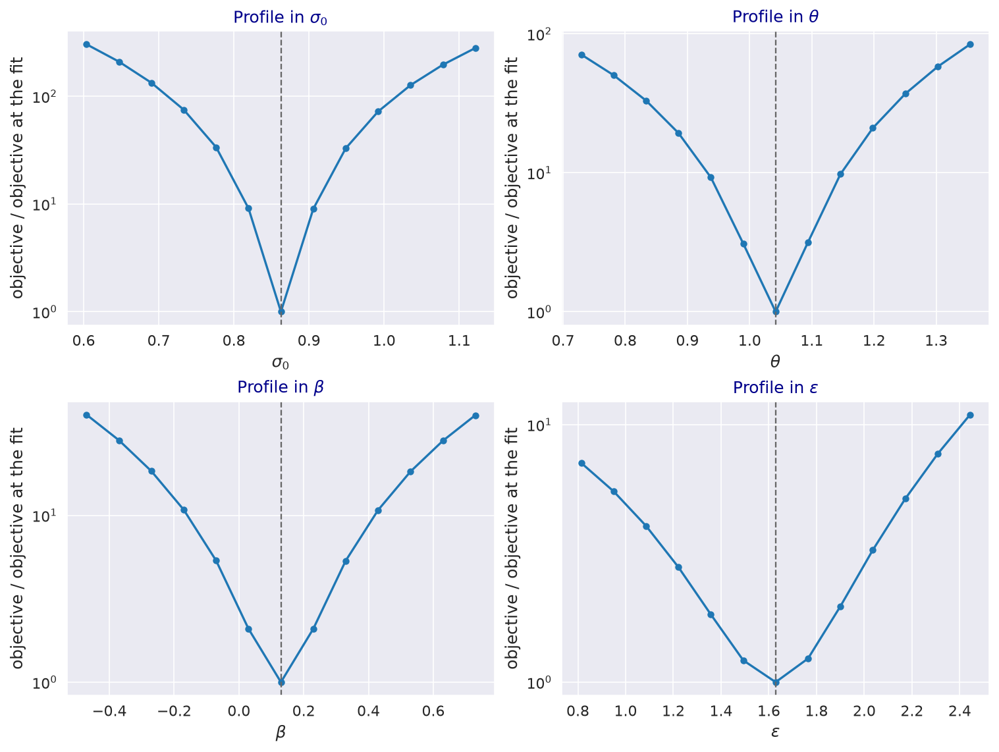
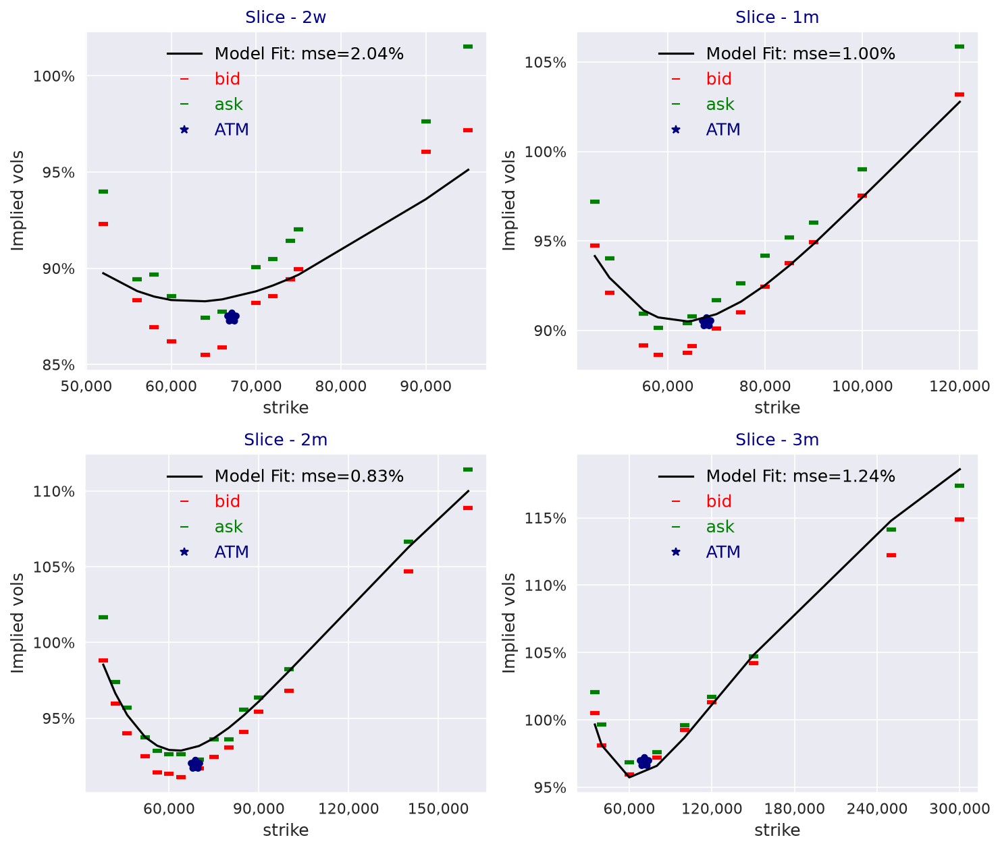

---
myst:
  html_meta:
    description: >-
      Calibrating the log-normal stochastic volatility model to option implied volatilities with
      stochvolmodels: the vega-weighted objective, the parameter sets, the martingale constraints,
      the analytic and Monte Carlo engines, the variance-swap backbone, and a worked calibration to
      the bundled Bitcoin chain with its objective profiles and a refit from a distant start.
---

# Calibration to implied volatilities

*Author: [Artur Sepp](https://github.com/ArturSepp) / First recorded: [2026-08-16](https://github.com/ArturSepp/StochVolModels/commit/e9e01403a6ba36aad7708049028c64438a606234)*

Implemented in [stochvolmodels](https://github.com/ArturSepp/StochVolModels).
Software citation: [CITATION.cff](https://github.com/ArturSepp/StochVolModels/blob/main/CITATION.cff).

Calibration finds the model parameters whose implied volatilities are closest to the market's.
Sepp and Rakhmonov (2023, Section 6.2) calibrate the log-normal stochastic volatility (SV) model
weekly to Bitcoin options by minimising a vega-weighted squared error of implied volatilities, with
the mean-reversion rates fixed beforehand and a martingale constraint. This article describes the
objective, the choice of free parameters, the constraints and engines of
`LogSVPricer.calibrate_model_params_to_chain`, and shows on the bundled Bitcoin chain how well the
objective changes around the historical parameter vector and tests a corrected-code refit
from a distant starting point.

## Overview

The calibration takes market IVs, a weighting rule, parameter bounds and constraints,
and a pricing engine. A chain can supply its mid IVs directly or carry bid and ask IVs
from which SVM computes the mid. The mean-reversion rates $\kappa_1$
and $\kappa_2$ trade off against the vol-of-vol and the volatility beta: different combinations
produce similar smiles. The paper therefore estimates $\kappa_1$ and $\kappa_2$ from the
autocorrelation of volatility and fits the four remaining parameters to options.

## Inputs, notation, and assumptions

| Keyword of `calibrate_model_params_to_chain` | Meaning | Default |
|---|---|---|
| `option_chain` | Chain with forwards, discount factors, strikes, option codes and either explicit `mid_ivs` or both IV sides | |
| `params0` | Starting point; under `PARAMS4` its `kappa1` and `kappa2` are held fixed | |
| `params_min`, `params_max` | Box bounds of the free parameters | $\sigma_0, \theta \in [0.1, 1.5]$, $\kappa_1, \kappa_2 \in [0.25, 10]$, $\beta \in [-3, 3]$, $\varepsilon \in [0.2, 3]$ |
| `is_vega_weighted` | Weight squared errors by Black-Scholes vega | `True` |
| `is_unit_ttm_vega` | Compute the vegas at unit maturity | `False` |
| `model_calibration_type` | Free parameters, `LogsvModelCalibrationType` | `PARAMS5` |
| `constraints_type` | Martingale constraints, `ConstraintsType` | `UNCONSTRAINT` |
| `calibration_engine` | `CalibrationEngine.ANALYTIC` or `MC` | `ANALYTIC` |
| `use_analytic_gradient` | Automatically supply the IV-loss gradient for controlled analytic `PARAMS4` and `PARAMS5` fits. Set `False` for SLSQP finite differences. | `None` |
| `nb_path`, `nb_steps`, `seed` | Monte Carlo engines only: paths, steps per year, seed of the fixed random numbers | 100,000; 360; 10 |

Implied volatilities are Black-Scholes volatilities in decimals; the chain's conventions are on the
[conventions page](option_chains_and_conventions.md#option-chains).

## Methodology

### The objective

The objective is the weighted mean squared error of Eq. (6.3),

$$
\mathrm{WMSE} = \sum_n w_n \left( \sigma_n^{model} - \sigma_n^{mid} \right)^2 ,
$$

over all options $n$ of the chain. For $\sigma^{mid}$, `get_mid_vols()` uses the explicit
`mid_ivs` when supplied and otherwise averages the bid and ask IVs. Set
`is_vega_weighted=False` for equal weight per quote. The paper uses Black-Scholes vega
weights. With vega weighting enabled, the package normalises
the vegas to sum to one within each maturity, so every maturity carries the same total weight and,
within a maturity, options near the money count most. With `is_unit_ttm_vega=True` the vegas are
computed as if the maturity were one year, which spreads the weight further into the wings; after
the normalisation it does not change the weight of a maturity.

### Free parameters

| `LogsvModelCalibrationType` | Fitted | Held |
|---|---|---|
| `PARAMS4` | $\sigma_0$, $\theta$, $\beta$, $\varepsilon$ | $\kappa_1$, $\kappa_2$ from `params0`, as in Section 6.2 |
| `PARAMS5` | $\sigma_0$, $\theta$, $\kappa_1$, $\beta$, $\varepsilon$ | $\kappa_2 = \kappa_1 / \theta$ |
| `PARAMS6` | Declared for all six parameters | Not implemented: raises `NotImplementedError` |
| `PARAMS_WITH_VARSWAP_FIT` | $\beta$, $\varepsilon$ | $\sigma_0$, $\theta$, $\kappa_1$, $\kappa_2$ from `params0`, with a variance-swap backbone |

### Constraints and optimiser

`ConstraintsType` adds the martingale conditions of Theorem 3.7 as inequality constraints:
$\kappa_2 \ge \beta$ for the money-market-account measure, $\kappa_2 \ge 2 \beta$ for the inverse
measure, and optionally $\kappa_1 + \kappa_2 \theta \ge 1.5 \vartheta^2$ for a finite fourth moment
of volatility (see [martingale conditions](martingale_conditions_and_skews.md#constraints-in-calibration)).
The package minimises with sequential least-squares programming (SLSQP) under the box bounds and
these constraints, with a function tolerance of $10^{-8}$. It raises `CalibrationError` when the
optimiser fails, returns non-finite values or a vector of the wrong length, or leaves the bounds.

### Engines

The analytic engine prices the chain by Fourier inversion of the affine expansion. The
historical fit fixes the frequency grid from the shortest market expiry and its ATM volatility.
The controlled fit selects a common grid across the active quotes and preflight parameters,
then freezes its nodes and weights for SLSQP. [Fixed Fourier grids](#fixed-fourier-grids)

The Monte Carlo engine draws its random
numbers once, with `get_randoms_for_chain_valuation` and the given `seed`, and reuses them at every
evaluation, so the objective is a smooth function of the parameters
([Monte Carlo schemes](monte_carlo_simulation.md)). The former `ROUGH_MC` route now raises
a migration error. Rough-logSV uses its [own experimental interface](rough_logsv.md); saved
selected-case fits support pointwise replay, while wider calibration remains gated.

### From coefficient sensitivities to the IV-loss gradient

The controlled classical LogSV fit uses the second-order expansion under the
money-market measure with a unit volatility backbone. At each Fourier frequency
the five complex coefficients $A=(A_0,\ldots,A_4)$ start at zero. Write the
coefficient ODE as $\dot A=f(A,p)$ for the vector of free parameters $p$.
For each parameter that enters the dynamics the forward sensitivity $S_j$
satisfies

$$
S_j(0)=0,\qquad
\dot S_j=f_A(A,p)S_j+\partial_{p_j}f(A,p).
$$

Each component of $f$ is quadratic in $A$. If
$f_k=A^\top Q_k A+L_k^\top A+H_k$ with symmetric $Q_k$, its derivative with
respect to $A$ is the row $(2Q_k A+L_k)^\top$. For each frequency the implementation
solves the pricing ODE once per maturity interval, replays its accepted Runge–Kutta
stages for all tangent columns, and carries both $A$ and $S$ into the next interval.
The sensitivities differentiate the coefficient flow on that time mesh. A bumped
pricing solve can select slightly different time steps. [Coefficient equations](affine_expansion.md)

Let $y=\sigma_0-\theta$, $b(y)=(1,y,y^2,y^3,y^4)^\top$ and
$M=\exp(A^\top b)$ at the quote's expiry. The transform derivative is

$$
\partial_{p_j}M
=M\left(S_j^\top b+A^\top b'(y) \partial_{p_j}y\right).
$$

Initial volatility enters only through $y$, giving $\partial_{\sigma_0}M=M A^\top b'$.
For $\theta$ the moving expansion centre contributes $-M A^\top b'$ in addition
to the coefficient sensitivity. Under PARAMS5, the source term in the tangent ODE
also includes the dependence of $\kappa_2$ on $\theta$ and $\kappa_1$.
[Five-parameter chain rule](#five-parameter-logsv-gradient)

For active quote $i$, let $J_{ij}$ be the derivative of its **discounted premium**
with respect to $p_j$. Write $u_\ell,\omega_\ell$ for the frequency nodes and
integration weights frozen during the fit and $x_i=\log(F_i/K_i)$ for log-moneyness.
On the money-market contour the price Jacobian is

$$
J_{ij}=-\frac{D_i\sqrt{F_i K_i}}{\pi}
\sum_\ell\frac{\omega_\ell}{u_\ell^2+1/4}
\Re\left[e^{-\mathrm{i}u_\ell x_i}\partial_{p_j}M(T_i,-1/2+\mathrm{i}u_\ell)\right].
$$

The minus sign comes from subtracting the capped payoff in both the call
and put formulas. Their parity legs are constant at fixed forward, strike
and discount. [Fourier inversion](european_option_pricing.md#the-capped-payoff-by-fourier-inversion)

Let $r_i=\sigma_i^{model}-\sigma_i^{mid}$
and let $\nu_i$ be discounted Black vega at the **model** IV and actual expiry.
Implicit differentiation of the Black price gives

$$
\partial_{p_j}\sigma_i^{model}=\frac{J_{ij}}{\nu_i},
\qquad
\partial_{p_j}\mathrm{WMSE}=2\sum_i w_i r_i\frac{J_{ij}}{\nu_i}.
$$

The market weights $w_i$ stay fixed, including when unit-maturity vega weighting
is selected. Small model vegas amplify premium errors in the IV gradient.
An invalid intermediate IV, derivative or model vega returns the optimizer's
finite penalty. A successful fit requires a valid gradient at the returned
parameters and a separate premium check on a wider, finer grid.

### The variance-swap backbone

The variance-swap fit stores a return-volatility loading $\eta_i$ on each calendar interval
$(T_{i-1},T_i]$ in `LogSvParams.vol_backbone`. Instantaneous return volatility is
$\eta_i\sigma_t$ and the quadratic-variation rate is $\eta_i^2\sigma_t^2$. The volatility
drift retains its model parameter $\theta$. Quotes and the ATM floor are both in volatility
units. Let $A_i=T_i K_i^2$ be market integrated variance and $B_i$ the unscaled model's
expected integrated variance from the truncated moment system. With $A_0=B_0=0$, the fit is

$$
\eta_i=\sqrt{\frac{A_i-A_{i-1}}{B_i-B_{i-1}}}.
$$

The square root applies at every maturity. Summing $\eta_i^2(B_i-B_{i-1})$ reproduces
each target $A_i$ within the moment approximation. Non-finite or non-positive increments
are rejected instead of being replaced with unit loading. The loading after the final
knot stays at its last value.

The default analytic calibration fixes both the cutoff and the node count from the shortest market
expiry and its ATM volatility throughout optimization. `vol_scaler` and `max_phi` allow
explicit grids. Set `historical_backbone_order=True` to reproduce the forward-variance
paper's analytic objective. The default values each payoff backward through calendar time.

## Worked example

Every block below is an excerpt of [`examples/docs/calibration.py`](../examples/docs/calibration.py),
which asserts every number quoted here. The chain is the bundled Bitcoin chain of 21 October 2021
(four maturities, 49 options), and `FITTED` is the historical pre-erratum result of the
[Bitcoin case study](app_bitcoin_options.md): `PARAMS4` with $\kappa_1 = 2.21$ and $\kappa_2 = 2.18$ from the paper,
under `INVERSE_MARTINGALE`.

```python
def weighted_error(params: svm.LogSvParams, chain: svm.OptionChain,
                   is_unit_ttm_vega: bool = False) -> float:
    """Objective of Eq. (6.3): squared implied-vol errors weighted by vegas normalised per slice."""
    pricer = svm.LogSVPricer()
    vegas = chain.get_chain_vegas(is_unit_ttm_vega=is_unit_ttm_vega)
    weights = [vega / np.sum(vega) for vega in vegas]
    model_vols = pricer.compute_model_ivols_for_chain(
        option_chain=chain, params=params, vol_scaler=pricer.set_vol_scaler(option_chain=chain))
    if not all(np.all(np.isfinite(model)) for model in model_vols):
        raise FloatingPointError("The calibration objective requires finite model volatilities")
    return sum(np.sum(w * np.square(model - mid))
               for w, model, mid in zip(weights, model_vols, chain.get_mid_vols()))
```

At this historical parameter vector, the corrected implementation gives an objective of
$5.50475\times10^{-4}$, or $8.38371\times10^{-4}$ with unit-maturity vegas (29 October 2026).
The example independently reconstructs normalized weights from the Black-Scholes vega formula
and checks the resulting objective. These are current repricing results, not a fresh calibration.

Moving one parameter at a time while holding the others at the historical vector gives these
objective ratios relative to the value at that vector:

| Parameter perturbation | Lower value | Higher value |
|---|---|---|
| $\sigma_0$: -10%, +10% | 30.00 | 31.13 |
| $\theta$: -10%, +10% | 7.25 | 9.96 |
| $\varepsilon$: -10%, +10% | 1.145 | 1.830 |
| $\beta$: $-0.1$, $+0.1$ | 1.688 | 2.373 |

The level parameters remain more sensitive at these perturbations than the smile parameters.
This local comparison does not establish parameter identification or show that the historical
vector minimizes the corrected objective.

[](images/calibration_objective_profiles.png)

*Historical pre-erratum calculation, retained without regeneration, for the bundled snapshot
of 21 October 2021. The objective of Eq. (6.3),
relative to its value at the fit, as one parameter moves and the others stay at the fit. Each profile
has its minimum at the fitted value, marked by the dashed line.*

The fit satisfies all three constraints with room: $\kappa_2 - \beta = 2.050$,
$\kappa_2 - 2 \beta = 1.921$ and $\kappa_1 + \kappa_2 \theta - 1.5 \vartheta^2 = 0.477$, so these constraints
do not bind at the historical vector. This does not prove that all constrained
optimizations have the same solution. The script's slow case refits the corrected implementation
from a distant starting point under the money-market-account constraint:

```python
def refit(chain: svm.OptionChain) -> svm.LogSvParams:
    """Fit sigma0, theta, beta and volvol from a distant start under the MMA martingale."""
    params0 = svm.LogSvParams(sigma0=1.2, theta=0.6, kappa1=2.21, kappa2=2.18, beta=-0.5,
                              volvol=1.0)
    return svm.LogSVPricer().calibrate_model_params_to_chain(
        option_chain=chain, params0=params0,
        model_calibration_type=svm.LogsvModelCalibrationType.PARAMS4,
        constraints_type=svm.ConstraintsType.MMA_MARTINGALE,
        calibration_engine=svm.CalibrationEngine.ANALYTIC, is_vega_weighted=True)
```

The slow check requires finite admissible parameters and an objective improvement over the
historical vector; it does not require the old fitted parameters to remain optimal. The figure
below records the earlier fit against the bid and ask quotes:

[](images/btc_case_fit.png)

*Historical pre-erratum calculation on the snapshot of 21 October 2021: the fitted model
against bid and ask implied volatilities, drawn by `LogSVPricer.plot_model_ivols_vs_bid_ask`; the exhibit of the Bitcoin case
study. The legend's "mse" is a root-mean-square error.*

For the variance-swap backbone, the strikes replicated from the chain, floored at the at-the-money
volatility, are 88.2%, 90.9%, 94.6% and 96.9% for the four maturities, and the historical fitter returns
loadings of 0.981, 0.928, 0.938 and 0.869.

### Five-tenor FX mid-IV fit

The Bloomberg snapshot retrieved on 25 November 2026 at 00:08:57 UTC contains five broker
quotes per expiry. OCA reconstructs a 10-delta put, 25-delta put, ATM, 25-delta call and
10-delta call from those quotes. Both models fit the same 25 decimal Black IVs with equal
weight per quote, using the same strikes, forwards and domestic discounts. The reconstruction
uses spot delta, delta-neutral ATM and a flat SOFR discount proxy through 1Y. Bid and ask
sides are absent. [OCA quote conventions and snapshot replay](https://optionchainanalytics.readthedocs.io/en/latest/data_sources.html#fx-broker-smiles)

Each cell shows **Heston / LogSV PARAMS4** in IV basis points. A signed error is
$10^4(\sigma^{model}-\sigma^{mid})$, so a positive value means the model IV is high.
The right column gives the root-mean-square error (RMSE) over the five pillars. The last
row gives RMSE over maturities, with the full-chain RMSE at the bottom right.

| Tenor | 10Δ put | 25Δ put | ATM | 25Δ call | 10Δ call | RMSE |
|---|---:|---:|---:|---:|---:|---:|
| 1M | −48.0 / −37.1 | −20.0 / −19.5 | −9.6 / −11.9 | −21.4 / −20.2 | −51.6 / −42.3 | 34.38 / 28.60 |
| 2M | +10.7 / +24.3 | +34.1 / +31.8 | +41.1 / +34.8 | +30.1 / +29.1 | +2.7 / +14.2 | 27.86 / 27.78 |
| 3M | +1.6 / +15.7 | +25.0 / +18.1 | +31.9 / +19.2 | +19.7 / +14.2 | −6.5 / +5.4 | 20.37 / 15.33 |
| 6M | −33.5 / −19.7 | +1.2 / −18.6 | +13.6 / −17.0 | +5.8 / −13.2 | −24.6 / −13.7 | 19.74 / 16.63 |
| 1Y | −44.7 / +4.2 | +9.6 / −7.0 | +33.9 / −3.2 | +21.3 / +2.5 | −29.6 / +10.2 | 30.24 / 6.11 |
| **RMSE** | 33.28 / 22.87 | 21.34 / 20.55 | 28.76 / 20.10 | 21.17 / 18.08 | 28.96 / 21.49 | **27.12 / 20.68** |

The largest difference in fit on this snapshot occurs at 1Y. Heston's fitted IVs
are below the mids on both 10-delta wings and above the mid at ATM. At 2M the two models
have nearly identical RMSE. Both models have their largest absolute error at the 1M
10-delta call.

**Bounds and numerical settings.** Both fits allow 3–11% initial volatility and
1.5–12% long-run volatility. For Heston these bounds apply to $\sqrt{v_0}$ and
$\sqrt{\theta}$ in the benchmark optimiser. Writing the variance diffusion coefficient
as $f\sqrt{2\kappa\theta}$, with $0.001\le f\le1$, enforces the Feller condition.
The fitted long-run volatility is 8.18%, and the fit reaches $f=1$. A separate run through the
public Heston calibrator reaches its built-in 0.01 floor on both variance levels
and gives 291.74 IV bp RMSE.

For LogSV, `PARAMS4` holds $\kappa_1=2$ and $\kappa_2=8$ fixed. The fitted
volatility level $\theta$ is **5.895%**, above the 1.50% floor. Two starts give
the same result to the precision shown. Restricting the *same snapshot* to 1M
and 2M gives 1.683% and 7.89 IV bp RMSE with the benchmark settings. The
public LogSV calibrator with the same parameter bounds and its default stopping
settings gives 1.50% and 17.45 IV bp on that subset, and 5.894% and 20.68 IV bp
on all five tenors. Both the expiry coverage and the stopping test matter when
interpreting a short-tenor boundary estimate.

The benchmark rescales parameter bounds to the unit interval and minimises the mean
squared IV error in volatility percentage points using SLSQP with `ftol=1e-12`.
It uses the controlled Fourier engine, the analytic LogSV gradient and three-point
Heston differences. After fitting, tightening the absolute premium tolerance from
$10^{-8}$ to $10^{-9}$ changes model IVs by less than 0.0001 IV bp at every pillar.
This checks inversion accuracy at the fitted parameters.

**Replay.** From the SVM source checkout, run the following commands with the path to
OCA's five-tenor `*_derived.csv` in place of `eurusd_derived.csv`. The example saves
fit results and the per-pillar comparison beside that local file. Run the
`logsv_short`, `native_logsv_short`, `native_logsv` and `native_heston` modes for the
subset and public-calibrator checks. [Benchmark script and starting parameters](../examples/fitters/compare_eurusd_fx_grid.py)

```bash
python examples/fitters/compare_eurusd_fx_grid.py eurusd_derived.csv heston
python examples/fitters/compare_eurusd_fx_grid.py eurusd_derived.csv logsv
python examples/fitters/compare_eurusd_fx_grid.py eurusd_derived.csv report
```

## Implementation in stochvolmodels

| Name | Role |
|---|---|
| `LogSVPricer.calibrate_model_params_to_chain` | The calibration, with the keywords of the table above |
| `LogsvModelCalibrationType`, `ConstraintsType`, `CalibrationEngine` | Free parameters, constraints and engine; stable exports |
| `CalibrationError` | Raised for a failed or invalid optimisation; a stable export |
| `LogSvParams` field `vol_backbone`, with `set_vol_backbone` and `get_vol_backbone_eta` | Backbone factors by maturity, used by the transform and the simulation |
| `OptionChain.get_slice_varswap_strikes`, `get_chain_vegas` | Replicated variance-swap strikes and the vegas of the weights |

The backbone fit is `fit_model_vol_backbone_to_varswaps` in `stochvolmodels.fitters.logsv_backbone`,
an internal function. Each objective evaluation prices the whole chain. Record the chain, the
starting point, the bounds, the constraint, the engine and, for Monte Carlo, the seed. Run the
example from a checkout with `python examples/docs/calibration.py`.

### Fixed Fourier grids

Pass `fourier={}` to `HestonPricer.calibrate_model_params_to_chain` or the analytic
`LogSVPricer.calibrate_model_params_to_chain` to target an absolute error of `1e-6` in
each option's discounted premium units. For example, `fourier={"price_atol": 0.01}`
targets one cent for dollar-denominated premiums. The objective still fits implied
volatilities using the selected quote weights. Missing market IVs and zero-weight quotes
are excluded before planning. Omission or `fourier="legacy"` selects the historical fit.

The preflight checks the starting parameters and feasible perturbations across all active
expiries. It lowers free initial and long-run variance or volatility levels and stresses
leverage and volatility of volatility within the model's fit bounds and constraints.
All sampled scenarios contribute to one panel partition. This checks the sampled cases.
SLSQP holds the nodes and weights fixed and evaluates fresh transforms at each trial.

At the fitted parameters, validation extends the cutoff, bisects every panel, and
checks resolution and tail decay again. Each active premium must agree within
`price_atol + price_rtol * time_values`, using fixed quote scales in premium units.
A finite miss starts one more fit from the fitted parameters on the refined grid.
A second miss, an exhausted work limit, or a numerical failure at the returned parameters
raises `CalibrationError`. LogSV retains its finite penalty for invalid intermediate trials.
Enable INFO logging for `stochvolmodels.pricers._fourier_calibration` to record the
sampled vectors, grid sizes and final premium differences. The
[offline regression and Bitcoin cost comparison](../src/stochvolmodels/tests/test_fourier_calibration.py)
exercises both calibrators. With SLSQP finite differences, the legacy and controlled
LogSV `PARAMS4` fits on the 49-quote Bitcoin example both had an IV RMSE of
1.371 volatility points. The maximum fitted-premium difference from a separately refined
Gauss–Legendre inversion was USD `0.0012882` for legacy and USD `0.000000443` for controlled.
At the default controlled tolerance of USD `0.000001`, the coefficient solver evaluated
552,960 frequency and time-segment pairs, including one restart. Legacy evaluated 408,000.

### Running the gradient fits

With `import stochvolmodels as svm`, pass the chain, the starting parameters and
either `svm.LogsvModelCalibrationType.PARAMS4` or `svm.LogsvModelCalibrationType.PARAMS5`
to the example below. The return value is a fitted `LogSvParams` object. With a
Fourier settings mapping such as `fourier={}`, both modes supply the analytic
gradient to SLSQP by default. Pass `use_analytic_gradient=False` to use finite
differences on the same grid. Explicit `True` requires a controlled analytic
`PARAMS4` or `PARAMS5` fit. The analytic objective, martingale
constraint and market-vega weights are the ones used in the Bitcoin comparisons.

```python
def fit_with_gradient(chain: svm.OptionChain, params0: svm.LogSvParams,
                      mode: svm.LogsvModelCalibrationType) -> svm.LogSvParams:
    return svm.LogSVPricer().calibrate_model_params_to_chain(
        option_chain=chain, params0=params0, model_calibration_type=mode,
        constraints_type=svm.ConstraintsType.MMA_MARTINGALE,
        fourier={},
    )
```

From the repository root, the first command runs both modes on a synthetic
two-expiry smile. The second reproduces the four controlled 49-quote Bitcoin
fits below, including individual-quote and scalar-loss central bumps at two
step sizes. The slow comparison prints warm fit time, compilation time and
optimizer evaluations separately.

```console
python -m pytest -q src/stochvolmodels/tests/test_docs_examples.py -k calibration-GRADIENT
python -m pytest -s -m slow src/stochvolmodels/tests/test_fourier_calibration.py -k "bitcoin_calibration_cost_comparison and not legacy"
```

### Four-parameter LogSV gradient

Pass `fourier={}` and
`model_calibration_type=LogsvModelCalibrationType.PARAMS4` to fit
$(\sigma_0,\theta,\beta,\varepsilon)$ with forward sensitivities. This calibration
fixes both mean-reversion rates and uses the unit volatility backbone. The solver
propagates the derivatives in $\theta$, $\beta$ and $\varepsilon$ along the
accepted Runge–Kutta steps. It evaluates the $\sigma_0$ derivative directly from
the expansion polynomial. The derivative in $\theta$ also includes the change of
expansion centre $\sigma_0-\theta$.

Each active option's price derivative is divided by its discounted Black vega at
the model IV. The scalar objective retains the original market weights, constraints
and active quotes. Its gradient differentiates the ODE flow on the accepted time
mesh with the Fourier plan held fixed during each optimizer run. Trials with invalid
gradients receive the existing penalty, and final validation checks both the
gradient and independently repriced premiums.

On the bundled 49-quote Bitcoin chain, both fits started from
$(1.2,0.6,-0.5,1.0)$, used market-vega weights and imposed the MMA martingale
constraint. The times below cover one run per method and include preflight, the
refined-grid restart and final validation. Numba compilation and the separate
Gauss–Legendre comparison are excluded.

| Full-chain measurement | SLSQP finite differences | Forward sensitivities |
|---|---:|---:|
| Warm fit time | 922.7 s | 309.4 s |
| Objective evaluations, first grid + restart | 101 + 5 | 21 + 1 |
| Frequency and maturity pairs evaluated | 552,960 | 170,880 |
| Vega-weighted squared IV loss | 0.000518911708 | 0.000518911708 |
| IV RMSE in volatility points | 1.371069 | 1.371070 |
| Maximum premium error against independent inversion, USD | 4.43e-7 | 4.43e-7 |

The gradient fit was 2.98 times as fast in this comparison. Across the two fitted
surfaces, the largest difference in independently repriced premiums was USD 0.002554.
The largest parameter change was $3.34\times10^{-6}$ in the residual vol-of-vol.

The central-bump check covers all 49 premiums and the weighted IV loss on the
actual optimizer grids. With parameter steps $10^{-4}\max(1,|p_j|)$, the largest
price-derivative discrepancy, scaled by the peak absolute sensitivity of its
column, was 0.00737% at the start and 0.00697% at the fit. The largest absolute
loss-gradient discrepancies were $6.10\times10^{-6}$ and $4.17\times10^{-8}$,
respectively. The regression repeats the check at half the step size.
[Reproduce the controlled and gradient fits](../src/stochvolmodels/tests/test_fourier_calibration.py).

### Five-parameter LogSV gradient

For `LogsvModelCalibrationType.PARAMS5`, pass `fourier={}` to fit
$(\sigma_0,\theta,\kappa_1,\beta,\varepsilon)$ with forward sensitivities.
At every trial the calibration sets $\kappa_2=\kappa_1/\theta$. For a discounted
premium $P$, the two coupled columns of the Jacobian are

$$
\frac{dP}{d\theta}=\frac{\partial P}{\partial\theta}
-\frac{\kappa_1}{\theta^2}\frac{\partial P}{\partial\kappa_2},
\qquad
\frac{dP}{d\kappa_1}=\frac{\partial P}{\partial\kappa_1}
+\frac{1}{\theta}\frac{\partial P}{\partial\kappa_2}.
$$

The partial derivatives on the right treat the two mean-reversion rates as independent.
The coefficient tensors are at most quadratic along each of these tangent directions.
Symmetric evaluations of the tensors therefore give their directional derivatives
up to floating-point roundoff. The solver propagates the four ODE sensitivities together,
so each frequency and maturity still needs one pricing solve.
The initial-volatility derivative follows directly from the expansion polynomial.

On the same 49 Bitcoin quotes, both five-parameter fits started from
$(1.2,0.6,2.21,-0.5,1.0)$ with $\kappa_2=2.21/0.6$. They used the same weights,
MMA martingale constraint and USD $10^{-6}$ premium tolerance. Each warm time
covers one fit, including preflight, one grid restart and final validation.
Compilation, the independent Gauss–Legendre inversion and the central bumps are
outside the timed interval.

| Full-chain measurement | SLSQP finite differences | Forward sensitivities |
|---|---:|---:|
| Warm fit time | 1,667.1 s | 402.4 s |
| Objective evaluations, first grid + restart | 200 + 6 | 35 + 1 |
| Frequency and maturity pairs evaluated | 996,000 | 232,200 |
| Vega-weighted squared IV loss | 0.000380967025 | 0.000380967025 |
| IV RMSE in volatility points | 1.097845 | 1.097848 |
| Maximum premium error against independent inversion, USD | 4.27e-7 | 3.65e-7 |

The gradient fit ran 4.14 times as fast. The fitted $\kappa_1$ was 3.74761
with sensitivities and 3.74768 with finite differences. The largest difference
between the two independently repriced fitted surfaces was USD 0.003563 per option.

Central repricing used the 1,080-node starting grid and the 2,550-node fitted
grid. For steps $10^{-4}\max(1,|p_j|)$, the worst price-Jacobian error across
the five columns, scaled by each column's peak absolute sensitivity, was
0.00585% at the start and 0.00238% at the fit. For $\kappa_1$ alone these
errors were 0.00108% and 0.00173%. The largest absolute errors in the weighted-loss
gradient were $3.74\times10^{-6}$ and $2.55\times10^{-8}$, respectively.
The `params5-controlled` and `params5-gradient` cases reproduce the fits and
the gradient case repeats the central bumps at half the step size.
[Bitcoin calibration regression](../src/stochvolmodels/tests/test_fourier_calibration.py).

## Interpretation and limitations

- **A local optimiser.** SLSQP finds a local minimum; restart from other points, as the refit does,
  when the result matters.
- **Identification.** The smile parameters are weakly identified relative to the level parameters,
  and the mean-reversion rates are not fitted by `PARAMS4`; fix them from time-series information as
  the paper does.
- **Spread diagnostics.** When both sides are available, compare the fitted IV with
  the quoted interval. For mid-only inputs, report signed IV errors and RMSE.
- **Short maturities at low volatility.** The transform's accuracy limit for small
  $\sigma_0 \sqrt{\tau}$ (see [Fourier pricing](european_option_pricing.md#interpretation-and-limitations))
  carries into the objective.

## See also

- [Bitcoin options: MMA, inverse and QV valuation](app_bitcoin_options.md)
- [Martingale conditions, measures and positive skews](martingale_conditions_and_skews.md)
- [Monte Carlo simulation schemes](monte_carlo_simulation.md)
- [Approximate log-normal SV smile fitter](logsv_smile_fitter.md)

## References

- Sepp, A. and Rakhmonov, P. (2023). Log-normal stochastic volatility model with quadratic drift.
  *International Journal of Theoretical and Applied Finance* 26(8), 2450003.
  [DOI 10.1142/S0219024924500031](https://doi.org/10.1142/S0219024924500031).
- [stochvolmodels software citation](https://github.com/ArturSepp/StochVolModels/blob/main/CITATION.cff).
