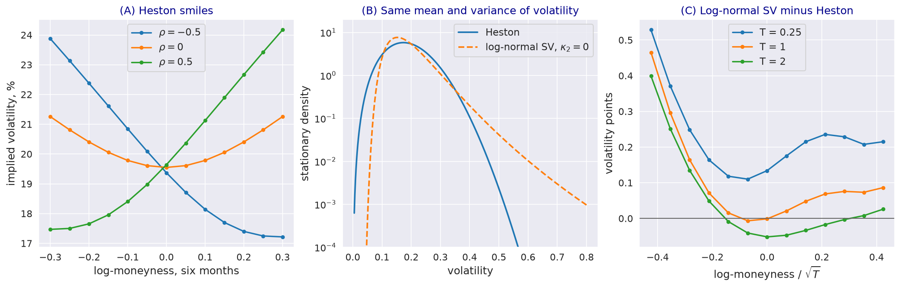

---
myst:
  html_meta:
    description: >-
      The Heston stochastic volatility model in stochvolmodels as a benchmark: square-root variance
      dynamics, the closed-form moment generating function, the Feller condition and the stationary
      gamma law, calibration and simulation, and a comparison with the log-normal SV model in
      volatility distribution, smiles and fit to the bundled Bitcoin chain.
---

# The Heston model as a benchmark

*Author: [Artur Sepp](https://github.com/ArturSepp) / First recorded: [2026-08-16](https://github.com/ArturSepp/StochVolModels/commit/e9e01403a6ba36aad7708049028c64438a606234)*

Implemented in [stochvolmodels](https://github.com/ArturSepp/StochVolModels).
Software citation: [CITATION.cff](https://github.com/ArturSepp/StochVolModels/blob/main/CITATION.cff).

The Heston (1993) model drives the variance of returns by a square-root process correlated with
the price. Its moment generating function (MGF) is known in closed form, which makes it the
standard benchmark for stochastic volatility (SV) models. The package prices, simulates and
calibrates it through the same interfaces as the
[log-normal SV model](logsv_model.md), so the two can be compared on the same chains. This article
explains the Heston model as implemented, and where it differs from the log-normal SV model in the
distribution of volatility, in smiles and in fits. The parameter-bound
`stochvolmodels.models.heston.HestonModel` path and transform adapter described below is
provisional; the established option-chain interface remains `HestonPricer`.

## Overview

The variance mean-reverts and its volatility is proportional to its square root, so the process is
affine: the MGF of the log-price and of the quadratic variance (QV) is exponential-affine in the
initial variance, with coefficients in closed form. The correlation $\rho$ of the price and variance
shocks sets the skew of the smile, and the vol-of-variance $\vartheta$ its curvature. Sepp and
Rakhmonov (2023, Section 1.1) cite evidence from VIX, S&P 500 implied and realized volatilities that
favours log-normal volatility dynamics over the square-root ones (Christoffersen, Jacobs and
Mimouni, 2010); the comparison below shows where the two differ in the package.

## Inputs, notation, and assumptions

| Paper | `HestonParams` | Meaning |
|---|---|---|
| $V_0$ | `v0` | Initial variance, in annualised variance units (0.04 is 20% volatility) |
| $\theta$ | `theta` | Long-run variance |
| $\kappa$ | `kappa` | Mean-reversion rate of the variance |
| $\rho$ | `rho` | Correlation of the price and variance shocks |
| $\vartheta$ | `volvol` | Volatility of the variance |

`theta` is a variance here and a volatility in `LogSvParams` (see the
[notation](option_chains_and_conventions.md#notation-paper-and-code)). Rates are zero and prices are
of options on the forward. The examples use $V_0 = \theta = 0.04$, $\kappa = 4$ and
$\vartheta = 0.4$.

## Methodology

### Dynamics

Under the pricing measure the log-price $X_t$ and the variance $V_t$ follow

$$
dX_t = -\frac{1}{2} V_t dt + \sqrt{V_t} dW^{(0)}_t , \qquad dV_t = \kappa (\theta - V_t) dt + \vartheta \sqrt{V_t} dW^{(1)}_t ,
$$

with $d \langle W^{(0)}, W^{(1)} \rangle_t = \rho dt$. By Itô's lemma the volatility
$\sigma_t = \sqrt{V_t}$ has diffusion coefficient $\vartheta / 2$: its volatility relative to its
level, $\vartheta / (2 \sigma_t)$, falls as volatility rises. In the log-normal SV model the relative
vol-of-vol is a constant, which is the source of the differences below.

### Closed-form MGF

With the transform variables $\Phi$ of the log-price and $\Psi$ of the QV, in the convention of the
[affine expansion](affine_expansion.md), the MGF is $\exp\left( A(\tau) + B(\tau) V_0 \right)$ with

$$
b_1 = \kappa + \rho \vartheta \Phi , \quad b_0 = \frac{1}{2} \Phi (\Phi + 1) - \Psi , \quad \zeta = \sqrt{b_1^2 - 2 b_0 \vartheta^2} , \quad \psi_\pm = \mp b_1 + \zeta , \quad c_\pm = \frac{\psi_\pm}{2 \zeta} ,
$$

$$
B(\tau) = \frac{\psi_- c_+ e^{-\zeta \tau} - \psi_+ c_-}{\vartheta^2 \left( c_+ e^{-\zeta \tau} + c_- \right)} , \qquad A(\tau) = -\frac{\kappa \theta}{\vartheta^2} \left( \psi_+ \tau + 2 \ln \left( c_+ e^{-\zeta \tau} + c_- \right) \right) .
$$

The default pricer inverts this MGF on a uniform grid and carries the coefficients from
one expiry to the next. See [Fourier pricing](european_option_pricing.md).

### Controlled Fourier pricing

Pass `fourier={}` to `price_vanilla`, `price_slice`, `price_chain`,
`compute_chain_prices_with_vols` or `compute_model_ivols_for_chain` for ordinary European
calls and puts. At each expiry, the pricer evaluates the transform from time zero and shares
each batch of frequencies across all strikes. It bisects panels to resolve the integral and
extends the cutoff until two successive outer frequency bands have sufficiently small mass.
The tail check estimates truncation error. The default absolute target is one millionth
of a unit of discounted premium per option.

```python
def controlled_wing_price() -> float:
    """Ten-year call with forward 100, unit discount and a premium tolerance of 1e-6."""
    params = svm.HestonParams(v0=0.04, theta=0.04, kappa=0.5, rho=-0.9, volvol=1.0)
    price, _ = svm.HestonPricer().price_vanilla(
        params=params, ttm=10.0, forward=100.0, strike=140.0, optiontype="C",
        fourier={"price_atol": 1e-6},
    )
    return price
```

This call returns **0.29577444**. Omitting `fourier` or selecting `fourier="legacy"`
gives **0.22052944** on the historical grid. The [runnable example](../examples/docs/heston_model.py)
uses the same model parameters for the controlled price.

| Setting in `fourier` | Default | Meaning |
|---|---:|---|
| `price_atol` | `1e-6` | Positive absolute tolerance in discounted premium units. |
| `price_rtol` | `0` | Adds `price_rtol * time_values` to the absolute tolerance of each quote. |
| `time_values` | `None` | Fixed, nonnegative discounted time values supplied by the caller when `price_rtol > 0`. |
| `initial_cutoff`, `max_cutoff` | `1`, `16384` | Initial frequency range and upper limit for its doubling. |
| `max_nodes`, `max_refinements` | `32767`, `512` | Per-expiry limits on sampled frequencies and panel bisections. |

`price_atol` and `time_values` accept a scalar, a strike-aligned vector for one expiry, or
one vector per expiry in chain order. If a work limit is reached, the pricer raises
`FloatingPointError`. Its `diagnostics` attribute records the maturity, affected strike,
cutoff, work counts, estimated panel error and estimated tail mass. The analytic calibrator
also supports [fixed Fourier grids](calibration.md#fixed-fourier-grids).
The [reference comparison](numerical_accuracy_and_performance.md#fourier-modes-and-reference-prices)
records the accuracy and default decision across five Heston fixtures.

### Repricing on a prepared grid

`grid = pricer.prepare_fourier(chain, params, fourier={"price_atol": 1e-6})` stores
the accepted quadrature weights and the Heston log transform at each frequency
and maturity. The supplied maturities must be positive and increasing. Preparation
checks all maturities on a common grid. The node budget and `grid.diagnostics.evaluations`
count frequencies across that grid, and each frequency costs one transform per maturity.

`grid.price_chain(quotes)` returns discounted call and put premiums in the requested
order. Previously certified quotes go directly through the stored quadrature.
Changing forwards, discount factors, strikes, option types or tolerances triggers
a resolution and tail check using the stored samples when the previous certificate
does not cover the request. A changed quote row needs its own strike-aligned tolerances
or time values if these were vectors at preparation.

If a query raises `FloatingPointError` with a panel or cutoff diagnostic, use
`grid = grid.refined_for(quotes)` with the same query settings. Refinement checks
both the original and new quotes, evaluates only additional frequencies and returns
a handle that can price either set. Queries can select a subset of the prepared maturities
in increasing order and supply strikes in any order.
A new maturity or a change in Heston model parameters requires a new preparation.

For the ten-year wing above, the following times are medians of 31 interleaved rounds
after compilation, using Python 3.12.10 on Windows with one BLAS thread. Setup prepares
a new handle in each round. Both warm columns recompute every price from saved transforms.
The changed-forward column raises the forward from 100 to 100.01 and includes validation
of the new quotes. All four warm price vectors matched fresh controlled calls exactly
in this run. Across the 1,001 original strikes, the largest absolute difference from
the independent Heston probability inversion was `9.97e-9` premium units at strike 50.7.

| Ten-year calls | Fresh controlled | Prepare | Warm, certified quotes | Warm, changed forward | Transforms, setup / warm |
|---|---:|---:|---:|---:|---:|
| Strike 140 | 7.01 ms | 8.53 ms | 0.60 ms | 2.12 ms | 180 / 0 |
| 1,001 strikes from 50 to 150 | 36.03 ms | 38.04 ms | 10.09 ms | 24.19 ms | 330 / 0 |

Extending the wing handle to the full strike grid took 32.74 ms and 150 additional
transform evaluations. Run `python -m examples.pricers.benchmark_prepared_heston`
from the checkout to reproduce the comparison. [Benchmark source](../examples/pricers/benchmark_prepared_heston.py)

### Feller condition and stationary law

The variance stays away from zero if $2 \kappa \theta \ge \vartheta^2$, the Feller condition. Its
stationary law is gamma, with shape $2 \kappa \theta / \vartheta^2$ and scale
$\vartheta^2 / (2 \kappa)$; the Feller condition is a shape of at least one. At a shape of exactly
one the law is exponential, with its mode at zero variance.

### Calibration and simulation

`HestonPricer.calibrate_model_params_to_chain` fits all five parameters by sequential least squares
to implied volatilities weighted by vegas normalised within each maturity, with bounds and the
Feller condition as an inequality constraint. By default, `model_mc_price_chain` uses 360 Euler steps a
year and floors the variance at $10^{-4}$ after each step (see
[Monte Carlo simulation](monte_carlo_simulation.md#the-heston-scheme)).

## Worked example

Every block below is an excerpt of
[`examples/docs/heston_model.py`](../examples/docs/heston_model.py), which asserts every number
quoted here. Smiles are computed from the closed-form MGF:

```python
def heston_smile(params: svm.HestonParams, ttm: float = 0.5) -> np.ndarray:
    """Implied volatilities of the Heston model from its closed-form MGF."""
    return svm.HestonPricer().compute_model_ivols_for_chain(option_chain=smile_chain(ttm),
                                                            params=params)[0]
```

**The correlation sets the skew.** At six months, with strikes from 30% below to 30% above the
forward in log terms, the smile is symmetric in log-moneyness without correlation, 19.55% at the
money and 21.26% at both ends. With $\rho = -0.5$ it falls from 23.88% through 19.37% to 17.22%;
with $\rho = 0.5$ it rises. A simulation of 400,000 paths prices the $\rho = -0.5$ slice within one
standard error of the closed form at every strike.

**Stationary volatility.** The example satisfies the Feller condition with a shape of 2. Its
stationary volatility has mean 0.1880 and standard deviation 0.0682:

```python
def stationary_volatility(params: svm.HestonParams):
    """Stationary law of the variance, a gamma distribution, and the mean and sd of volatility."""
    shape = 2.0 * params.kappa * params.theta / params.volvol ** 2
    scale = params.volvol ** 2 / (2.0 * params.kappa)
    mean = np.sqrt(scale) * special.gamma(shape + 0.5) / special.gamma(shape)
    return stats.gamma(a=shape, scale=scale), mean, np.sqrt(params.theta - mean ** 2)
```

A log-normal SV model with the same initial volatility and correlation, the same relative
vol-of-vol at 20% volatility, and the same stationary mean and variance of volatility has, with
$\kappa_2 = 0$, an inverse gamma stationary law (Sepp and Rakhmonov, 2023, Eq. (3.38)):

```python
def matched_logsv(heston: svm.HestonParams, vartheta: float = 1.0) -> svm.LogSvParams:
    """Log-normal SV parameters with the same initial volatility, correlation and stationary mean
    and variance of volatility; with kappa2 = 0 its stationary law is inverse gamma.

    vartheta = 1 equals the Heston vol-of-vol of volatility, volvol / (2 sigma), at sigma = 0.2.
    """
    _, mean, sd = stationary_volatility(heston)
    shape = 2.0 + mean ** 2 / sd ** 2  # inverse gamma: variance = mean^2 / (shape - 2)
    beta = heston.rho * vartheta
    return svm.LogSvParams(sigma0=np.sqrt(heston.v0), theta=mean,
                           kappa1=(shape - 1.0) * vartheta ** 2 / 2.0, kappa2=0.0, beta=beta,
                           volvol=np.sqrt(vartheta ** 2 - beta ** 2))
```

With the first two moments equal, the tails differ: volatility exceeds 40% with probability 0.30%
under Heston and 1.29% under the log-normal SV model, and exceeds 50% with probability 0.005% and
0.31%; the 99.9% quantiles are 0.43 and 0.59.

**Smiles at matched dynamics.** The two models give the same at-the-money volatility, within 0.06
points at one and two years. The low-strike wing is higher under the log-normal SV model, by 0.47
points at one year and 0.40 at two, the heavier right tail of volatility passing to low strikes
through the negative correlation.

**A fit to the bundled Bitcoin chain.** On 29 October 2026, recalibrating Heston to the bundled
21 October 2021 chain with all five parameters free gave root-mean-square errors of 1.10, 0.65,
0.80 and 0.78 volatility points. Evaluating the historical LogSV parameters with the corrected
expansion gives 2.04, 1.00, 0.87 and 1.58 points; the pre-erratum values were 2.04, 1.00, 0.83 and
1.24. The [Bitcoin case study](app_bitcoin_options.md) fixes LogSV's mean-reversion parameters and
has not recalibrated its other parameters here. Its independent PDE calculation gives a longest-
expiry RMSE of 1.13 points, demonstrating that the finite expansion inflates part of the apparent
fit difference. This is a comparison of these configurations, not a model-ranking experiment.

The Heston fit sets $\rho = 0.09$ and $\vartheta = 4.09$, and the Feller condition binds: the
stationary variance is exponential, and volatility falls below 20% with probability 3.5% in the
long run.

[](images/heston_vs_logsv.png)

*Synthetic teaching exhibit. (A) Heston smiles at six months for $\rho = -0.5$, 0 and 0.5; (B)
stationary densities of volatility under Heston and the matched log-normal SV model, on a log
scale; (C) log-normal SV minus Heston implied volatility at three maturities, at matched dynamics.*

## Implementation in stochvolmodels

`HestonParams` is defined in `stochvolmodels.models.heston`, alongside `HestonModel`.
The affine transform and supplied-increment propagator live in `models.heston.kernels`;
`pricers.heston_pricer.HestonPricer` retains pricing and calibration. Root exports and
previous parameter/kernel imports remain aliases to the same objects.

| Name | Role |
|---|---|
| `HestonParams` | Fields `v0`, `theta`, `kappa`, `rho`, `volvol`, as in the table above |
| `HestonPricer.price_chain`, `compute_model_ivols_for_chain` | Prices and implied volatilities from the closed-form MGF |
| `HestonPricer.prepare_fourier`, `PreparedHestonGrid` | Controlled prices and explicit refinement at prepared maturities |
| `HestonPricer.model_mc_price_chain`, `simulate_terminal_values` | Euler by default, with the historical Numba seed. Select QE-M with `mc_scheme="qe_m"` and pass `seed` and `steps_per_year` for reproducible paths. |
| `HestonPricer.calibrate_model_params_to_chain` | Fit of all five parameters with the Feller constraint |
| `BTC_HESTON_PARAMS` | Preset used as a starting point for Bitcoin chains (compatibility tier) |

`HestonPricer` also provides `price_vanilla`, `price_slice` and `compute_chain_prices_with_vols` from
the shared pricer interface. Run the example from a checkout with
`python examples/docs/heston_model.py`.

### Provisional path and transform adapter

Import `HestonModel` from `stochvolmodels.models.heston`. It binds a validated copy of
`HestonParams` and implements the structural `PathModel` and `TransformModel` capabilities
from `stochvolmodels.models`. `HestonPricer` owns option-chain prices, implied volatilities and
calibration; `HestonModel` supplies dynamics to path valuation and log transforms to numerical
pricing. Runtime protocol checks establish the presence of methods, not numerical correctness.

The constructor requires finite nonnegative `v0`, `theta`, `kappa` and `volvol`, and `rho` in
`[-1, 1]`. It does not impose the Feller inequality used by the calibration routine. Changing the
original parameter object, or the detached object returned by `model.params`, does not alter
the model's parameter snapshot.

```python
def heston_model_example() -> tuple:
    """Use the provisional path and transform adapter with constant variance."""
    from stochvolmodels.models import PathModel, TransformModel
    from stochvolmodels.models.heston import HestonModel

    params = svm.HestonParams(v0=0.04, theta=0.04, kappa=2.0, rho=-0.5, volvol=0.0)
    model = HestonModel(params)
    assert isinstance(model, PathModel) and isinstance(model, TransformModel)
    paths = model.simulate_paths(
        measure="Q_MMA", observation_times=np.array([0.0, 0.125, 0.25]),
        spot0=100.0, n_paths=64, steps_per_year=24, seed=7,
    )
    phi = np.array([0.0, -1.0, 1j], dtype=complex)
    log_transform = model.log_mgf_grid(ttm=0.25, phi_grid=phi)
    return paths, phi, log_transform
```

The canonical `MODEL_INTERFACE` case checks this constant-variance example against the Gaussian
log-return transform and the deterministic integrated variance. It makes no option-price accuracy
claim for the small path sample.

`simulate_paths` supports only `measure="Q_MMA"`, the money-market-account measure. Observation
times are a strictly increasing NumPy array in years, starting at zero and containing at least two
entries. The initial `spot0` is positive; the simulated asset has zero drift, with no forward carry
or discounting. The returned `ModelPaths.assets` has shape `(n_paths, n_times, 1)`, asset ID
`zero_drift_price`, and levels `spot0 * exp(log_zero_drift_return)`. Named states have shape
`(n_paths, n_times)`:

| State | Convention |
|---|---|
| `log_zero_drift_return` | Cumulative log return, initially zero |
| `variance` | Instantaneous annualized variance, initially `v0` |
| `sigma` | Annualized volatility, the square root of `variance` |
| `quadratic_variance` | Cumulative integrated variance, initially zero |

The producer marks its arrays read-only, records the numerical scheme and RNG provenance, and
reports failed paths without silently dropping them. Paths retain their raw simulated levels;
discounting and any explicit forward recentering belong to the valuation layer.

Each observation interval carries the preceding log return, variance and integrated variance
forward, using `int(interval * steps_per_year) + 1` steps. The local `RandomState(seed)` does not
use the legacy global Numba seed. Repeating an identical request is reproducible; changing the
observation partition changes the integration grid and random-draw order. Each new
`simulate_paths` call starts at the parameter snapshot: it does not accept a continuation payload.
The lower-level `simulate_heston_x_vol_terminal` function accepts initial state arrays, including
length-one log-return and integrated-variance arrays whose supplied values are broadcast and
preserved. `HestonPricer.simulate_terminal_values` honors its scalar `x0`, while initializing
variance from `params.v0` and integrated variance at zero.

`log_mgf_grid(ttm=..., phi_grid=..., psi_grid=...)` returns
$\log \mathbb{E}[\exp(-\phi X_T-\psi I_T)]$ under `Q_MMA`; omitting `psi_grid` sets it to zero.
The finite, nonempty one-dimensional NumPy grids must have the same shape. Zero maturity and
zero vol-of-variance use exact limiting formulas. Ordinary grids reuse the existing Heston
transform; cancellation and repeated-root cases use an adaptive Riccati solve. These numerical
branches do not extend the model's moment-existence domain.

### Martingale-corrected QE simulation

`mc_scheme="qe_m"` selects Andersen's quadratic-exponential variance step and
martingale-corrected log-price update on the Heston path, terminal and chain interfaces.
The scheme matches the first two conditional CIR moments. At high conditional dispersion
the variance transition includes an atom at zero. Integrated variance uses equal endpoint
weights, with the exact integral for deterministic variance. If the conditional exponential
moment does not exist, the step raises `FloatingPointError` with its starting variance and
step size. Increasing `steps_per_year` reduces the step size.
[Andersen, sections 3.2 and 4.3.2](https://www.maths.univ-evry.fr/pages_perso/crepey/Finance/andersen%20vol%20sto.pdf)

For a step of length $h$ starting at variance $v$, write $\xi$ for `volvol`,
$d=e^{-\kappa h}$ and $u=(1-d)/\kappa$, with $u=h$ at $\kappa=0$. The
conditional mean and variance used by the transition are

$$
m=vd+\theta(1-d),\qquad
s^2=\xi^2 u\left(vd+\frac{\theta(1-d)}{2}\right).
$$

For $m>0$ and $\xi>0$, the ratio $\psi=s^2/m^2$ selects the draw of next-step
variance $V'$. When $\psi\le 1.5$, set
$a=m\psi/[2(1+\sqrt{1-\psi/2})]$ and draw
$V'=(\sqrt{m-a}+\sqrt{a}Z_v)^2$ with $Z_v$ standard normal. When $\psi>1.5$,
the probability of a positive draw is $q=2/(1+\psi)$. Conditional on that
event, $V'$ is exponential with rate $\lambda=q/m$. The remaining probability
$1-q$ is assigned to zero. Both branches have mean $m$ and variance $s^2$.

The spot step uses the variance integral $I=h(v+V')/2$, the residual variance
$R=(1-\rho^2)I$, and an independent standard normal $Z_x$. For
$c=\rho(1+\kappa h/2)/\xi-\rho^2 h/4$, the log-forward increment is

$$
\Delta X=cV'-\log\mathrm{E}\left[e^{cV'}\mid v\right]
-\frac{R}{2}+\sqrt{R}Z_x .
$$

Integrating over $Z_x$ and then $V'$ gives
$\mathrm{E}[e^{\Delta X}\mid v]=1$. The quadratic branch requires $2ac<1$,
and the exponential branch requires $c<\lambda$. For $\xi=0$, the variance
evolves deterministically, its integral is $vu+\theta(h-u)$, and the log-forward
increment has mean $-I/2$ and variance $I$ with that exact integral.

QE-M supports ordinary calls and puts under the money-market measure. Its chain premiums
are discounted raw payoff means, with standard errors across independent paths. The model
streams two normal vectors per step and records the RNG convention in `ModelPaths`.
At forward 100 and strike 140 in the ten-year stress case above, 65,536 paths in 32 seeded
batches at 48 steps per year gave 0.2920 with a batch standard error of 0.0107. The
independent probability-integral price was 0.29577444. The floored Euler paths at the
same resolution gave a raw call premium of 11.0624 with a batch standard error of 0.0934.
These numbers are specific to the severe variance-boundary case.
[Runnable QE-M example](../examples/docs/heston_model.py)

## Interpretation and limitations

- **A fit is not the test.** The Heston refit has smaller residuals than the historical LogSV
  parameters in this comparison; LogSV was not refitted and its longest-expiry expansion has
  material pricing error. The Heston result has a binding Feller condition and a stationary law
  that puts mass near zero volatility. The argument of Sepp and Rakhmonov for log-normal dynamics
  concerns the behaviour of volatility over time, not a single smile.
- **Tails of volatility.** Square-root dynamics give a light right tail of volatility; when the
  distribution of volatility, or options on it, matter, the two models differ even at equal
  moments.
- **Constant parameters.** The package's Heston model has no term structure of parameters; each
  chain is fitted with one set.
- **Simulation.** Historical Euler simulation floors variance at $10^{-4}$. When the Feller
  condition fails, repeated visits to the floor can bias the simulated law. QE-M allows zero
  variance. Check time-step convergence as well as the reported Monte Carlo sampling error.
- **Calibration interface.** The docstring of `calibrate_model_params_to_chain` says that `v0` is
  inferred from the at-the-money volatility; the code fits it with the other four parameters.

## See also

- [Log-normal stochastic volatility model with quadratic drift](logsv_model.md)
- [Steady-state distribution, moments and expected QV](volatility_distribution_and_moments.md)
- [Fourier pricing of European options](european_option_pricing.md)
- [Calibration to implied volatilities](calibration.md)

## References

- Christoffersen, P., Jacobs, K. and Mimouni, K. (2010). Models for S&P 500 dynamics: evidence from
  realized volatility, daily returns and options prices. *The Review of Financial Studies* 23(9),
  3141-3189.
- Heston, S. L. (1993). A closed-form solution for options with stochastic volatility with
  applications to bond and currency options. *The Review of Financial Studies* 6(2), 327-343.
  [DOI 10.1093/rfs/6.2.327](https://doi.org/10.1093/rfs/6.2.327).
- Sepp, A. and Rakhmonov, P. (2023). Log-normal stochastic volatility model with quadratic drift.
  *International Journal of Theoretical and Applied Finance* 26(8), 2450003.
  [DOI 10.1142/S0219024924500031](https://doi.org/10.1142/S0219024924500031).
- [stochvolmodels software citation](https://github.com/ArturSepp/StochVolModels/blob/main/CITATION.cff).
