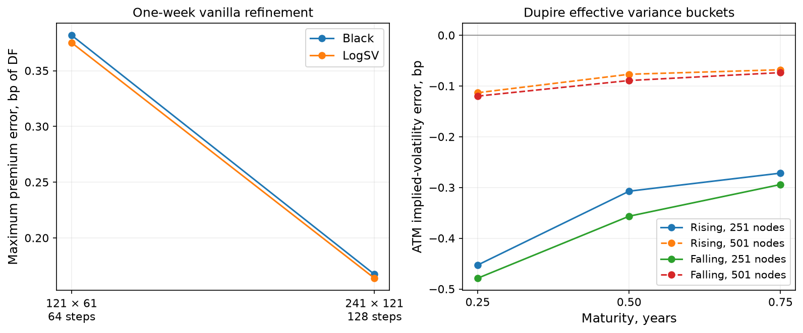

---
myst:
  html_meta:
    description: >-
      Deterministic local volatility, Dupire variance buckets and LogSV leverage calibration,
      with standalone PDE, Monte Carlo and market-pipeline examples and refinement evidence.
---

# Local volatility and local stochastic volatility

*Author: [Artur Sepp](https://github.com/ArturSepp) / First recorded: [2026-11-17](https://github.com/ArturSepp/StochVolModels/commit/45ca508c2d0d0439292df3591f37e905ee4d625c)*

Implemented in [stochvolmodels](https://github.com/ArturSepp/StochVolModels).
Software citation: [CITATION.cff](https://github.com/ArturSepp/StochVolModels/blob/main/CITATION.cff).

Local volatility specifies return volatility as a deterministic function of time and
asset level. Local stochastic volatility (LSV) multiplies a stochastic volatility process
by a deterministic leverage function. The package examples use provisional APIs and the import paths
in the current checkout. For version 2.18.8, run the examples from that tag. The
conditional-variance study below uses experimental repository solvers.

## Overview

`LocalVolSurface` and `LocalVolPdePricer` provide one-dimensional diffusion pricing.
`DupireRecoverer` estimates local variance from a call surface, preserving raw arrays,
repair masks and instantaneous derivatives. Converting the result to a pricing surface
assigns an effective variance to each maturity bucket.

`LSVModel` owns LogSV dynamics, a leverage surface, a return-volatility backbone and an
optional fixed jump law. Fitters construct the model. `LogSvPdePricer` and
`LSVMonteCarloPricer` independently value the resulting European contracts.
`LSVMarketPipeline` coordinates market preparation, fitting and acceptance checks.
[Rendered API](api.md#local-volatility-and-local-stochastic-volatility)

## Inputs, notation, and assumptions

| Symbol or object | Meaning | Convention |
|---|---|---|
| $x=\log(S/F)$ | Normalized log-forward coordinate | Dimensionless |
| $\sigma_{\mathrm{loc}}(t,x)$ | Local volatility | Annualized decimal volatility |
| $\sigma_t$ | LogSV stochastic volatility | Positive volatility state |
| $L(t,x)$ | Leverage | Positive dimensionless multiplier |
| $\eta(t)$ | Volatility backbone | Calendar-time return loading |
| `LocalVolSurface`, `LeverageSurface` | Time buckets and spatial rows | Row $i$ applies on $(T_{i-1},T_i]$, including its right endpoint |
| `CallSurface` | Discounted calls on absolute strikes | Supply matching forward and discount curves |
| `OptionChain` | Ragged original contracts | Preserve strikes, types, forwards and discounts at each expiry |

Volatility and leverage interpolate linearly in space. Their final time row extends
past its maturity. Leverage extrapolation is configurable. `LocalVolSurface` also
supports absolute-level coordinates at zero carry.

## Methodology

The diffusion-only LSV dynamics in log-forward coordinates are

$$
dX_t=-\tfrac12[\eta(t)L(t,X_t)\sigma_t]^2dt
+\eta(t)L(t,X_t)\sigma_t dW_t,
$$

$$
d\sigma_t=(\kappa_1+\kappa_2\sigma_t)(\theta-\sigma_t)dt
+\sigma_t(\beta dW_t+\varepsilon dB_t),
$$

with independent Brownian motions $W$ and $B$. The correlation is
$\beta/\sqrt{\beta^2+\varepsilon^2}$. The matching leverage identity is

$$
L^2(t,x)=\frac{\sigma_{\mathrm{loc}}^2(t,x)}
{\eta^2(t)\mathbb{E}[\sigma_t^2\mid X_t=x]}.
$$

`SequentialLSVProjector` estimates the conditional moment from a carried joint density.
`LSVFixedPointCalibrator` iterates within each bucket and records its convergence history.
`LSVParametricCalibrator` fits a bounded low-dimensional leverage family to Black implied
volatilities. Explicit invalid-trial records and density tolerances make an optimizer's
result auditable. Independent vanilla repricing checks the returned model.

For deterministic instantaneous volatility $\sigma(t)=a+bt$, integrated variance is
$w(T)=a^2T+abT^2+b^2T^3/3$. The exact effective variance in a bucket is

$$
v_i=\frac{w(T_i)-w(T_{i-1})}{T_i-T_{i-1}},\qquad w(0)=0.
$$

The corrected Dupire conversion recovers these buckets for diffusion-only flat smiles.
For a spatial smile it keeps the recovered shape, averages adjacent instantaneous
variances on later buckets, and fits each bucket's scale to an eligible near-forward call.
The first maturity constrains terminal prices while leaving the within-bucket path
underdetermined. Fitting one scale also leaves residual smile error to measure by repricing.
Active fixed jumps use the compensated jump law in inversion and pricing.
[Dupire conversion conventions](software_design.md#continuous-dupire-inversion)

## Worked example

The synthetic rising curve has $a=0.2$, $b=0.4$. The falling curve has $a=0.6$,
$b=-0.4$. Calls use forward 100, unit discount, 81 strikes from 60 to 140, and five
quoted dates from one quarter to three quarters of a year. The script verifies every
effective bucket against the integrated-variance formula, then prices ATM calls.

| Curve | Nodes / steps | 3m error (IV bp) | 6m error (IV bp) | 9m error (IV bp) |
|---|---:|---:|---:|---:|
| Rising | 251 / 64 | -0.453 | -0.307 | -0.272 |
| Rising | 501 / 128 | -0.113 | -0.0768 | -0.0679 |
| Falling | 251 / 64 | -0.479 | -0.357 | -0.294 |
| Falling | 501 / 128 | -0.12 | -0.0891 | -0.0735 |

Entries are signed implied-volatility errors in absolute volatility basis points,
$10{,}000(IV_{\mathrm{PDE}}-IV_{\mathrm{Black}})$. Both grids span log-forward
$[-3,3]$ with concentration scale 0.12. Time stepping uses the Rannacher default
in each bucket. These results measure conversion and pricing jointly.



*Synthetic teaching exhibit. The right panel shows the bucket-repricing errors above.
The left panel gives the independent one-week solver checks described in the PDE guide.*

### Parametric leverage fitting

With a constant stochastic volatility of 20%, a flat 24% target has exact leverage
1.2. This example fits that target, then reprices the returned model on the vanilla
pricer's separate mesh.

```python
from enum import Enum

import numpy as np
from scipy.special import ndtr

from stochvolmodels.data.option_chain import OptionChain
from stochvolmodels.fitters.dupire import CallSurface, DupireRecoverer, DupireRepairPolicy
from stochvolmodels.fitters.lsv_market_pipeline import LSVMarketPipeline
from stochvolmodels.fitters.lsv_parametric import (
    ImpliedVolCalibrationTarget, LSVParametricCalibrationConfig, LSVParametricCalibrator,
)
from stochvolmodels.models.lsv.local_vol import LocalVolFamily, LocalVolSurface
from stochvolmodels.models.lsv import LSVModel
from stochvolmodels.models.lsv.simulation import LSVMonteCarloConfig
from stochvolmodels.pde_solvers import Grid1D, TensorGrid2D
from stochvolmodels.pricers.local_vol_pde_pricer import LocalVolPdePricer
from stochvolmodels.models.logsv.params import LogSvParams
from stochvolmodels.pricers.logsv_pde_pricer import LogSvPdePricer
from stochvolmodels.pricers.lsv_mc_pricer import LSVMonteCarloPricer
```

```python
def parametric_example():
    """Fit a flat leverage bucket to an independent 24% Black smile."""
    x = Grid1D.concentrated(-0.9, 0.9, 81, 0.0, 0.12)
    grid = TensorGrid2D(x, Grid1D([0.1, 0.15, 0.2, 0.25, 0.3]))
    params = LogSvParams(sigma0=0.2, theta=0.2, beta=0.0, volvol=0.0)
    target = ImpliedVolCalibrationTarget([0.2], [0.95, 1.0, 1.05], [[0.24] * 3])
    local = LocalVolSurface(target.times, x, np.full((1, x.size), 0.24))
    config = LSVParametricCalibrationConfig(family=LocalVolFamily.FLAT)
    fit = LSVParametricCalibrator(grid, config).calibrate(params, target, local, 64)
    assert abs(fit.parameter_values[0, 0] - 1.2) < 0.02
    price, iv = LogSvPdePricer().price_vanilla(fit.model, 0.2, 1.0, 1.0, "C")
    assert abs(iv - 0.24) < 0.003
    return fit
```

### Monte Carlo validation

The correlated example uses $\beta=-0.5$, $\varepsilon=0.7$, initial and mean volatility
20%, both drift coefficients 2, unit leverage, and expiry 0.25 years. It uses 32,768
antithetic paths, 720 steps per year and seed 7. The engine owns a local NumPy generator
configured by `LSVMonteCarloConfig.seed`. Standard errors use independent antithetic
pair means. The comparison PDE has 241 × 121 nodes and 256 quadratic-start steps.

| Strike / forward | PDE premium | MC premium | MC standard error | z-score |
|---:|---:|---:|---:|---:|
| 0.9 | 0.00971 | 0.00986 | 0.000169 | 0.903 |
| 1 | 0.0398 | 0.0399 | 0.00022 | 0.32 |
| 1.1 | 0.00738 | 0.00747 | 0.000125 | 0.678 |

The displayed z-score is $(PV_{\mathrm{MC}}-PV_{\mathrm{PDE}})/SE_{\mathrm{MC}}$.
It is a sampling-scale comparison for this fixed seed. Time and space bias remain
separate from Monte Carlo sampling uncertainty.

### Market pipeline

The standalone market example creates three synthetic bid/ask smiles, fits flat leverage,
and reprices on a separate PDE grid and 8,192-path simulation with seed 42.
`result.original` preserves the input contract units. `result.acceptance.checks`
contains a named decision for each configured threshold.

```python
def market_pipeline_example():
    """Fit synthetic bid/ask quotes and inspect every independently repriced gate."""
    times = np.array([0.1, 0.2, 0.3])
    chain = OptionChain.get_uniform_chain(times, np.array(["1", "2", "3"]),
                                          strikes=np.linspace(0.9, 1.1, 7))
    y = Grid1D([0.1, 0.15, 0.2, 0.25, 0.3])
    fit_grid = TensorGrid2D(Grid1D.concentrated(-1.0, 1.0, 81, 0.0, 0.12), y)
    replay_grid = TensorGrid2D(Grid1D.concentrated(-1.0, 1.0, 121, 0.0, 0.12), y)
    fitter = LSVParametricCalibrator(
        fit_grid, LSVParametricCalibrationConfig(family=LocalVolFamily.FLAT))
    pipeline = LSVMarketPipeline(
        fitter, LogSvPdePricer(grid=replay_grid, steps_per_interval=64),
        LSVMonteCarloPricer(config=LSVMonteCarloConfig(8192, 120, 42)))
    params = LogSvParams(sigma0=0.2, theta=0.2, beta=0.0, volvol=0.0)
    result = pipeline.run(chain, params, grid_size=7, repair_policy=DupireRepairPolicy(0.01, 0.16))
    assert (len(result.original), len(result.original[0].pde_prices),
            len(result.acceptance.checks)) == (3, 7, 7)
    assert result.acceptance.failed_checks == ("market_spread",)
    assert np.all(np.isfinite(result.original[0].pde_prices))
    return result
```

The default seven checks cover repair fraction, PDE/target IV error, PDE/MC IV error,
unit mass, terminal negative mass, the MC forward moment and spread coverage.
Set `LSVMarketAcceptanceCriteria(max_pde_boundary_mass=...)` to add perimeter
occupancy as an eighth check. The synthetic chain has identical bid and ask volatilities, giving a zero-width spread.
This example passes six checks and fails `market_spread` because of residual pricing error.
Fit completion and acceptance are separate reported outcomes.

## Implementation in stochvolmodels

Run all four canonical cases, including the sloped buckets, parametric fit,
correlated MC comparison and market pipeline.

~~~console
python examples/docs/local_volatility_and_lsv.py
python scripts/check_pde_examples.py
~~~

The scripts use core dependencies and run offline. CI also executes them from an empty
namespace using the installed wheel outside the source checkout.
[Canonical script](https://github.com/ArturSepp/StochVolModels/blob/main/examples/docs/local_volatility_and_lsv.py)
· [API reference](api.md#local-volatility-and-local-stochastic-volatility)

For a parameter object with a volatility backbone, use `LSVModel.from_params(params)`
and pass that model to both pricing engines. `LogSvPdePricer` is the PDE entry point.
`LogSVPricer` remains the separate transform entry point.

## Interpretation and limitations

Calibration can match quotes while producing excessive negative density or boundary
occupancy. Review fit convergence, rejected trials, terminal and peak negative mass,
and independent original-strike repricing. Refining leverage dates, space and time
can improve different errors, and each setting should be reported.

`CalibrationWeighting.LEGACY_ATM` prioritizes near-forward quotes: it starts with
weights $\exp(-(K/F-1)^2/T)$, multiplies the weight at the strike nearest the forward
by 100, and normalizes the weights to sum to one. The least-squares residual uses
their square roots. This reproduces the older fit objective; it is not a recommended
universal quote weighting. The default is `VEGA_NORMALIZED`.

Historical agreement means that identical inputs and explicit compatibility settings
reproduce saved prices, fitted parameters and diagnostics within recorded tolerances.
It does not establish that the older numerical convention is more accurate. `historical_endpoints=True`
on Dupire conversion, or `historical_dupire_endpoints=True` on the pipeline,
selects the older endpoint buckets. Use these switches to reproduce archived results
and identify the numerical convention in reports. The public comparison sources live
in `validation/pde_reference/`; the ordinary model and pricer APIs are installed
with the package.

The synthetic cases establish behavior on the stated inputs. Frozen BTC and stress
examples exercise additional acceptance and failure cases through provisional APIs.
The seven stress scenarios check fixed model parameters and expected pass/fail decisions;
they do not certify production suitability. In the stress runner, `matches_archive`
means that the **set of failed acceptance checks** equals the recorded expectation. It can
be true for an intentionally rejected scenario; numerical price and density comparisons
are separate tests.

The sequential projector's "historical lagged update" is its default end collocation:
propagate a bucket with the previous leverage row, estimate conditional variance at its
end, and use the updated row for the next propagation. Independently repricing the returned
surface applies each recovered row to its own bucket and can therefore differ from that
calibration law. Midpoint collocation estimates the moments halfway through the bucket and
repropagates the accepted row from the original bucket start. Report collocation, row dates,
grid, time, density and independent-price checks when comparing either mode.
[BTC calibration and production stress examples](examples.md)

### Conditional variance by log-forward bin

The installed `project_conditional_variance` function computes the conditional second
moment of volatility at each log-forward node. To check a range of log-forward values
$B$, integrate the volatility-squared numerator and the marginal probability over the
same bin, then divide. A cell crossing a bin edge contributes in proportion to its
overlap. This gives $\mathbb{E}[\sigma_t^2\mid X_t\in B]$, the bin average of
instantaneous variance used here with unit return loading.
[Conditional variance and leverage](software_design.md#conditional-variance-and-leverage)

The frozen stress study used strike/forward ratios 0.82, 0.92, 1.00, 1.08 and 1.22 to
define six bins including both tails, at 3, 6, 12 and 24 months. It compared the
607 × 309 and 727 × 446 returning grids with Monte Carlo at 2,880 and 5,760 steps per
year. For each Brownian factor, the coarse increment was the sum of the two fine
increments over the same interval. Opposite shocks generated the antithetic partner.
The 3.2 million independent pairs at each resolution supplied standard errors for both
conditional estimates and their paired difference. [PDE boundary methods](pde_solvers.md#reference-solvers-and-volatility-boundaries)

| Two-year lower tail, asset/forward below 0.82 | Conditional second moment |
|---|---:|
| Returning PDE | 0.480301 |
| Refined PDE | 0.480452 |
| Coarse Monte Carlo | 0.479602 |
| Fine Monte Carlo | 0.479626 |

This bin held 81.70% of the refined PDE's unconditional second moment. The fine Monte
Carlo relative standard error was 0.580%. All 24 bin–expiry comparisons met the
predeclared limits. Across all bins and expiries, the largest PDE grid change was
0.340% (limit 2%), the largest Monte Carlo relative standard error was 0.893% (limit
1%), and the largest coupled time-step change was 0.357% (limit 2%). Each PDE estimate
also lay within four standard errors plus 2% of each Monte Carlo estimate. These
results qualify bin averages for this model and these dates. Pointwise values used to
fit leverage, or values on another calibrated model, require separate evidence.

## See also

- [Finite-difference PDE solvers](pde_solvers.md)
- [Conditional variance and leverage](software_design.md#conditional-variance-and-leverage)
- [Market adapter](software_design.md#optionchain-market-adapter)
- [LSV market calibration](software_design.md#lsv-market-calibration)
- [API reference](api.md#local-volatility-and-local-stochastic-volatility)

## References

- Sepp, A. and Rakhmonov, P. (2023). Log-normal stochastic volatility model with
  quadratic drift. *International Journal of Theoretical and Applied Finance*
  26(8), 2450003. [DOI](https://doi.org/10.1142/S0219024924500031).
- The bucket conversion, leverage fitting and acceptance policies above describe
  the implementation in this package. [Fitter source](https://github.com/ArturSepp/StochVolModels/tree/main/src/stochvolmodels/fitters).
