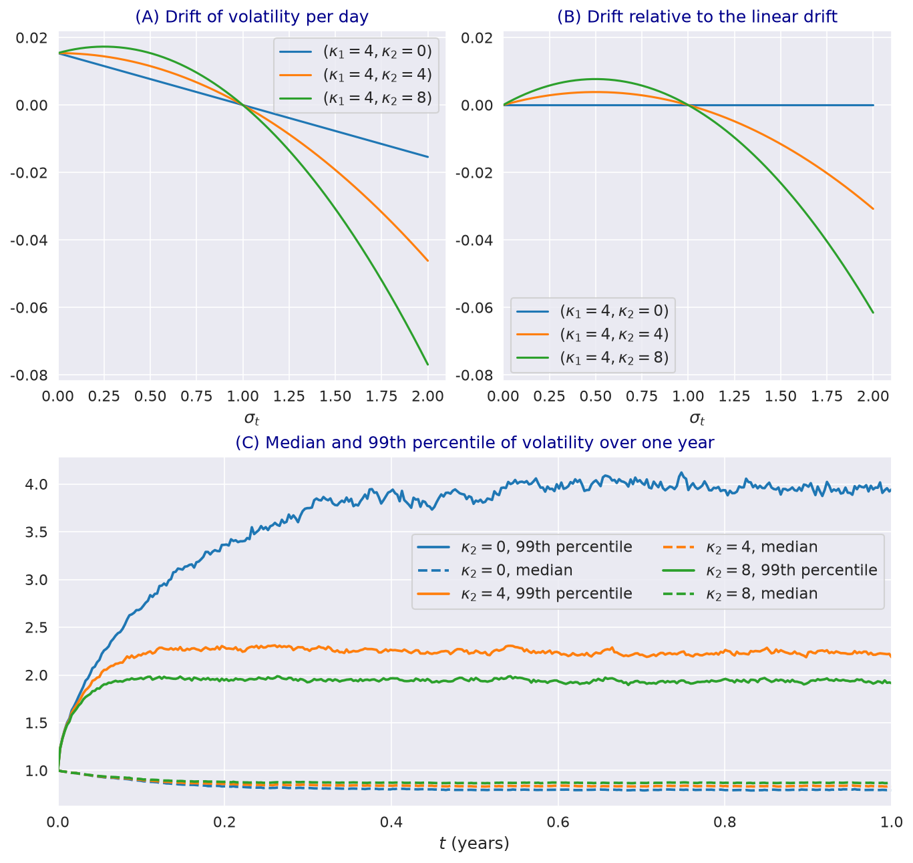

---
myst:
  html_meta:
    description: >-
      The log-normal stochastic volatility model with quadratic drift (Karasinski-Sepp) in
      stochvolmodels: dynamics under the physical and risk-neutral measures, invariance of the
      quadratic drift, volatility beta, regularity, and the LogSvParams and LogSVPricer interface.
---

# Log-normal stochastic volatility model with quadratic drift

*Author: [Artur Sepp](https://github.com/ArturSepp) / First recorded: [2026-08-16](https://github.com/ArturSepp/StochVolModels/commit/e9e01403a6ba36aad7708049028c64438a606234)*

Implemented in [stochvolmodels](https://github.com/ArturSepp/StochVolModels).
Software citation: [CITATION.cff](https://github.com/ArturSepp/StochVolModels/blob/main/CITATION.cff).

The log-normal stochastic volatility (SV) model with quadratic drift, which the package calls the
Karasinski-Sepp model, lets the volatility of an asset follow a mean-reverting log-normal
diffusion that is correlated with the asset through a volatility beta. The mean reversion has a
quadratic term. It pulls high volatility back faster than a linear drift, it keeps the model's
form when the physical measure is changed to the risk-neutral one, and it keeps valuation
consistent when the volatility beta is positive. This article presents the dynamics following Sepp
and Rakhmonov (2023, Section 3) and the package's parameters and pricer.

## Overview

Volatility is close to log-normal in index, option-implied and realised data, and log-normal
volatility models fit these data better than the square-root and 3/2 models (Christoffersen,
Jacobs and Mimouni, 2010). The model of Karasinski and Sepp (2012) makes volatility log-normal and
correlates its changes with returns through a volatility beta $\beta$. Sepp and Rakhmonov (2023)
add a quadratic term to its drift, following Lewis (2018) and Carr and Willems (2019). The result
has four properties that the rest of the documentation builds on:

1. **Either sign of skew.** The volatility beta can be negative, as for equity indices, or positive:
   permanently for the VIX index and short or leveraged-short exchange-traded funds, and at times for
   some commodities, currencies and cryptocurrencies (Section 1.4 of the paper).
2. **Invariance.** The quadratic form of the drift is the same under the physical measure and the
   risk-neutral measure.
3. **Martingale property.** Valuation under the money-market-account (MMA) measure is consistent
   when $\kappa_2 \ge \beta$, and under the inverse measure when $\kappa_2 \ge 2 \beta$; see
   [martingale conditions](martingale_conditions_and_skews.md).
4. **Tractability.** The moments of volatility and the moment generating function (MGF) have
   closed-form approximations, so options are priced by Fourier inversion and checked by Monte
   Carlo simulation; see [the steady state and moments](volatility_distribution_and_moments.md) and
   [Fourier pricing of European options](european_option_pricing.md).

## Inputs, notation, and assumptions

| Symbol | Field of `LogSvParams` | Meaning | Convention |
|---|---|---|---|
| $\sigma_0$ | `sigma0` | Initial volatility | Annualised decimal |
| $\theta$ | `theta` | Mean volatility | $\theta > 0$ |
| $\kappa_1$ | `kappa1` | Linear mean-reversion rate | Per year, $\kappa_1 \ge 0$ |
| $\kappa_2$ | `kappa2` | Quadratic mean-reversion rate | Per year and unit of volatility, $\kappa_2 \ge 0$ |
| $\beta$ | `beta` | Volatility beta, the loading of volatility on the price shock | Any sign |
| $\varepsilon$ | `volvol` | Volatility of residual volatility | $\varepsilon > 0$ |
| $\vartheta^2$ | derived, `vartheta2` | Total vol-of-vol, $\beta^2 + \varepsilon^2$ | Per year |
| $\bar{\lambda}_0$, $\bar{\lambda}_1$ | not in the package | Equity and volatility risk premia per unit of volatility | Physical measure only |

The rate $r(t)$ is deterministic. The parameters satisfy Assumption 3.1 of the paper:
$\kappa_1 \ge 0$, $\kappa_2 \ge 0$ and $\theta > 0$. Prices are computed under the MMA measure unless
the inverse measure is requested. The other conventions, including units and the mapping of
symbols to code, are on the [conventions page](option_chains_and_conventions.md).

## Methodology

### Dynamics under the physical measure

Under the physical measure $\mathbb{P}$ the price $S_t$ and its volatility $\sigma_t$ follow,
Eq. (3.1),

$$
dS_t = \mu_t S_t dt + \sigma_t S_t dW^{(0)}_t ,
$$

$$
d\sigma_t = (\kappa_1 + \kappa_2 \sigma_t)(\theta - \sigma_t) dt + \beta \sigma_t dW^{(0)}_t + \varepsilon \sigma_t dW^{(1)}_t ,
$$

where $W^{(0)}$ and $W^{(1)}$ are independent Brownian motions. The relative change of volatility
loads $\beta$ on the price shock and $\varepsilon$ on an independent shock, so the correlation
between returns and relative volatility changes is $\beta / \vartheta$. The speed of mean reversion,
$\kappa_1 + \kappa_2 \sigma_t$, grows with the level of volatility.

### Change of measure and invariance of the quadratic drift

The market prices of risk of the two shocks are $\lambda_0(t)$, fixed by the drift of the price,
$\lambda_0(t) = (\mu_t - r_t) / \sigma_t$ (Eq. (3.4)), and $\lambda_1(t)$. With risk premia
proportional to volatility, $\lambda_i(t) = \bar{\lambda}_i \sigma_t$ (Eq. (3.6)), the drift of
volatility under the MMA measure $\mathbb{Q}$ becomes, Eq. (3.7),

$$
\kappa_1 \theta - (\kappa_1 - \kappa_2 \theta) \sigma - \left( \kappa_2 + \beta \bar{\lambda}_0 + \varepsilon \bar{\lambda}_1 \right) \sigma^2 .
$$

It is again a quadratic drift, $(\hat{\kappa}_1 + \hat{\kappa}_2 \sigma)(\hat{\theta} - \sigma)$, with the
parameters of Eqs. (3.8) and (3.9):

$$
\hat{\kappa}_2 = \kappa_2 + \beta \bar{\lambda}_0 + \varepsilon \bar{\lambda}_1 ,
$$

$$
\hat{\kappa}_1 = \frac{1}{2} \left( \kappa_1 - \kappa_2 \theta + D \right), \quad \hat{\theta} = \frac{-(\kappa_1 - \kappa_2 \theta) + D}{2 \hat{\kappa}_2}, \quad D = \sqrt{(\kappa_1 - \kappa_2 \theta)^2 + 4 \theta \kappa_1 \hat{\kappa}_2} .
$$

By Theorem 3.1 of the paper, the two measures are equivalent if and only if
$\kappa_2 \ge \max\left( -\beta \bar{\lambda}_0 - \varepsilon \bar{\lambda}_1, 0 \right)$. A model with a
linear drift, $\kappa_2 = 0$, does not share this invariance: the change of measure creates a
quadratic term that the linear model does not have. The rest of the documentation works under
$\mathbb{Q}$ and drops the hats.

### Dynamics under the money-market-account measure

Under $\mathbb{Q}$ the price, its volatility and the quadratic variance $I_t$ follow, Eq. (3.12),

$$
dS_t = r(t) S_t dt + \sigma_t S_t dW^{(0)}_t, \quad dI_t = \sigma_t^2 dt ,
$$

$$
d\sigma_t = (\kappa_1 + \kappa_2 \sigma_t)(\theta - \sigma_t) dt + \beta \sigma_t dW^{(0)}_t + \varepsilon \sigma_t dW^{(1)}_t ,
$$

with total vol-of-vol $\vartheta^2 = \beta^2 + \varepsilon^2$, Eq. (3.13). The drift of volatility is,
Eq. (3.14),

$$
\mu(\sigma) = (\kappa_1 + \kappa_2 \sigma)(\theta - \sigma) = \kappa_1 \theta - (\kappa_1 - \kappa_2 \theta) \sigma - \kappa_2 \sigma^2 .
$$

The quadratic rate adds $\kappa_2 \sigma (\theta - \sigma)$ to the linear drift: a push upwards below
the mean and a pull downwards above it that grows with the square of volatility.

### Regularity

Under Assumption 3.1, volatility never reaches zero and never explodes (Theorem 3.2 of the paper),
and its stochastic differential equation has a unique strong solution (Theorem 3.3). The drift grows
faster than linearly, so the standard Lipschitz conditions do not apply; the proof uses the result
of Gyöngy and Krylov (1980) for monotone coefficients.

## Worked example

Every block below is an excerpt of
[`examples/docs/logsv_model.py`](../examples/docs/logsv_model.py), which asserts every number quoted
here. The first two examples use the parameters of the paper's drift figure: $\kappa_1 = 4$,
$\theta = 1$, $\vartheta = 1.75$ and $\kappa_2$ equal to 0, 4 or 8.

```python
def drift(sigma: np.ndarray, params: svm.LogSvParams) -> tuple:
    """The volatility drift of Eq. (3.14) in its factored and expanded forms."""
    factored = (params.kappa1 + params.kappa2 * sigma) * (params.theta - sigma)
    expanded = (params.kappa1 * params.theta
                - (params.kappa1 - params.kappa2 * params.theta) * sigma
                - params.kappa2 * sigma ** 2)
    return factored, expanded
```

At twice the mean, $\sigma = 2$, the drift is -4, -12 and -20 per year for $\kappa_2$ equal to 0, 4
and 8: the quadratic rate triples or quintuples the pull towards the mean. At half the mean it is 2,
3 and 4, a much smaller change. The script also checks the simulator against Eq. (3.14): the average
change of volatility over a tenth of a day, from $\sigma_0$ equal to 0.5, 1 and 2, matches the drift
within three standard errors for $\kappa_2 = 0$ and $\kappa_2 = 8$.

The effect on the tail of volatility is large. The script simulates one year of daily volatility
paths with the same random increments for the three rates:

```python
def volatility_paths(kappa2: float, ttm: float = 1.0, nb_path: int = 20000,
                     seed: int = 7) -> tuple:
    """Daily volatility paths; the same seed gives the same increments for every kappa2."""
    nb_steps, dt, _ = set_time_grid(ttm=ttm, nb_steps_per_year=360)
    brownians = np.sqrt(dt) * np.random.default_rng(seed).standard_normal((nb_steps, nb_path))
    return svm.LogSVPricer().simulate_vol_paths(params=drift_params(kappa2), ttm=ttm,
                                                nb_path=nb_path, nb_steps=360, brownians=brownians)
```

| $\kappa_2$ | Median of $\sigma_1$ | 99th percentile of $\sigma_1$ | 99th percentile of the maximum over the year |
|---|---|---|---|
| 0 | 0.793 | 3.94 | 8.58 |
| 4 | 0.834 | 2.19 | 3.78 |
| 8 | 0.868 | 1.91 | 3.03 |

The median moves little, while the 99th percentile of volatility at one year falls from 3.94 to
1.91 and that of its running maximum from 8.58 to 3.03.

[](images/logsv_drift_and_paths.png)

*Synthetic teaching exhibit. (A) The drift of Eq. (3.14) per day (the annual drift divided by 260)
and (B) its difference to the linear drift, for $\kappa_1 = 4$, $\theta = 1$ and $\kappa_2 = 0, 4, 8$,
drawn by the paper module `vol_drift.py`. (C) The median (dashed) and 99th percentile (solid) of
volatility over one year from 20,000 daily paths with $\vartheta = 1.75$, the same increments for
each rate, seed 7.*

The measure change of Eq. (3.9) is a few lines. With physical parameters $\kappa_1 = 2$,
$\kappa_2 = 1$, $\theta = 0.5$, $\beta = -0.5$ and $\varepsilon = 1$, and risk premia
$\bar{\lambda}_0 = 0.5$ and $\bar{\lambda}_1 = -0.3$:

```python
def risk_neutral_parameters(kappa1: float, kappa2: float, theta: float, beta: float,
                            volvol: float, lambda0: float, lambda1: float) -> tuple:
    """Rates and mean under the MMA measure, Eq. (3.9), for the risk premia of Eq. (3.6)."""
    kappa2_q = kappa2 + beta * lambda0 + volvol * lambda1
    root = np.sqrt((kappa1 - kappa2 * theta) ** 2 + 4.0 * theta * kappa1 * kappa2_q)
    theta_q = (-(kappa1 - kappa2 * theta) + root) / (2.0 * kappa2_q)
    kappa1_q = 0.5 * ((kappa1 - kappa2 * theta) + root)
    return kappa1_q, kappa2_q, theta_q
```

The risk-neutral parameters are $\hat{\kappa}_1 = 1.756$, $\hat{\kappa}_2 = 0.45$ and
$\hat{\theta} = 0.569$. The script checks, on a grid of volatilities, that
$(\hat{\kappa}_1 + \hat{\kappa}_2 \sigma)(\hat{\theta} - \sigma)$ equals the drift of Eq. (3.7), and
that $\hat{\kappa}_2 \ge 0$ as Theorem 3.1 requires.

Finally, a three-month slice with a negative volatility beta:

```python
def first_slice() -> tuple:
    """Price a three-month slice with a negative volatility beta and read its implied vols."""
    params = svm.LogSvParams(sigma0=0.2, theta=0.25, kappa1=4.0, kappa2=4.0, beta=-1.0,
                             volvol=1.0)
    strikes = np.array([0.8, 0.9, 1.0, 1.1, 1.2])
    optiontypes = np.array(["P", "P", "C", "C", "C"])
    prices, ivols = svm.LogSVPricer().price_slice(params=params, ttm=0.25, forward=1.0,
                                                  strikes=strikes, optiontypes=optiontypes)
    return params, strikes, optiontypes, prices, ivols
```

The implied volatilities fall from 0.295 at strike 0.8 through 0.219 at the money to 0.173 at
strike 1.2, the downward-sloping smile of a negative volatility beta. A Monte Carlo valuation with
50,000 paths and daily steps agrees with every price within three standard errors.

## Implementation in stochvolmodels

Canonical numerical modules are `models.logsv.params`, `models.logsv.affine_expansion`,
`models.logsv.moments` and `models.logsv.simulation`. The capability adapter is
`models.logsv.LogSvModel`; `pricers.logsv_pricer.LogSVPricer` retains chain pricing and
calibration. Existing root and `pricers.logsv` imports remain compatible.

| Name | Role |
|---|---|
| `LogSvParams` | The parameters of Eq. (3.12); a stable export. `kappa2=None` sets $\kappa_2 = \kappa_1 / \theta$. The properties `vartheta2`, `kappa` and `theta2` give $\vartheta^2$, $\kappa_1 + \kappa_2 \theta$ and $\theta^2$. |
| `LogSVPricer` | The pricer; a stable export. `price_vanilla`, `price_slice` and `price_chain` value options by Fourier inversion, under the MMA measure or, with `is_spot_measure=False`, the inverse measure. `model_mc_price_chain` values the same chain by Monte Carlo; `calibrate_model_params_to_chain` fits parameters to implied volatilities. |
| `LogSVPricer.simulate_vol_paths`, `LogSVPricer.simulate_terminal_values` | Volatility paths, and terminal log returns, volatilities and quadratic variances |

`LogSvParams` does not check the martingale conditions: calibration imposes them through
`ConstraintsType`, as described in [martingale conditions](martingale_conditions_and_skews.md). Its
`vol_backbone` field scales instantaneous return volatility on calendar intervals, as described
under [calibration](calibration.md). `H`, `weights` and `nodes` configure the experimental
rough extension. The package works under the MMA measure and does not implement the physical
parameterisation of Eq. (3.9); the canonical script does. Run it from a checkout with
`python examples/docs/logsv_model.py`.

### Frozen Fourier grid for a chain

Pass `fourier={}` to select one frequency grid for every expiry and strike. The preflight
uses the supplied model parameters, the chain's forwards and discounts, and each quote's
premium tolerance. It tests panel resolution and the mass in the last two frequency bands.
Extensions and subdivisions require coefficient solves only for new frequencies. With a
constant return loading, each frequency continues from one expiry to the next. For a varying
loading, each expiry uses its own backward propagation through the calendar knots. Final
pricing reuses the stored transforms at the frozen nodes.

```python
def short_expiry_prices() -> np.ndarray:
    """Price one- and seven-day LogSV slices on one frozen frequency grid."""
    params = svm.LogSvParams(sigma0=0.28, theta=0.40, kappa1=2.0, kappa2=3.0,
                             beta=-0.65, volvol=0.85)
    chain = svm.OptionChain.get_uniform_chain(
        ttms=np.array([1, 7]) / 365, ids=np.array(["1d", "7d"]),
        forwards=np.array([100., 100.]), strikes=np.array([80., 100., 120.]),
    )
    return np.asarray(svm.LogSVPricer().price_chain(chain, params, fourier={"price_atol": 1e-6}))
```

The one-day at-the-money call is **0.58564723**. The default LogSV preflight starts with
nine 15-node panels through frequency 128. The first panel ends at `initial_cutoff=0.5`.
The other [tolerance and work settings](heston_model.md#controlled-fourier-pricing)
match Heston's. Here `max_nodes` counts distinct frequencies across the chain. Each
frequency can require several time-segment solves. Repricing at new parameters computes fresh
transforms. Exhausting a work limit raises `FloatingPointError` with diagnostics.

The option applies to `price_vanilla`, `price_slice`, `price_chain` and the chain
implied-volatility helpers. Set `is_spot_measure=False` for the inverse measure.
Omitting `fourier` or passing `"legacy"` selects the uniform grid. The premium tolerance
controls numerical inversion of the selected affine expansion. Expansion error is a
separate source of price error. During analytic calibration, a
[fixed Fourier grid](calibration.md#fixed-fourier-grids) covers the optimizer run.
The [full-state comparison](numerical_accuracy_and_performance.md#logsv-expansion-against-the-full-state-model)
shows how the integration and model errors differ on the published SPY calls.

### Repricing on a prepared grid

`LogSVPricer.prepare_fourier(chain, params)` returns a `PreparedLogSVGrid` with three complex
coefficients at first order or five at second order per active frequency and expiry
(48 or 80 bytes). The handle owns its model settings, including the calendar backbone.
Call `grid.price_chain(quotes)`
to change strikes, forwards or discounts, or select a subset of those expiries. Each new
quote repeats the resolution and tail checks with zero coefficient solves. A miss raises
`FloatingPointError` with the affected strike and expiry. Call `grid.refined_for(quotes)`
to retain the old samples and solve additional frequencies within the original work limits.
Both handles can be used independently. New dynamics or maturities require fresh preparation.

For $n_T$ prepared expiries, $n_u$ active frequencies and $n_A$ polynomial
terms, the stored coefficient array has shape $(n_T,n_u,n_A)$ and occupies
$16 n_T n_u n_A$ bytes, in addition to panel weights and quote metadata.
The handle stores coefficients before evaluating the initial state. At each
frequency, let $y=\sigma_0-\theta$ and $g(y)=\sum_{k=0}^{n_A-1}A_k y^k$.
The two quantities used in pricing and state sensitivity are

$$
M(y)=e^{g(y)},\qquad
\frac{\partial M}{\partial\sigma_0}=M(y)\sum_{k=1}^{n_A-1}k A_k y^{k-1}.
$$

A query evaluates the appropriate quantity on the saved nodes and applies
the strike phases, discount and quadrature weights for the requested contracts.
Each requested maturity must match a prepared expiry exactly. A refinement checks
the union of previous and new quote requirements and charges newly sampled
frequencies against the original work limits, including earlier discarded panels.
Calibration at a new $\theta$, $\kappa_1$, $\kappa_2$, $\beta$ or $\varepsilon$
recomputes the coefficients on its fixed grid. [Calibration sensitivities](calibration.md#from-coefficient-sensitivities-to-the-iv-loss-gradient)

To move the initial volatility from 40% to 45%, call `grid.price_chain(quotes, sigma0=0.45)`.
Only the final evaluation of the polynomial in $\sigma_0-\theta$ changes. The coefficients,
calendar loadings, forwards and discounts can all be held fixed. Omitting `sigma0` uses the
preparation state. Each scenario must pass the embedded quadrature and tail checks.

`grid.sigma0_sensitivity(quotes, sigma0=0.45, atol=1e-6)` differentiates the transform
analytically and checks the differentiated integral against its own absolute tolerance.
The result is discounted premium per unit of initial volatility. Multiply by 0.01 for the
first-order premium change per volatility point. For the 30-day ATM call in the runnable
example, the sensitivity at 40% is 9.94015, or about 0.0994 premium units per point.
After a missed check,
`grid.refined_for(quotes, sigma0=0.45, sensitivity_atol=1e-6)` returns a handle checked for
both premium and sensitivity at that state. Pass the same premium settings in `fourier` if
the price query specified them. Both checks control Fourier integration of the chosen expansion.

Supply quote controls in `fourier={...}` on either method. Scalar tolerances carry forward.
Supply new strike-aligned tolerances or time values when the quote set changes. A preparation
on the 1-day and 7-day example took 690 coefficient solves. Repricing strikes 87, 95, 105
and 113 at both expiries took zero additional solves, versus 510 on a fresh controlled call.
The two price arrays agreed within `4.7e-12` premium units. Over six successive
interior strike sets, warm queries took 2.2–4.9 ms each. Preparation took 0.98 s
and paid for itself on the second query in that run. A fresh controlled price
took 0.62–1.01 s per strike set. The grid retained 43,200 bytes of coefficients.
Compilation was measured separately.
[Runnable prepare, query and refine example](../examples/docs/logsv_model.py)

### Forward delta and gamma

`grid.forward_greeks(quotes)` returns two lists of arrays in the same expiry and strike order
as the quoted chain. Delta and gamma differentiate the discounted premium with respect to the
forward, holding strike, discount, initial volatility and dynamics fixed. On the inverse
contour the differentiated premium includes SVM's conversion by the forward. The optional
`sigma0` selects the initial-volatility scenario for both derivatives.

For frequency $u$, the forward-dependent factor in the half-contour integral is
$H=\sqrt{FK}\exp[-iu\log(F/K)]$. With $a=1/2-iu$ its derivatives are

$$
\partial_F H=\frac{a}{F}H,\qquad
\partial_F^2 H=-\frac{u^2+1/4}{F^2}H.
$$

The additive call term $DF$ contributes $D$ to delta. The additive put term $DK$ has zero
forward derivatives. The gamma multiplier cancels the vanilla kernel denominator
$u^2+1/4$, so gamma can require a wider cutoff, especially near expiry at the money.
Each Greek gets an embedded quadrature check and a tail check in its own units.
`delta_atol` is in premium per forward unit and `gamma_atol` is in premium per squared
forward unit. Both default to `1e-6`. A query uses only saved coefficients. After a missed
check, refine with the same tolerances and state.

```python
risk_grid = grid.refined_for(quotes, delta_atol=1e-9, gamma_atol=1e-9)
deltas, gammas = risk_grid.forward_greeks(quotes, delta_atol=1e-9, gamma_atol=1e-9)
```

In the constant-volatility example, a one-hour call with $F=K=100$, volatility 24% and
$D=0.98$ has forward delta $0.4905012625$ and gamma $1.5246726011$. These are the Black
values $D\Phi(d_1)$ and $D\varphi(d_1)/(F\sigma\sqrt{T})$. The stochastic-volatility
regression separately checks one-day and 30-day calls and puts against central forward bumps.
[Verification cases](../src/stochvolmodels/tests/test_prepared_logsv_grid.py)

### Bitcoin benchmark for forward delta and gamma

The 21 October 2021 Bitcoin chain has 49 quotes across four expiries (12, 13, 15 and 9
quotes). The benchmark fixes the parameters from the [five-parameter implied-volatility
fit](calibration.md#five-parameter-logsv-gradient) and uses the second-order LogSV expansion
under the money-market measure. Delta and gamma are the first and second derivatives of
discounted USD premium with respect to the USD forward. Each bump holds strikes, discounts
and model parameters fixed. One basis point (bp) is a relative forward move of 0.0001.

| Bump to each expiry's forward | Max absolute delta error | Delta RMSE | Max absolute gamma error | Gamma RMSE |
|---|---:|---:|---:|---:|
| ±2 bp | 6.52e-8 | 2.31e-8 | 4.03e-12 | 1.34e-12 |
| ±1 bp | 1.63e-8 | 5.78e-9 | 1.01e-12 | 3.34e-13 |
| ±0.5 bp | 4.07e-9 | 1.45e-9 | 2.52e-13 | 8.36e-14 |

Errors compare the analytic Greeks with central differences of premiums on an independent
24-point Gauss–Legendre rule per panel. The reference uses 2,112 nodes through frequency
512. At ±0.5 bp, the change from 960 nodes through 256 was at most 3.83e-10 for delta
and 4.40e-14 for gamma. Both inversions use the same model expansion. The largest delta
error was on the shortest expiry's USD 58,000 put and the largest gamma error on its
USD 70,000 call.

For a relative forward bump $s$, the reference computes the finite change of the strike
phase with `expm1(-phi * log1p(s))`. This preserves the small premium changes entering
the second difference. Halving the bump reduced both maximum errors by about four.
Subtracting the outright double-precision premiums gave a maximum gamma discrepancy
of 8.17e-11 at ±0.5 bp.

| Operation on the full chain | Median wall time | Coefficient solves |
|---|---:|---:|
| Prepare the premium grid | 10.4 s | 8,760 |
| Check and refine the grid for both Greeks | 23.5 ms | 0 |
| Warm query for analytic delta and gamma together | 15.7 ms | 0 |
| Warm central bumps on the prepared grid, base plus up and down | 26.5 ms | 0 |

At a USD premium tolerance of `1e-6`, the grid retained 1,170 nodes through frequency 256.
It already satisfied `delta_atol=1e-8` and `gamma_atol=1e-12`. The refinement time
therefore measures the checks on the existing nodes. One coefficient solve here means
one frequency on one maturity interval, including frequencies discarded during preparation.

The 24 November 2026 run used Windows 11, Python 3.12.10 and one BLAS thread. The median setup
times cover three fresh preparations and refinements. The warm timings cover 51 calls per
method in alternating order. The bump query reprices the base and both ±0.5 bp scenarios
on the same grid. On this run the analytic query was 1.69 times as fast. An initial
14.0 s warm-up (including 11.7 s of Numba compilation) and the independent reference
inversions were timed outside these measurements.

From a source checkout with the package installed, run the following command. It prints
the error and timing summaries. The optional `--output-dir` writes all 49 quote-level
comparisons to `btc_forward_greeks_quotes.csv` and individual timings, fitted parameters
and reference-grid details to `btc_forward_greeks_results.json`.
[Benchmark source](../examples/pricers/benchmark_btc_forward_greeks.py)

```console
python -m examples.pricers.benchmark_btc_forward_greeks --output-dir agents/btc-forward-greeks
```

## Interpretation and limitations

- **Volatility beta and correlation.** $\beta$ is a loading, not a correlation: the correlation of
  returns with relative volatility changes is $\beta / \vartheta$, and the same correlation can come
  from different pairs of $\beta$ and $\varepsilon$.
- **Mean reversion is hard to identify from one chain.** The rates $\kappa_1$ and $\kappa_2$, the
  volatility beta and the vol-of-vol can produce similar smiles. The paper therefore fixes the rates
  from the autocorrelation of volatility before calibrating the other parameters; see the
  [Bitcoin case study](app_bitcoin_options.md).
- **Martingale conditions.** A parameter set with $\kappa_2 < \beta$ is not a consistent model under
  the MMA measure, and one with $\kappa_2 < 2 \beta$ is not under the inverse measure. The pricer
  still returns numbers for such parameters.
- **Measure change.** The invariance of the quadratic drift assumes risk premia proportional to
  volatility, Eq. (3.6).
- **Scope.** The package values European options on the price and on its quadratic variance. It
  does not value American or path-dependent options; the rough extension is experimental.

## See also

- [Option chains, notation and conventions](option_chains_and_conventions.md)
- [Steady-state distribution, moments and expected quadratic variance](volatility_distribution_and_moments.md)
- [Martingale conditions, measures and positive skews](martingale_conditions_and_skews.md)
- [Fourier pricing of European options](european_option_pricing.md)
- [Calibration](calibration.md)

## References

- Carr, P. and Willems, S. (2019). A lognormal type stochastic volatility model with quadratic
  drift. arXiv:1908.07417.
- Christoffersen, P., Jacobs, K. and Mimouni, K. (2010). Models for S&P 500 dynamics: evidence from
  realized volatility, daily returns and options prices. *The Review of Financial Studies* 23(9),
  3141-3189.
- Gyöngy, I. and Krylov, N. V. (1980). On stochastic equations with respect to semimartingales I.
  *Stochastics* 4(1), 1-21.
- Karasinski, P. and Sepp, A. (2012). Beta stochastic volatility model. *Risk*, October 2012.
- Lewis, A. L. (2018). Exact solutions for a GBM-type stochastic volatility model having a
  stationary distribution. arXiv:1809.08635.
- Sepp, A. and Rakhmonov, P. (2023). Log-normal stochastic volatility model with quadratic drift.
  *International Journal of Theoretical and Applied Finance* 26(8), 2450003.
  [DOI 10.1142/S0219024924500031](https://doi.org/10.1142/S0219024924500031).
- [stochvolmodels software citation](https://github.com/ArturSepp/StochVolModels/blob/main/CITATION.cff).
