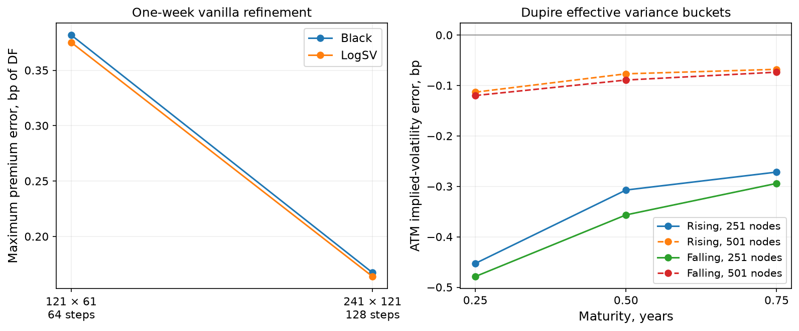

---
myst:
  html_meta:
    description: >-
      Finite-difference PDE solvers for forward densities and backward values, with
      coefficient conventions, boundary diagnostics and reproducible LogSV vanilla refinement.
---

# Finite-difference PDE solvers

*Author: [Artur Sepp](https://github.com/ArturSepp) / First recorded: [2026-11-17](https://github.com/ArturSepp/StochVolModels/commit/45ca508c2d0d0439292df3591f37e905ee4d625c)*

Implemented in [stochvolmodels](https://github.com/ArturSepp/StochVolModels).
Software citation: [CITATION.cff](https://github.com/ArturSepp/StochVolModels/blob/main/CITATION.cff).

A partial differential equation (PDE) solver evolves a value function or a probability
density on a finite grid. The provisional `stochvolmodels.pde_solvers` API provides
one-dimensional theta stepping and two-dimensional alternating-direction implicit (ADI)
stepping. The compound-Poisson example requires the Stage 2 jump API in 2.21.0.dev7 or later. The unsplit reference
solver and positive spatial discretization described below are repository experiments.

## Overview

Use `PDE1DSolver` for a one-dimensional diffusion and `PDE2DADISolver` for a
two-dimensional diffusion with a mixed derivative. The generic solver receives numerical
coefficients, boundaries and a time grid. Model classes supply dynamics, product classes
supply payoffs, and pricers apply discounting and quote-unit conventions.

For ordinary European LogSV calls and puts, `LogSvPdePricer` performs a forward-density
solve for the entire chain. `LogSVPricer` is the transform-based entry point.
Local volatility and local stochastic volatility have a separate worked guide.
[Local volatility and LSV](local_volatility_and_lsv.md)

## Inputs, notation, and assumptions

| Input | Meaning | Convention |
|---|---|---|
| `Grid1D`, `TensorGrid2D` | Ordered spatial nodes and quadrature weights | Densities are pointwise values, integrated with these weights |
| `variance`, `variance_x`, `variance_y` | Pure second-derivative coefficients | Half the instantaneous variance |
| `covariance_xy` | Mixed-derivative coefficient | Full instantaneous cross covariance |
| `drift`, `drift_x`, `drift_y` | First-derivative coefficients | Coordinate units per year |
| `discount` | Killing rate | A positive rate reduces integrated mass |
| `time_grid` | Calendar dates | Strictly increasing for either direction |
| `values` | Initial density or terminal payoff | Array shape equals grid shape |

The two-dimensional covariance must satisfy $c^2 \leq 4a_xa_y$. A deterministic
coordinate therefore has zero covariance with the other coordinate. LogSV pricing uses
$x=\log(S/F)$ and volatility $y=\sigma$. Prices use the forward and discount factor
provided at each expiry.

## Methodology

The backward generator is

$$
\mathcal{L}u=a_xu_{xx}+a_yu_{yy}+cu_{xy}+b_xu_x+b_yu_y-ru.
$$

A backward solve evolves terminal values from the last calendar date to the first.
A forward solve evolves a density from the first date to the last. If $A$ is the
discrete backward generator and $W$ contains the quadrature weights, its forward
counterpart is $W^{-1}A^\mathsf{T}W$. Payoff integration and density propagation then
use the same weighted pairing.

`TimeStepConfig` selects the one-dimensional theta scheme. `ADIConfig` selects
Douglas, Craig–Sneyd or Hundsdorfer–Verwer splitting. The generic solver obeys the
supplied dates exactly. `LogSvPdePricer` uses quadratic spacing in its first bucket
to resolve the initial point mass, and uniform spacing thereafter. Each leverage
or backbone knot splits the propagation. Explicit space and time refinement remains
part of a pricing accuracy check.

Backward boundaries support fixed values, linear relations and natural endpoints.
Forward propagation supports natural boundaries. With zero killing, a natural
endpoint retains mass arriving along its axis. The mixed stencil can produce signed
densities. Inspect total mass, negative mass, forward moment and boundary occupancy
together. `boundary_mass.absolute_total` counts the perimeter once, including corners.
The optional density policy can reject a solve, and any renormalization is explicit.
[Boundary and stepping contracts](software_design.md#generic-finite-difference-solvers)

### Exponential jump marks

`ExponentialJumpKernel(grid, rate, side="down", exterior="zero")` computes the
expectation for one additive mark with mean magnitude `1 / rate`. Backward application
integrates the piecewise-linear payoff over each cell. Forward application moves a
pointwise density using the quadrature-weighted transpose. With a zero exterior,
`kernel.exterior_mass(density)` measures probability lost in that event. A clamped
exterior deposits the same probability on the endpoint. Use `side="up"` for positive marks.

For a common arrival with conditionally independent marks, call
`apply_common_exponential_jump(values, x_kernel, y_kernel, direction)` on an
`(nx, ny)` array. To evolve over a time interval, prepare the clocks once and pass the
process to the solver. In this example the three intensities count x-only, y-only and
common events per year. A common arrival draws one independent exponential mark per axis.

<!-- fragment -->
```python
from stochvolmodels.pde_solvers import ExponentialJumpKernel, ExponentialJumpProcess

jumps = ExponentialJumpProcess(
    grid,
    x_kernel=ExponentialJumpKernel(grid.x, 5.0, exterior="zero"),
    y_kernel=ExponentialJumpKernel(grid.y, 10.0, exterior="zero"),
    x_intensity=0.4, y_intensity=0.6, common_intensity=0.2,
)
solution = solver.solve(grid, provider, boundaries, direction, times, values, jump=jumps)
```

Here `grid` is a `TensorGrid2D` and `solver` is a `PDE2DADISolver`. For a
`PDE1DSolver`, pass a `Grid1D`, `x_kernel` and `x_intensity`. Omitting a clock sets
its intensity to zero. Supply any model drift compensation through the coefficient provider.

Both solvers apply a compound-Poisson half-step on each side of the diffusion step.
Each count contributes the corresponding power of the single-event mixture. For a
standalone jump step, `jumps.poisson_step(values, direction, dt)` accepts
`tail_tolerance` and `max_terms`. Retained count probabilities sum to one.
For a completed solver interval, `jump_truncated_probability` reports the probability
that either half-step exceeds its count cutoff. The forward `jump_killed_mass` sums
physical overshoot losses from both half-steps, in integrated density units. The
expected-mass diagnostic accounts for those losses and for discounting. Weighted
forward/backward duality applies with natural diffusion boundaries and density
renormalization disabled. The existing `forward_x_jump` interface supplies fixed-size
forward translations and is mutually exclusive with `jump`.

[Solver API](api.md#provisional-and-experimental-surfaces)

### Two-name survival with continuous barriers

Run the pricing example and the independent qualification from the repository root.

```bash
python -m examples.pde_solvers.run_two_name_survival
python -m validation.pde_two_name_survival --output results.json
```

Both names start at log value zero. Their lower barriers are −0.2 and −0.1. Each name
has an individual jump clock, and a third clock moves both names. All three clocks
have annual intensity one. Jump sizes on a common arrival are independent exponentials
with means 0.2 and 0.1. The example reports marginal and joint survival, the probability
of at least one default, and the probability that both have defaulted. At zero interest,
the first-default probability is also the price of one unit paid on first default.

With zero drift and zero diffusion, cumulative losses only increase. Mixing gamma loss
distributions over the Poisson counts gives exact joint survival of 0.70195422,
0.47676345 and 0.20466416 at three, six and twelve months. With annual Brownian
variances 0.00027 and 0.000583 and correlation 0.5, the backward solver uses absorbing
lower faces and kills jump overshoots. On 289 nodes per axis and 64 steps per year,
the corresponding joint probabilities are 0.69318542, 0.46137141 and 0.18903398.

The qualification simulates exact jump times. Between jumps it conditions on Gaussian
endpoints and uses one-dimensional Brownian-bridge crossing probabilities to bound
joint survival. Its JSON reports the estimated gap between the bounds, Monte Carlo
standard errors, and the effect of changing space, time and upper bounds individually.

### Reference solvers and volatility boundaries

To measure time-stepping error on a fixed spatial grid, the repository's unsplit reference
assembles the full sparse generator, including the mixed derivative. Backward Euler and
Crank–Nicolson advance this matrix directly. A matrix exponential provides a small-grid
check. The startup experiment replaces the first nominal step from the point mass with
two unsplit backward Euler half-steps, then resumes the selected integrator.

To measure spatial error, the experimental positive generator uses nonnegative transition
rates along interpolated directions to represent covariance. It records any extra axial
diffusion needed at the stencil radius limit. At zero volatility, where normal diffusion
vanishes, the inward transition has rate $b/h$ for inward drift $b$ and first cell width
$h$. At the upper cap the default freezes motion normal to the face. Selecting
`MonotoneConfig(reflect_upper_vol=True)` in `validation.pde_monotone` returns mass to the
adjacent volatility node at the same log-forward. For last spacing $h$, volatility drift
$b$ and instantaneous volatility variance $v=2a_y$, the return rate is
$v/h^2+\max(-b,0)/h$. This control tests how much the finite cap affects the volatility law.

## Worked example

The one-dimensional example starts with a point mass at zero, half-variance 0.02,
zero drift and zero killing. At one quarter of a year the exact mass is one and
the exact second moment is 0.01. The canonical script asserts both. Its two-dimensional
case also checks a negative cross covariance against the Gaussian moment formula.

```python
from enum import Enum

import numpy as np

from stochvolmodels.data.option_chain import OptionChain
from stochvolmodels.pde_solvers import (
    BoundaryPair1D, BoundarySet2D, Grid1D, TensorGrid2D,
    PDE1DCoefficients, PDE2DCoefficients, PDE1DSolver, PDE2DADISolver,
    PDEDirection, StaticCoefficientProvider1D, StaticCoefficientProvider2D,
)
from stochvolmodels.pricers.logsv.logsv_params import LogSvParams
from stochvolmodels.pricers.logsv_pde_pricer import LogSvPdePricer
from stochvolmodels.pricers.logsv_pricer import LogSVPricer
from stochvolmodels import compute_bsm_vanilla_slice_prices
```

```python
def heat_1d():
    """Check probability mass and the exact second moment of Brownian diffusion."""
    grid = Grid1D.uniform(-1.0, 1.0, 101)
    coefficients = PDE1DCoefficients.constant(grid.size, 0.02, 0.0, 0.0)
    result = PDE1DSolver().solve(
        grid, StaticCoefficientProvider1D(coefficients), BoundaryPair1D.natural(),
        PDEDirection.FORWARD, np.linspace(0.0, 0.25, 65), grid.project_delta(0.0),
    )
    mass = grid.integrate(result.values)
    variance = grid.integrate(grid.nodes**2 * result.values)
    np.testing.assert_allclose([mass, variance], [1.0, 0.2**2 * 0.25], atol=1e-10)
    return result
```

The synthetic one-week smile uses initial and mean volatility 20%, both drift
coefficients equal to 2, forward 100, discount factor 0.98 and strikes 95, 100 and 105.
The Black row sets both volatility diffusion loadings to zero. The LogSV row uses
$\beta=-0.5$ and $\varepsilon=0.7$. Its independent comparator is the second-order
affine expansion on 6,001 frequency nodes, so that difference includes expansion error.

| Reference | Grid | Steps | Maximum premium error (bp) |
|---|---:|---:|---:|
| Black | 121 × 61 | 64 | 0.382 |
| Black | 241 × 121 | 128 | 0.167 |
| LogSV | 121 × 61 | 64 | 0.375 |
| LogSV | 241 × 121 | 128 | 0.164 |

Errors are maxima over the three quoted contracts, in basis points of discounted
forward, $10{,}000|\Delta PV|/(DF)$. The x domain is $[-0.8,0.8]$, concentrated on
$0.2\sqrt{7/365}$, and the volatility domain is $[0,0.8]$, concentrated around 0.2
with scale 0.05. The script also checks mass and records signed forward-moment error,
terminal negative mass and absolute boundary mass.



*Synthetic teaching exhibit. The left panel compares the one-week PDE with Black and
the affine expansion. The right panel independently checks Dupire bucket repricing
against deterministic integrated variance. Each point uses the mesh and time settings
reported by the canonical scripts. Refinement changes both space and time.*

## Implementation in stochvolmodels

Import `PDE1DSolver`, `PDE2DADISolver`, their grids and configuration types from
`stochvolmodels.pde_solvers`. Detailed solutions expose step diagnostics and requested
saved states. `LogSvPdePricer.price_chain_detailed` returns original-order premiums,
Black implied volatilities, failed-inversion masks and expiry diagnostics.
For a return-volatility backbone, construct `LSVModel.from_params(params)` before
passing it to the pricer.

Run the canonical script through its normal entry point.

~~~console
python examples/docs/pde_solvers.py
python scripts/check_pde_examples.py
~~~

The second command imports the reviewed provisional modules and runs their examples
in empty namespaces. CI also runs both guide scripts using an isolated installed-wheel
interpreter outside the checkout. The source remains runnable offline with core dependencies.
[Canonical script](https://github.com/ArturSepp/StochVolModels/blob/main/examples/docs/pde_solvers.py)
· [Rendered solver API](api.md#finite-difference-pde-solvers)

From a source checkout, run the independent volatility-moment reference on the bundled
two-year stress case. It writes a numerical record and report to a new study directory.

~~~console
python -m validation.pde_volatility_moments --stage reference
~~~

The reference evolves cell probabilities in log volatility with zero flux at the outer
faces and checks the result against the IJTAF solver in volatility levels. The later
`attribution`, `boundaries`, `projection` and `audit` stages consume archived study
records. A subsequent study used coupled Monte Carlo paths to check both fixed PDE grids.
[Conditional-variance method and results](local_volatility_and_lsv.md#conditional-variance-by-log-forward-bin)

## Interpretation and limitations

Finite-domain occupancy can bias prices even when mass and the forward moment look
accurate. Narrow grids and strong correlations require separate domain, spatial and time
checks. Terminal negative mass and the maximum over all substeps answer different
questions. `peak_negative_mass` reports the latter.

The vanilla PDE pricer supports ordinary European calls and puts under the money-market
measure. The generic generator also supports inverse-measure coefficients, while the
vanilla wrapper enforces its own contract. Inverse and quadratic-variance contracts use
their dedicated package entry points. Small wing premiums can give unstable implied
volatility errors, so retain premium errors and failed-inversion masks.

### What the frozen grids establish

In the two-year stress case, initial and mean volatility are 0.2, both mean-reversion
coefficients are 0.5, the return-shock loading is −1 and orthogonal vol-of-vol is 1.5.
The table gives the **unconditional variance of volatility** at two years. The two
607 × 309 runs use identical nodes, a volatility cap of 22.6 and 512 time steps.

| Method | Grid | Terminal variance of volatility |
|---|---:|---:|
| Independent log-volatility reference | 2,305 nodes | 0.091799 |
| Positive generator, upper normal motion frozen | 607 × 309 | 0.099883 |
| Positive generator, returning upper boundary | 607 × 309 | 0.091883 |
| Returning boundary, refined in space and time | 727 × 446 | 0.091917 |

The largest difference between the two returning grids over five vanilla calls was
0.0890 basis points of discounted forward. In a separate adverse BTC fit, refining
the grid from 599 × 353 to 733 × 427 at fixed domain and 1,680 time steps changed
all 49 vanilla quotes by at most 0.510120 basis points. That figure measures successive
spatial refinement for the fitted chain. Conditional moments require their own check
against joint price–volatility observations.

## See also

- The [solver and validation command index](https://github.com/ArturSepp/StochVolModels/blob/main/validation/README.md#command-index) lists the 1D and 2D examples and the longer refinement, startup, positivity and historical studies.
- [Local volatility and LSV](local_volatility_and_lsv.md)
- [Existing LogSV PDE pricing guide](software_design.md#logsv-vanilla-pde-valuation)
- [Numerical accuracy and performance](numerical_accuracy_and_performance.md)
- [API reference](api.md#finite-difference-pde-solvers)

## References

- Sepp, A. and Rakhmonov, P. (2023). Log-normal stochastic volatility model with
  quadratic drift. *International Journal of Theoretical and Applied Finance*
  26(8), 2450003. [DOI](https://doi.org/10.1142/S0219024924500031).
- The weighted-adjoint and boundary conventions above describe this package's
  implementation. [Solver source](https://github.com/ArturSepp/StochVolModels/tree/main/src/stochvolmodels/pde_solvers).
