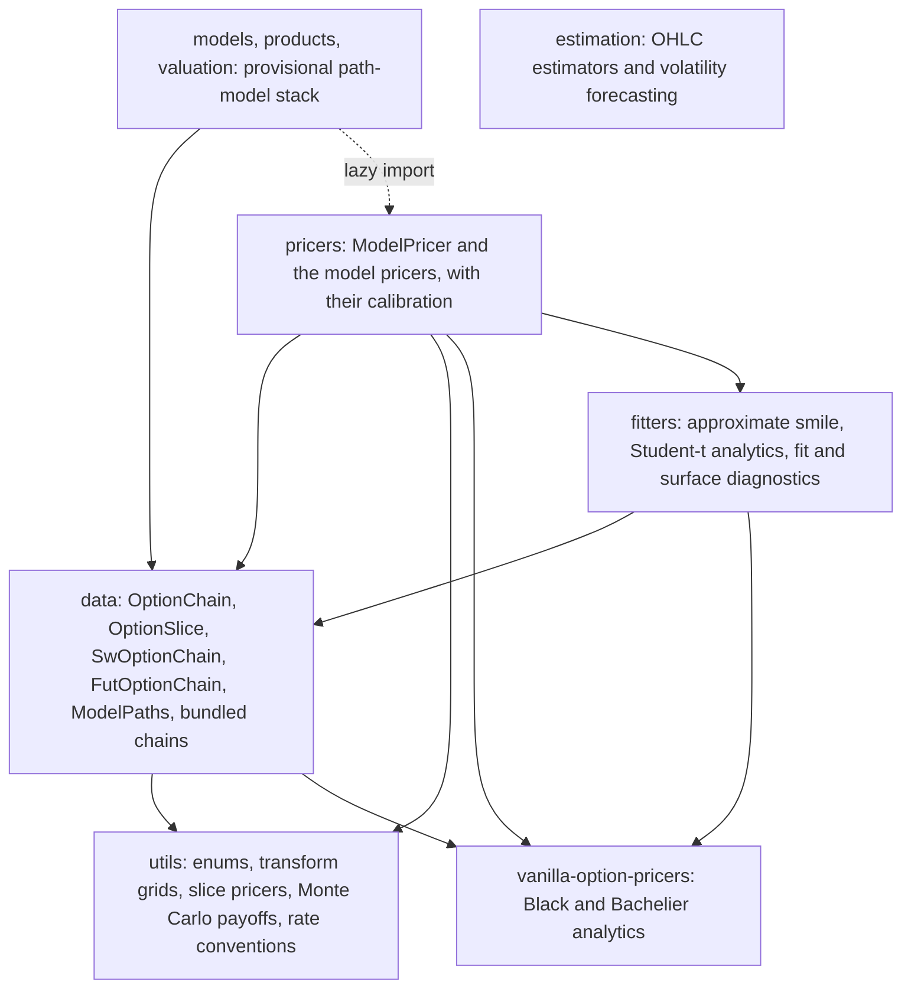

---
myst:
  html_meta:
    description: >-
      The software design of stochvolmodels: the module layers, the ModelPricer interface, the
      analytic transform and Monte Carlo paths, the numba boundary and random-number generators,
      the stability tiers, the dependency surface, and the models that have no article yet.
---

# Software design

*Author: [Artur Sepp](https://github.com/ArturSepp) / First recorded: [2026-09-27](https://github.com/ArturSepp/StochVolModels/commit/701a5ce4f2a25e39540a916a6ca1512f9a27ab92)*

Implemented in [stochvolmodels](https://github.com/ArturSepp/StochVolModels).
Software citation: [CITATION.cff](https://github.com/ArturSepp/StochVolModels/blob/main/CITATION.cff).

This page describes how the package is organised: which layer owns what, the interface every
pricer implements, how a price is computed by transform and by simulation, where compiled numba
code begins, which names are stable, and what the package depends on. The
[notation and conventions](option_chains_and_conventions.md) page defines the units and the
stability tiers; the [API reference](api.md) lists the names by the page that explains them.

## Layers

In words: arrows point from a layer to the layers it imports. The utilities import nothing else
from the package. The data containers use the utilities and delegate Black-Scholes and Bachelier
analytics to `vanilla-option-pricers`. The pricers build on both, and each pricer carries its own
calibration method; there is no separate calibration package. The provisional path-model stack
shares only the containers with the pricers and imports the LogSV and Heston kernels lazily, so
importing it compiles no numba code. The estimation suite stands alone.

| Layer | Modules | Role |
|---|---|---|
| Utilities | `utils/config.py`, `funcs.py`, `mgf_pricer.py`, `mc_payoffs.py`, `var_swap_pricer.py`, `rate_core.py`, `plots.py` | `OptionType` and `VariableType`; time grids and seeding; transform grids and Fourier slice pricers; Monte Carlo payoffs; the model-free variance-swap strike; rate conventions; plotting helpers |
| Data | `data/option_chain.py`, `model_paths.py`, `sample_option_chains.py`, `fetch_option_chain.py` | Option-chain containers per maturity, the validated path payload, the bundled chains, optional loaders from data providers |
| Pricers | `pricers/model_pricer.py`, `logsv_pricer.py`, `logsv/`, `heston_pricer.py`, `hawkes_jd_pricer.py`, `gmm_pricer.py`, `tdist_pricer.py`, `regime_switch_logsv_pricer.py`, `rough_logsv/`, `factor_hjm/` | The pricer interface and the models; the affine expansion and moment equations of the log-normal SV model |
| Fitters | `fitters/logsv_smile.py`, `tdist.py`, `diagnostics.py`, `surface_checks.py`, `adapters/` | The [approximate smile fitter](logsv_smile_fitter.md), Student-t analytics, fit/surface checks, native quote scales and optional OCA handoff |
| Path models | `models/`, `products/`, `valuation.py` | Protocols for path, transform and terminal models; payoffs; path valuation with explicit measure and weights |
| Estimation | `estimation/` | OHLC variance estimators, realized-volatility targets, forecasting models and walk-forward evaluation |

Two couplings cross this picture: the log-normal SV parameters import the rough-kernel module to
approximate kernels when $H < 1/2$, and the regime-switching pricer imports the regime models of
the provisional stack.

### Generic finite-difference solvers

The provisional `stochvolmodels.pde_solvers` module in the 2.7.0 source and distribution
provides `PDE1DSolver` for theta stepping and `PDE2DADISolver` for Douglas, Craig–Sneyd
and Hundsdorfer–Verwer ADI. Import them directly from this module. The caller supplies the
model coefficients, grid and terminal value or initial density. A pricer owns payoff units and
discounting conventions.

Pass `solve(grid, coefficient_provider, boundaries, direction, time_grid, values)` an
increasing grid of calendar times. `PDEDirection.BACKWARD` starts from the final time and
propagates values to the first. `PDEDirection.FORWARD` starts from the first time and
propagates a pointwise density using the quadrature-weighted discrete adjoint.
`grid.project_delta` supplies a point initial condition. The result carries the final array,
per-step diagnostics and any states requested at exact grid times via `save_times`.

In `PDE1DCoefficients` and `PDE2DCoefficients`, each pure second-derivative coefficient
is half the corresponding instantaneous variance. The mixed-derivative coefficient is the
full cross covariance. A deterministic coordinate requires zero cross covariance. A positive
discount coefficient introduces killing into the evolution.

Backward solves accept natural, fixed-value and linear boundary relations. Geometric
extrapolation continues the slope of the two nearest interior nodes at either end of an axis
with at least four nodes. Forward solves support natural boundaries. A natural endpoint
retains mass arriving along that axis at zero discount, so counting its mass as surviving
would affect barrier valuations. The two-dimensional mixed stencil can produce signed
densities. Inspect per-step negative mass as well as total mass and refine the domain, mesh
and time steps for the observable of interest. The module docstring includes a runnable
one-dimensional mass check.

### LogSV vanilla PDE valuation

Import `LogSvPdePricer` from `stochvolmodels.pricers.logsv_pde_pricer`. Calling
`LogSvPdePricer().price_chain(chain, params)` returns one array of quote-currency
prices per expiry, in the input strike order. The model adapter takes a detached
`LogSvModel` parameter snapshot. It supports the money-market measure, $H=1/2$,
a unit price backbone and the martingale condition $\kappa_2 \geq \beta$.

The pricer evolves the undiscounted law of normalized log-forward and volatility
once through the exact chain expiries. At each expiry it evaluates the product
payoff at $F_T \exp(X_T)$ and multiplies the expectation by $D_T$. The method
accepts ordinary C/P contracts. Use `price_chain_detailed` to inspect the package
Black IVs and `invalid_iv` masks alongside the raw prices. Each expiry reports
mass, normalized forward (target one), negative mass and the largest discounted
put–call parity error relative to the market forward. `steps` and
`peak_negative_mass` also capture signed densities between expiries.

The default spatial mesh and 128 Douglas steps per expiry interval are starting
values. Supply `grid`, `steps_per_interval` and `adi` to vary domain, spacing and
time resolution independently. Check the wings against quote spreads and check the
forward moment under refinement. The IJTAF replication includes a runnable
fixed-parameter [comparison](https://github.com/ArturSepp/StochVolModels/tree/main/papers/logsv_model_with_quadratic_drift_ijtaf_2023/replication/verification).

### Deterministic local volatility

The provisional `LocalVolSurface` stores annualized volatility. Each row applies
through its maturity, including the right endpoint. Subsequent times use the last
row. Volatility interpolates linearly between spatial nodes and stays constant
beyond either end. `from_parametric_slices` samples the flat, skew, smile, product
and wing formulas on a supplied log-forward grid.

The default coordinate is normalized log-forward, $X=\log(S/F)$. Its drift
is minus half the local variance. Each expiry uses its
own market forward to convert grid points to spot. `CoordinateSystem.LEVEL`
instead uses absolute asset prices with zero drift and a constant forward
across expiries. Both apply the supplied discount once at payoff projection.
The pricing grid may differ from the surface interpolation grid.

`price_chain(chain, surface)` returns one array of quote-currency premiums per expiry.
The 1D theta solver splits at every interior bucket end and quoted maturity, carries
the undiscounted density between them, and uses the package's ordinary C/P payoffs.
`price_chain_detailed` adds Black IVs and inversion failure masks, expiry mass and
negative mass, the forward moment divided by the market forward, the largest absolute
discounted market parity error, and the peak negative mass across all steps.
Refine the grid, boundaries and steps for the time horizon and strikes of interest.
The pricer's module docstring includes an executable two-bucket pricing example.

### Continuous Dupire inversion

`stochvolmodels.fitters.dupire.CallSurface` takes discounted European call premiums
on a common grid of absolute strikes, maturities in years, and one forward and
discount factor per maturity. Both curves default to one for normalized calls.
`DupireRecoverer().continuous(surface)` differentiates the quotes at fixed strike.
With forward growth $b=\partial_T \log F$, short rate $r=-\partial_T \log D$ and
$q=r-b$, the recovered annualized variance is $(C_T+qC+bK C_K)/(K^2 C_{KK}/2)$.

Inspect `raw_local_variance`, the two terms of the ratio, and `valid_mask`.
Both terms must exceed their tolerances. The outer time rows and strike columns
use one-sided stencils and are flagged by the complement of `interior_mask`.
An explicit `DupireRepairPolicy` replaces invalid estimates by its variance floor
and clips valid estimates to its bounds. The result retains every raw estimate
and marks each adjustment in `repaired_mask`. These bounds act on local variance. The original quoted premiums stay available on the result.

`result.to_local_vol_surface()` requires positive finite volatility at every node
and explicit repair of any invalid estimates. For each row it transforms the
strikes to $\log(K/F_T)$ and linearly interpolates volatility, with flat wings.
The default output grid uses the first maturity's log-forward nodes. A supplied
`Grid1D` can specify a different common grid. The PDE pricer uses these
instantaneous estimates as bucket values through their respective maturities,
so repricing can differ from the input calls. The fitter's module docstring
contains an executable Black-surface recovery and put-pricing example.

### Conditional variance and leverage

`LSVModel.from_params(params, leverage_surface)` snapshots the Markovian
LogSV parameters and optional return backbone. Under the money-market measure
the return diffusion is $\eta(t)L(t,x)\sigma$, with $x=\log(S/F)$ and volatility
level $\sigma$. The mixed derivative carries one factor of leverage, and the
log-forward variance and drift carry its square. Volatility dynamics retain their
original coefficients. Pricing applies the sufficient bound
$\kappa_2\geq\beta\eta L$ on each active leverage row for positive $\beta$.
Rows are constant through their inclusive maturity and interpolate linearly
in log-forward space with either flat wings or an explicit extrapolation error.

`SequentialLSVProjector(grid).project(params, local_vol)` starts from a point
mass at $(0,\sigma_0)$. It advances each interval with the previous leverage row
and computes $m(x)=E[\sigma^2\mid X=x]$ from the terminal joint density using
the volatility-axis quadrature weights. The new row targets
$L=\sigma_{LV}/(\eta\sqrt{m})$. Low-marginal and invalid-moment masks identify
unreliable nodes. The historical fill policy linearly fills interior gaps by node
index and extends the nearest valid endpoint into each wing. Alternatively
`LowDensityPolicy.RAISE` rejects a missing moment. Variance estimates, raw
leverage, extrapolation and cap masks, and the damped updates are inspectable.

Every density used to update leverage must satisfy the configured unit-mass
and integrated-negative-mass tolerances. Slice diagnostics retain each ADI
substep, including transient negative mass between projections. Repricing
with `LogSvPdePricer().price_chain(chain, result.model)` starts a fresh
propagation with the recovered rows. It splits at leverage and backbone knots
as well as quoted maturities and discounts each vanilla in its quote currency.
The projection module docstring includes an executable recovery and pricing example.

### Fixed-point leverage calibration

`LSVFixedPointCalibrator(grid, config).calibrate(params, target_local_vol)` holds
LogSV dynamics fixed and fits one leverage row per positive target maturity.
It begins at the point mass $(0,\sigma_0)$. Every trial in an interval starts from
the same last accepted density. The solver propagates the candidate row $c$, checks
the terminal density against the projection mass limits and computes a bounded
proposal $b$ from its conditional variance. A trial converges when every log-forward
node satisfies $|b-c|\leq a+r\max(|b|,|c|)$, with absolute tolerance $a$ and
relative tolerance $r$. A retry uses $(1-d)c+d b$ for damping weight $d$.
Nodes affected by the density floor or leverage bounds participate in the test.

The converged candidate and its own terminal law carry into the next interval.
`result.model` can be repriced from time zero with `LogSvPdePricer`.
`result.slices[i].iterations` retains each trial's residuals, leverage update,
conditional moments, endpoint density and substep diagnostics.
`LSVConvergenceError` reports the failed interval and its trial history at the
iteration limit. An unusable density raises a validation error at that trial.
Convergence measures the leverage equation on the chosen grid. Vanilla repricing
against the local-volatility target measures a separate price error.
The fitter module docstring includes an executable two-maturity example.

### Parametric leverage calibration

`stochvolmodels.fitters.lsv_parametric.LSVParametricCalibrator` holds LogSV dynamics
fixed and fits a leverage formula per expiry. Supply an `ImpliedVolCalibrationTarget`
on common strikes and a log-forward `LocalVolSurface` at the same dates. For a
market with different forwards or discounts, express strikes as K/F and use a unit
forward and discount on the common grid. Reprice the fitted model on the original
`OptionChain` to obtain premiums in quote currency.

The fitter prefits the local-volatility rows, scales the starts by the backbone and
initial volatility, then minimizes squared Black IV errors with unit-sum weights.
`LSVParametricCalibrationConfig` selects a flat, skew, smile, product or wing formula
and uniform, Black vega or historical ATM weights. `initial_parameters` can supply
a bounded start for each expiry. Every trial starts from the preceding accepted law.
The final replay at the optimizer's parameters supplies the next starting density.
The fitter checks total and negative mass at each density used to compute a price.

`result.parameter_names` names the columns of `result.parameter_values`. Each slice
records its prefit, optimizer start, solver work, weighted IV residuals and accepted
terminal law. `LogSvPdePricer` interpolates the model's bounded leverage rows when
repricing on a finer grid. Its `steps_per_interval` accepts one positive integer or
one count per expiry. Each internal backbone or leverage knot receives that interval's
count. Assess market spread coverage and independent prices when interpreting a fit.

In the frozen BTC replay of 21 October 2021, the product-family fit puts 35 of 44
common-grid IVs inside bid–ask. One trial at the third expiry has negative mass
of `2.59e-5`. Reproducing the fit requires a trial limit of at least that size.
The baseline replay uses `3e-5` during fitting and retains the historical `2e-5`
fine-grid acceptance limit. To reproduce the adverse fit through all four dates,
the stress replay allows up to `1.5e-4` trial negative mass. It reaches optimizer
convergence with 12 of 44 IVs inside bid–ask and fails the fine-grid negative-mass,
target-IV and independent Monte Carlo IV checks.

### Model, pricer, product and data ownership

The directory names reflect two stages of development. The original `pricers/` modules bundle
parameters, stochastic dynamics, transforms, simulation, pricing and calibration. The later
`models/` layer exposes reusable capabilities independently of an option chain. Heston's earlier
absence from `models/` was an incomplete adapter migration; Heston pricing itself was supported.
`models.heston.HestonModel` now exposes both `PathModel` and `TransformModel` while preserving
the existing `HestonParams` and `HestonPricer` import paths.

Use the following ownership rules for new implementations:

| Layer | Owns | Consumes and returns |
|---|---|---|
| `models` | Parameters bound to a stochastic law, measure conventions, state evolution, and available transforms or terminal laws | A simulation request returns `ModelPaths`; a transform request returns a numerical transform grid. A model need not provide capabilities its mathematics does not support. |
| `products` | Contract terms, required assets or states, expiry, payoff and settlement units | Paths become one undiscounted payoff per path. Products do not choose simulation schemes or fit quotes. |
| `pricers` and `valuation` | Numerical integration or Monte Carlo estimation, deterministic discounting, pricing conventions and implied-volatility conversion | Model outputs and contracts become prices and standard errors. The legacy pricers retain their calibration entry points. |
| `fitters` | Approximate smile fitting and fit/surface diagnostics | Observed quotes and model evaluations become fit results or diagnostic reports; provider adapters remain optional. |
| `data` | Market observations, quote conventions, maturity and strike axes, and shared numerical payloads | `OptionChain` holds quotes; `ModelPaths` holds simulated state. Data containers do not define stochastic dynamics. |
| `estimation` | Historical volatility estimates, forecasts and point-in-time validation | Time series become estimates and forecasts; risk-neutral calibration remains a separate task. |

The target dependency direction is pricing/valuation to model capabilities, products and data.
For compatibility, existing model adapters may lazily call a numerical kernel still located in
`pricers/`; this is a documented transition, not a second implementation of the same dynamics.
Moving all historical parameters and kernels would be a separate migration with compatibility
re-exports. The presence of a model does not imply that every product or pricing method is
supported: capability and measure checks define valid combinations.

`HestonModel` paths use `Q_MMA`, a money-market-account numeraire and a zero-drift asset.
They record `variance` in annualized variance units, `sigma` in annualized volatility units,
and `quadratic_variance` as integrated variance. Annualization of the last quantity belongs to
the product's explicit quote convention. The adapter preserves the legacy Euler floor of
`1e-4`, uses a local seeded generator, and reports the observation partition and scheme.
The floor introduces discretization bias near zero variance, including the degenerate
zero-variance process; the exact transform does not apply that numerical floor.
Its transform is `log E[exp(-phi * X - psi * I)]`, where `X` is the log return and `I` is
integrated variance. The path adapter supports only `Q_MMA`; it does not infer an inverse measure,
insert a forward curve, discount a payoff, or recenter simulated prices.
Ordinary transform grids reuse the legacy closed form. Near very small volatility of variance,
repeated Riccati roots or cancellation, the adapter integrates the same Riccati equations
adaptively; exact zero forcing and deterministic-variance limits are handled explicitly.

These rules are exercised by the capability, Heston, path-valuation, option-chain and volatility
data consistency tests. Fitter annotations and explanatory module headers are checked by
`scripts/check_fitter_contracts.py` in the static CI job. The
[numerical import convention](contributing.md#numerical-imports) uses NumPy for elementary
operations and `scipy.special` for special functions, including exact integer combinations.
Ruff rejects `math` and `cmath` imports by default; explicit import-line exceptions retain
`math.erf` in the Numba kernel and `math.fsum` for accurate valuation sums.

### Diagnostic and research boundaries

Packaged diagnostics observe supplied data and model outputs; they do not select a fit,
repair a quote, infer a price unit or choose an acceptance threshold. The
[native quote adapter](surface_diagnostics.md#native-quote-scales-and-admissible-perturbations)
computes scales and conditional price-bound intervals from explicit ticks and bounds.
`diagnose_fit` consumes aligned scales while preserving unavailable normalized errors and
their raw residuals. `DiagnosticReport` snapshots evidence; it is separate from
`OptionChain` observations and `ModelPaths` simulated states.

The [repository research utilities](examples.md#research-diagnostics) combine reports, replay
saved evidence, generate paired synthetic challenges and verify frozen studies. They live
under `examples/calibration`, with tests in source CI, and are excluded from the installed
wheel. Their noise scenarios and caller-supplied statistical limits do not become production
warning policies. Historical session archives and the private LSV calibration experiments are outside
these maintained public interfaces.

## The pricer interface

`ModelPricer` (`pricers/model_pricer.py`) has one abstract method, `price_chain(option_chain,
params)`, which returns option prices slice by slice. Everything else is built on it:

- `compute_chain_prices_with_vols` and `compute_model_ivols_for_chain` invert the prices to
  Black-Scholes implied volatilities through the chain;
- `price_slice` and `price_vanilla` wrap one maturity or one option in a chain;
- the `plot_*` methods draw model smiles against quotes or Monte Carlo.

`model_mc_price_chain`, `simulate_terminal_values`, `simulate_vol_paths` and
`calibrate_model_params_to_chain` raise `NotImplementedError` unless a pricer implements them;
`compute_mc_chain_implied_vols` turns Monte Carlo prices and standard errors into implied
volatilities with 95% bounds. Parameters are dataclasses deriving from `ModelParams`.
`validate_optimization_result` raises `CalibrationError` when an optimizer fails or returns values
outside its bounds.

| Pricer | Analytic prices | Monte Carlo | Calibration |
|---|---|---|---|
| `LogSVPricer` | Affine expansion of the MGF, Fourier inversion | Numba simulation; fixed random numbers; rough extension | Analytic, Monte Carlo and rough engines, validated |
| `HestonPricer` | Closed-form MGF, Fourier inversion | Numba simulation | Five parameters with the Feller constraint, validated |
| `HawkesJDPricer` | Riccati equations of the MGF, Fourier inversion | NumPy simulation | Eight parameters; the optimizer result is not validated |
| `GmmPricer`, `TdistPricer` | Closed-form mixtures and Student-t prices | None | Per maturity, validated |
| `RegimeSwitchLogSVPricer` | Regime-switching MGF, Fourier inversion | NumPy simulation | None |
| `RateLogSVPricer`, `RateFutLogSVPricer` | Double-exponential quadrature of the drift-frozen MGF; they return normal volatilities | Factor simulation | None |

The experimental rate pricers are a legacy exception to `ModelPricer.price_chain`'s price
return contract: their specialized callers consume normal implied volatilities. They must not
be passed through the generic price-to-implied-volatility helpers. Unifying that return
contract requires a separate compatibility migration. Swaption-chain price inversion accepts
annuity-normalized prices and uses Bachelier inversion with a unit discount factor; its arrays
are nested by swap tenor, option expiry, then strike.

## Analytic and Monte Carlo paths

A transform price follows the same steps in every model, shown here for the log-normal SV model:

1. A volatility scale sets the transform grid, $\Phi = -1/2 + i p$ under the money-market-account
   measure or $1/2 + i p$ under the inverse measure, with $p$ on a uniform grid; calibration fixes
   one scale so that the grid does not move with the parameters.
2. The MGF is computed on the grid maturity by maturity, carrying the solution from one maturity
   to the next; for the log-normal SV model the coefficients of the affine expansion come from
   `scipy.integrate.solve_ivp` point by point, or from compiled analytic solutions.
3. `vanilla_slice_pricer_with_mgf_grid` integrates the payoff transform against the MGF with
   Simpson weights; `slice_qvar_pricer_with_a_grid` does the same for options on quadratic
   variance.
4. `OptionChain.compute_model_ivols_from_chain_data` inverts the prices with
   `vanilla-option-pricers`.

A Monte Carlo price simulates the terminal log-price, volatility and quadratic variance from one
maturity to the next and passes them to `compute_mc_vars_payoff`, which re-centres the simulated
prices on the forward, values calls, puts, inverse options and options on quadratic variance, and
returns means and standard errors. The provisional stack instead simulates whole paths into a
`ModelPaths` object and values them with `stochvolmodels.valuation.value_paths`.

## The numba boundary

The transform grids, slice pricers, Monte Carlo payoffs, the Heston and log-normal SV simulators,
the analytic expansion solutions, the mixture pricers and the rough-kernel matrix exponentials are
compiled with numba. Compilation happens on first use, not on import, and is not cached (except in
the rough kernel), so the first price of a session takes seconds (see
[numerical accuracy and performance](numerical_accuracy_and_performance.md)). The adaptive ODE
solves of the affine expansion and of the Hawkes model stay in Python, since `solve_ivp` cannot be
compiled.

`OptionChain` stores its per-maturity strikes, types and quotes as `numba.typed.List` of arrays, so
that a chain passes into compiled code without conversion.

Simulators draw from different generators, and a seed must reach the right one:

| Generator | Simulators | Seed with |
|---|---|---|
| Numba's internal generator | `LogSVPricer.model_mc_price_chain` and `simulate_terminal_values`; `HestonPricer` Monte Carlo | `stochvolmodels.utils.funcs.set_seed` |
| NumPy's global generator | `LogSVPricer.simulate_vol_paths`; `HawkesJDPricer` Monte Carlo; factor HJM simulators, which reseed it themselves | `numpy.random.seed` |
| A local generator from a seed argument | Fixed-random chain valuation and calibration; the rough extension; `LogSvModel.simulate_paths`; the regime-switching and TGARCH simulators | the function's `seed` |

Importing the package changes no generator state; a test enforces it.

## Stability tiers and exports

The package root resolves names lazily: `import stochvolmodels` loads almost nothing, and each name
is imported on first access. `__all__` holds the stable names; advanced and compatibility names are
importable from the root outside `__all__`; provisional and experimental surfaces are reached by
direct module imports. The tiers are defined in
[notation and conventions](option_chains_and_conventions.md#stability-tiers).

Contract tests fix the surface: `__all__` equals the recorded stable list, every stable name has a
docstring and appears in the API reference, the re-exports of `vanilla-option-pricers` are the same
objects, the historical root names keep their identity, a fresh import of the package loads no
numerical or plotting module, and the provisional protocols import neither numba nor pandas.

## Dependency surface

The core depends on `vanilla-option-pricers`, numba, NumPy, SciPy, pandas, matplotlib and seaborn,
and supports Python 3.11 to 3.14. Optional extras add the research stack (`qis` and
OptionChainAnalytics, used by the paper directories and the data loaders), plotly, scikit-learn and
statsmodels, Jupyter, and the documentation tools. Ruff bans module-level imports of the optional
packages and any import of the sibling packages of the author's other libraries;
`scripts/check_dependency_boundaries.py` checks that no provider package enters the core or test
requirements, and a test checks that importing the package loads none of them. The data loaders and
the OptionChainAnalytics adapter import their providers inside functions or behind `ImportError`
guards.

## Models without an article

These surfaces are in the package and tested, but no public paper maps to them yet, so they have
no article; the [API reference](api.md#provisional-and-experimental-surfaces) lists them.

| Surface | Tier | Modules | Entry points |
|---|---|---|---|
| Regime-switching log-normal SV: two regimes with equilibrium risk premia and transition jumps | Provisional | `models/regime_logsv.py`, `models/regime_logsv_simulation.py`, `pricers/regime_switch_logsv_pricer.py` | `RegimeSwitchLogSvParams`, `solve_regime_switch_equilibrium`, `RegimeSwitchLogSVPricer` |
| Rough log-normal SV: Hurst exponent below 1/2 by a multi-exponential kernel, Monte Carlo only | Experimental | `pricers/rough_logsv/` | `LogSvParams(H=...)`, `approximate_kernel`, `LogSVPricer.model_mc_price_chain(use_rough_mc=True)`; see [Monte Carlo simulation](monte_carlo_simulation.md#the-rough-extension) |
| TGARCH: a discrete threshold-volatility recursion, not a discretisation of the log-normal SV model | Provisional | `models/tgarch.py` | `TgarchParams`, `TgarchModel.simulate_paths` |
| Inverse-gamma normal terminal law: one maturity, a normal variance-mean mixture | Provisional | `models/inverse_gamma_normal.py` | `InverseGammaNormalTerminalModel` |
| Estimation suite: OHLC variance estimators, realized-volatility targets, forecasting models | Documented with the provisional surfaces | `estimation/` | `estimate_ohlc_var`, `fit_volatility_forecaster`, `walk_forward_volatility_forecast` |

## Settings and paths

`stochvolmodels.local_path` reads an optional `settings.yaml` next to the package with two keys,
`RESOURCE_PATH` and `OUTPUT_PATH`; without it, a source checkout uses its `resources/` and `outputs/`
directories. `settings.yaml.example` is the template; the settings file itself is machine-local,
ignored by Git and kept out of every distribution. Only the plotting helpers and the data loaders
use these paths.

## See also

- [Notation and conventions](option_chains_and_conventions.md)
- [API reference](api.md)
- [Testing and coverage](testing_and_coverage.md)
- [Numerical accuracy and performance](numerical_accuracy_and_performance.md)
