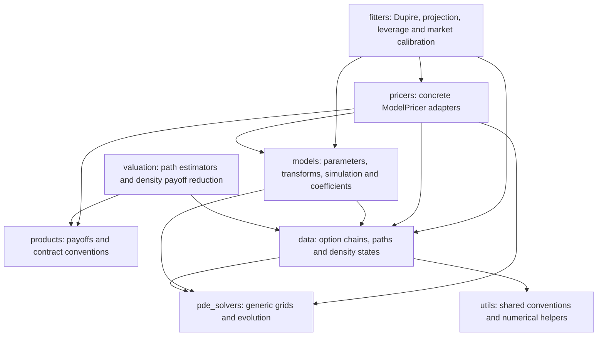

---
myst:
  html_meta:
    description: >-
      The software design of stochvolmodels: the module layers, the ModelPricer interface, the
      analytic transform and Monte Carlo paths, the numba boundary and random-number generators,
      the stability tiers, the dependency surface, and the models that have no article yet.
---

# Software design

*Author: [Artur Sepp](https://github.com/ArturSepp) / First recorded: [2026-09-27](https://github.com/ArturSepp/StochVolModels/commit/701a5ce4f2a25e39540a916a6ca1512f9a27ab92)*

Implemented in [stochvolmodels](https://github.com/ArturSepp/StochVolModels).
Software citation: [CITATION.cff](https://github.com/ArturSepp/StochVolModels/blob/main/CITATION.cff).

This page describes how the package is organised: which layer owns what, the interface every
pricer implements, how a price is computed by transform and by simulation, where compiled numba
code begins, which names are stable, and what the package depends on. The
[notation and conventions](option_chains_and_conventions.md) page defines the units and the
stability tiers; the [API reference](api.md) lists the names by the page that explains them.

## Layers

Models own parameter definitions and model-specific transforms, simulation and propagation.
Generic solvers evolve arrays without knowing a financial model, market quotes or payoffs.
Products define contracts; pricers adapt a model to option-chain prices and implied volatilities.
The existing `valuation.py` integrates payoffs from paths or density states. Fitters recover
surfaces and parameters and use pricers for independent repricing and acceptance checks.

Canonical model implementations do not import pricers. Heston kernels remain lazy in its
capability adapter. Rough parameters and numerical controls are lazy exports from
`models.rough_logsv`; the concrete `RoughLogSVPricer` stays in `pricers.rough_logsv_pricer`.
Package-root names retain their existing lazy mappings and compatibility surface.

Substantial models are organized by family. Each package initializer exposes model and
parameter definitions lazily; `params.py` owns parameterization and `model.py` implements
capabilities where a model adapter exists. Model-specific moments, transforms, simulation,
equilibrium calculations and coefficient adapters live beside those definitions. Small cohesive
models remain single modules. Reusable discretization and linear algebra stay in `pde_solvers/`
and existing utilities.

For LogSV, `models.logsv.moments` owns volatility moments and expected quadratic variance;
`fitters.logsv_backbone` owns calibration to variance-swap quotes. Existing `LogSvParams`
methods delegate grid construction, moment-generator calculations and rough-kernel approximation
to family modules, preserving their signatures and state updates. Import PDE coefficients from
`models.logsv.coefficients` and Monte Carlo engines from the corresponding family's `simulation` module.

| Layer | Canonical modules | Responsibility |
|---|---|---|
| Numerical solvers | `pde_solvers/` | Generic grids, theta/ADI evolution, jump operators, boundaries and diagnostics |
| Models | `models/base.py`, `heston/`, `logsv/`, `rough_logsv/`, `regime_logsv/`, `tgarch/`, `hawkes_jd/`, `tdist/`, `gmm.py` | Parameters, model-specific transforms, terminal laws, moments and simulation |
| Coefficient adapters | `models/lsv/local_vol.py`, `models/logsv/coefficients.py`, `models/lsv/` | Local volatility, leverage, PDE coefficients and propagation under a supplied model |
| Products and valuation | `products/`, `valuation.py` | Contract payoffs, path estimators and density integration |
| Pricers | `pricers/model_pricer.py` and concrete pricer modules | Option-chain pricing, implied volatilities and existing calibration/plot entry points |
| Fitters | `fitters/logsv_backbone.py`, `lsv_projection.py`, `dupire.py`, `lsv_fixed_point.py`, `lsv_parametric.py`, `lsv_market_pipeline.py` and smile fitters | Conditional-moment projection, surface inversion, calibration and acceptance |
| Data | `data/option_chain.py`, `model_paths.py`, `density.py` | Quote, path and density payloads; density states may depend on generic grids |
| Utilities | `utils/` | Shared enums, including `CoordinateSystem`, numerical integration, array validation and plotting |
| Estimation | `estimation/` | Historical variance estimates, forecasts and point-in-time evaluation |

The separation retains deliberate exceptions. Calibration and plotting methods remain on
`ModelPricer` and its adapters. `GmmTerminalModel` and `TdistTerminalModel` stay in their pricer
modules because their pricing capabilities call concrete pricers. Student-t distribution
mathematics lives in `models.tdist.distribution`; vanilla pricing and inversion live in
`pricers.tdist.analytics`. Deep factor-HJM splitting and remaining
chain/terminal simulation wrappers are deferred. The optional `data.fetch_option_chain` adapter
still uses a fitter-side provider adapter. Development runners may compose models and pricers.

The rough-logSV pricer package exports its model parameters, numerical controls and pricing
adapter. Import the underlying numerical functions from `models.rough_logsv` and the LSV
projector from `fitters.lsv_projection`. `LogSvModel`
retains its established public serialization identity; other moved definitions use their
canonical implementation modules for new objects.
A moved function resolves its globals in its canonical module, so code that patches private
implementation globals must target that module. Existing calibration optimizer hooks remain
in the pricer modules. The compatibility variance-swap fitter retains its patchable
quadratic-variance hook and delegates the bootstrap to `fitters.logsv_backbone`. No kernel
equations, numerical settings, random-stream conventions or regression fixtures change as
part of this separation.

### Generic finite-difference solvers

For executable examples, coefficient conventions and refinement measurements, see the
[PDE solver guide](pde_solvers.md) and [local-volatility and LSV guide](local_volatility_and_lsv.md).

The provisional `stochvolmodels.pde_solvers` module, first published in
[2.18.0](https://pypi.org/project/stochvolmodels/2.18.0/),
provides `PDE1DSolver` for theta stepping and `PDE2DADISolver` for Douglas, Craig–Sneyd
and Hundsdorfer–Verwer ADI. Import them directly from this module. The caller supplies the
model coefficients, grid and terminal value or initial density. A pricer owns payoff units and
discounting conventions.

Pass `solve(grid, coefficient_provider, boundaries, direction, time_grid, values)` an
increasing grid of calendar times. `PDEDirection.BACKWARD` starts from the final time and
propagates values to the first. `PDEDirection.FORWARD` starts from the first time and
propagates a pointwise density using the quadrature-weighted discrete adjoint.
`grid.project_delta` supplies a point initial condition. The result carries the final array,
per-step diagnostics and any states requested at exact grid times via `save_times`.

In `PDE1DCoefficients` and `PDE2DCoefficients`, each pure second-derivative coefficient
is half the corresponding instantaneous variance. The mixed-derivative coefficient is the
full cross covariance. A deterministic coordinate requires zero cross covariance. A positive
discount coefficient introduces killing into the evolution.

Backward solves accept natural, fixed-value and linear boundary relations. Geometric
extrapolation continues the slope of the two nearest interior nodes at either end of an axis
with at least four nodes. Forward solves support natural boundaries. A natural endpoint
retains mass arriving along that axis at zero discount, so counting its mass as surviving
would affect barrier valuations. The two-dimensional mixed stencil can produce signed
densities. Inspect per-step negative mass as well as total mass and refine the domain, mesh
and time steps for the observable of interest. The module docstring includes a runnable
one-dimensional mass check.

### LogSV vanilla PDE valuation

Import `LogSvPdePricer` from `stochvolmodels.pricers.logsv_pde_pricer`. Calling
`LogSvPdePricer().price_chain(chain, params)` returns one array of quote-currency
prices per expiry, in the input strike order. The model adapter takes a detached
`LogSvModel` parameter snapshot. It supports the money-market measure, $H=1/2$,
a unit price backbone and the martingale condition $\kappa_2 \geq \beta$.
For a nonempty `params.vol_backbone`, import `LSVModel` from `stochvolmodels.models.lsv`
and pass `LSVModel.from_params(params)` to the same pricer. This adapter preserves the
term structure and splits propagation at every loading knot. `LogSVPricer` is the existing
transform pricer; `LogSvPdePricer` is the opt-in density pricer. Their distinct capitalization
is part of the existing import API.

The pricer evolves the undiscounted law of normalized log-forward and volatility
once through the exact chain expiries. At each expiry it evaluates the product
payoff at $F_T \exp(X_T)$ and multiplies the expectation by $D_T$. The method
accepts ordinary C/P contracts. Use `price_chain_detailed` to inspect the package
Black IVs and `invalid_iv` masks alongside the raw prices. Each expiry reports
mass, normalized forward (target one), negative mass and the largest discounted
put–call parity error relative to the market forward. `steps` and
`peak_negative_mass` also capture signed densities between expiries.

Each expiry's `boundary_mass` measures occupancy of the outermost grid nodes under the
undiscounted law. `x_lower` and `x_upper` refer to log-forward, and `y_lower` and
`y_upper` to volatility. Each side sums signed nodal density times the same tensor
quadrature weights used for payoff pricing. Each corner belongs to both adjoining sides.
Use `signed_total` for the net mass on the perimeter and `absolute_total` for the sum
of absolute nodal masses there. Both totals count each corner once. Substantial
occupancy can coexist with unit total mass and a forward moment close to one.

The default mesh concentrates log-forward nodes around zero on the volatility scale of
its shortest expiry. With an LSV backbone or leverage surface, the central spacing uses the
largest return loading through that first expiry. The largest loading over the full chain,
the longest expiry, all quoted strikes and any jump tails determine
the domain width. A single expiry uses 121 log-forward nodes. For mixed expiries the number
of nodes grows with the width in sinh coordinates to preserve the central resolution. The
1w/1m/3m/1y flat 20% chain uses 207 log-forward nodes. The default time partition uses
128 Douglas steps per uninterrupted bucket. From the initial point mass to the first
expiry, backbone or leverage knot (whichever comes first), step $j$ of $N$ ends at
$T_1(j/N)^2$. Subsequent buckets use equal time steps. This reduces the early signed
density produced by the mixed derivative. At a fixed step count the longer steps near
the end of the first bucket can increase vanilla time-discretization error. Refine the
step count when comparing prices. Supply `quadratic_start=False` for uniform stepping.
Supply `grid`, `steps_per_interval` and `adi` to vary domain, spacing and time resolution
independently. Check the wings against quote spreads and check the
forward moment under refinement. The IJTAF replication includes a runnable
fixed-parameter [comparison](https://github.com/ArturSepp/StochVolModels/tree/main/papers/logsv_model_with_quadratic_drift_ijtaf_2023/replication/verification).

### Deterministic local volatility

The provisional `LocalVolSurface` stores annualized volatility. Each row applies
through its maturity, including the right endpoint. Subsequent times use the last
row. Volatility interpolates linearly between spatial nodes and stays constant
beyond either end. `from_parametric_slices` samples the flat, skew, smile, product
and wing formulas on a supplied log-forward grid.

The default coordinate is normalized log-forward, $X=\log(S/F)$. Its drift
is minus half the local variance. Each expiry uses its
own market forward to convert grid points to spot. `CoordinateSystem.LEVEL`
instead uses absolute asset prices with zero drift and a constant forward
across expiries. Both apply the supplied discount once at payoff projection.
The pricing grid may differ from the surface interpolation grid.

`price_chain(chain, surface)` returns one array of quote-currency premiums per expiry.
The 1D theta solver splits at every interior bucket end and quoted maturity, carries
the undiscounted density between them, and uses the package's ordinary C/P payoffs.
`price_chain_detailed` adds Black IVs and inversion failure masks, expiry mass and
negative mass, the forward moment divided by the market forward, the largest absolute
discounted market parity error, and the peak negative mass across all steps.
The expiry's `boundary_mass.x_lower` and `x_upper` give the signed, quadrature-weighted
mass at the two price endpoints in the chosen coordinate. `signed_total` adds them and
`absolute_total` adds their magnitudes. Barrier survival uses the barrier contract's
own monitoring and payoff rules.
Refine the grid, boundaries and steps for the time horizon and strikes of interest.
The pricer's module docstring includes an executable two-bucket pricing example.

The local-volatility pricer defaults to a Rannacher start (`theta=None`). Two implicit
Euler half-steps replace the first nominal step of each interval between quotes
or volatility knots. Crank–Nicolson advances the remaining steps of that interval.
At 128 nominal steps this takes 129 solves per interval. Damping restarts because
a change in the volatility or step length can create oscillations in the carried
density. With 10% volatility for one day followed by 50% through one year, the
peak negative mass was 0.322 when damping only at time zero and zero with the
restart (401 nodes, 128 nominal steps per bucket).
A numeric `theta` applies to every step. Use `theta=1.0` to replay historical
implicit Euler prices or `theta=0.5` for undamped Crank–Nicolson.
`result.steps` gives each accepted step's times, raw mass and negative mass.

The following one-week example uses flat 20% volatility, forward 100, discount 0.97,
401 concentrated log-forward nodes over eight standard deviations on each side, and 128
nominal steps. The strikes have log-moneyness of −2.5, 0 and +2.5 standard deviations.
Entries are signed errors against exact Black implied volatility in bp. Peak negative
mass is the integral of the negative part in magnitude, maximized over all steps.

| Initial steps and continuation | Put wing | ATM call | Call wing | Peak negative mass |
|---|---:|---:|---:|---:|
| Implicit Euler throughout | +10.433 | −2.025 | +10.439 | 0 |
| Crank–Nicolson throughout | +0.406 | −0.075 | +0.413 | 0.68968 |
| Two implicit half-steps, then Crank–Nicolson | +0.446 | −0.076 | +0.453 | 0 |
| Four implicit half-steps, then Crank–Nicolson | +0.486 | −0.084 | +0.493 | 0 |

For the same strikes at one year, the maximum absolute premium error due to time
stepping alone was measured against the matrix exponential of the fixed 401-node
spatial generator. Errors are in bp of discounted forward.

| Nominal steps | Implicit Euler | Crank–Nicolson | Two half-steps, then Crank–Nicolson |
|---:|---:|---:|---:|
| 32 | 3.1261 | 4.1751 | 0.023218 |
| 64 | 1.5646 | 0.6364 | 0.005949 |
| 128 | 0.7827 | 0.001288 | 0.001532 |
| 256 | 0.3915 | 0.000381 | 0.000384 |

Spatial resolution still affects the wings. At 512 nominal steps the maximum Black
IV error of the damped scheme was 6.808, 1.646, 0.429 and 0.105 bp on 101, 201, 401
and 801 nodes respectively.

### Continuous Dupire inversion

`stochvolmodels.fitters.dupire.CallSurface` takes discounted European call premiums
on a common grid of absolute strikes, maturities in years, and one forward and
discount factor per maturity. Both curves default to one for normalized calls.
`DupireRecoverer().continuous(surface)` differentiates the quotes at fixed strike.
With forward growth $b=\partial_T \log F$, short rate $r=-\partial_T \log D$ and
$q=r-b$, the recovered annualized variance is $(C_T+qC+bK C_K)/(K^2 C_{KK}/2)$.

Inspect `raw_local_variance`, the two terms of the ratio, and `valid_mask`.
Both terms must exceed their tolerances. The outer time rows and strike columns
use one-sided stencils and are flagged by the complement of `interior_mask`.
An explicit `DupireRepairPolicy` replaces invalid estimates by its variance floor
and clips valid estimates to its bounds. The result retains every raw estimate
and marks each adjustment in `repaired_mask`. These bounds act on local variance. The original quoted premiums stay available on the result.

`result.to_local_vol_surface()` requires positive finite volatility at every node
and explicit repair of any invalid estimates. A pricing row holds from the previous expiry
through its own expiry. On an unrepaired diffusion-only strip where one Black volatility
prices every strike of each expiry, the annualized bucket variance is
$(w_i-w_{i-1})/(T_i-T_{i-1})$, with $w_i=T_i\sigma_{\mathrm{imp},i}^2$ and $w_0=T_0=0$.
This uses the variance accumulated before the first quote.

For a smile, the first expiry identifies a terminal distribution. To construct a single
local-volatility row for that interval, the converter takes its spatial shape from the first
Dupire variance row. Later shapes average the adjacent instantaneous variances at fixed
$\log(K/F_T)$. The converter fits one positive multiplier per bucket to the quoted call
nearest the forward with positive time value, carrying the fitted law through earlier
expiries. It includes the compensated jump law when supplied. Explicit variance bounds
apply to the fitted rows and can prevent an exact fit to the anchor. Other strikes provide
an independent repricing check. The numerical fit uses 401 log-forward nodes and implicit
Euler with 192 steps from the initial point mass and 48 per later interval.

The default output grid uses the first maturity's log-forward nodes. Supply a `Grid1D` to
choose the common grid. The pricing model interpolates the resulting volatility in space
with flat wings. For the 2.18.0 convention, `historical_endpoints=True` samples the
instantaneous volatility at the right endpoint of each bucket. Both conversions retain the
raw and repaired inversion arrays and their masks on the result.

### Fixed-jump Dupire inversion

Pass a `FixedLogForwardJump` to `DupireRecoverer().jump_adjusted(surface, jump)`
or to the normalized market input's `recover_dupire(jump=jump)`. For a fixed log
jump $j$ with annual intensity $\lambda$, the discounted call contribution at each
maturity is $\lambda [e^j(C(K e^{-j})-C(K))+(e^j-1)K C_K]$. Subtracting it from
the continuous numerator recovers the diffusion component of local variance.

`result.jump_adjustment` retains the jump law, the contribution and a mask of shifted
strikes outside the quoted grid. Those strikes use the slope of the nearest end
segment. The usual validity and repair masks still apply. To reprice the original
calls, include the same compensated jumps alongside the recovered diffusion.

### Conditional variance and leverage

`LSVModel.from_params(params, leverage_surface)` snapshots the Markovian
LogSV parameters and optional return backbone. Under the money-market measure
the return diffusion is $\eta(t)L(t,x)\sigma$, with $x=\log(S/F)$ and volatility
level $\sigma$. The mixed derivative carries one factor of leverage, and the
log-forward variance and drift carry its square. Volatility dynamics retain their
original coefficients. Pricing applies the sufficient bound
$\kappa_2\geq\beta\eta L$ on each active leverage row for positive $\beta$.
Rows are constant through their inclusive maturity and interpolate linearly
in log-forward space with either flat wings or an explicit extrapolation error.

`SequentialLSVProjector(grid).project(params, local_vol)` starts from a point
mass at $(0,\sigma_0)$. With default end collocation it advances each interval with the previous leverage row
and computes $m(x)=E[\sigma^2\mid X=x]$ from the terminal joint density using
the volatility-axis quadrature weights. The new row targets
$L=\sigma_{LV}/(\eta\sqrt{m})$. Low-marginal and invalid-moment masks identify
unreliable nodes. The historical fill policy linearly fills interior gaps by node
index and extends the nearest valid endpoint into each wing. Alternatively
`LowDensityPolicy.RAISE` rejects a missing moment. Variance estimates, raw
leverage, extrapolation and cap masks, and the damped updates are inspectable.

`LSVProjectionConfig`, its fixed-point subclass and `LSVParametricCalibrationConfig`
use the same `quadratic_start` convention as the vanilla pricer. A trial replay from time
zero uses the same graded grid on every evaluation. A continuation from a positive time
uses uniform steps. The frozen BTC calibration and stress replays select uniform steps.

Projection and both fitters use 64 time steps per uninterrupted coefficient bucket
by default. Each density used for a conditional moment or option price must satisfy
`mass_tolerance` (default `1e-10` about one) and `negative_mass_tolerance` (default
`1e-4` of undiscounted mass). Pass either tolerance or a step count explicitly to
change it. In the flat 25% target case with volatility beta ±0.5, 20 steps left
about 8% negative mass at the first 0.10-year expiry. At 64 steps the accepted
fixed-point densities there had less than 1.3e-7 negative mass. Slice diagnostics retain each ADI
substep, including transient negative mass between projections. Repricing
with `LogSvPdePricer().price_chain(chain, result.model)` starts a fresh
propagation with the recovered rows. It splits at leverage and backbone knots
as well as quoted maturities and discounts each vanilla in its quote currency.
The projection module docstring includes an executable recovery and pricing example.

Both fitters accept `leverage_times` for additional row endpoints inside the target horizon.
The fitted rows keep the target dates. Refinement and midpoint mode also include interior
backbone knots. `steps_per_interval` specifies the ADI budget for each coefficient bucket
inside the corresponding target interval. Keeping this budget fixed while adding rows
increases the total number of steps.

Set `collocation="midpoint"` in the projection or fixed-point configuration to evaluate
the conditional second moment halfway through each bucket. Sequential projection predicts
the midpoint law with the incoming leverage. The fixed-point fitter iterates the candidate
at that same midpoint. Both propagate the accepted row from the original bucket start to
its end and check the endpoint density. Accepted slices expose `collocation_time`, midpoint
step diagnostics, and the full-interval diagnostics.

`result.repricing` restarts the fitted law at time zero. Pass `quote_chain` to compare
discounted calls and puts at its forwards and strikes. Without quotes the comparison
uses a unit-forward, undiscounted ATM call at each target date. A spatially constant
target uses exact Black prices with integrated bucket variance. A skewed target uses
the independent one-dimensional local-volatility PDE. The target is the supplied local-volatility
surface. For a surface recovered from market data, its own market repricing error is a separate
quantity. Each slice exposes signed `price_errors` in quote currency and `iv_errors` in
decimal annualized volatility. Multiply the latter by 10,000 for IV bp. An invalid Black
inversion leaves a NaN in the strike residual and in its maximum. Use `density_mass` and
`negative_mass` to inspect the independently repriced law.

For a flat 25% target with $\sigma_0=\theta=0.2$, $\kappa_1=\kappa_2=2$,
$\beta=-0.5$ and $\varepsilon=0.8$, the table gives maximum absolute Black IV
errors in bp at $T=0.1,0.25,0.5$ and $K/F=0.85,0.95,1,1.05,1.15$. Each solve
used the same default LogSV spatial grid and 64 ADI steps per full bucket.

| Leverage rows and collocation | Sequential | Fixed point |
|---|---:|---:|
| 3, end | 66.30 | 57.64 |
| 3, midpoint | 42.18 | 26.83 |
| 10, midpoint | 11.83 | 13.92 |
| 40, midpoint | 4.77 | 4.79 |

On the frozen BTC chain of 21 October 2021, with the repaired Dupire bucket surface
as target, fixed-point midpoint fitting reduced the maximum error across the 49 vanillas
from 73.20 IV bp with four rows to 43.94 with eight and 28.67 with sixteen. At sixteen
rows the largest premium error was 2.34 bp of discounted forward. The fitted-model
PDE and antithetic Monte Carlo prices agreed within 1.83 pair-adjusted standard errors
across the chain (65,536 paths, 720 steps/year, seed 718). Refining the independent
one-dimensional target solver itself moved some wing IVs by 10.37 bp. These BTC target
comparisons used the historical implicit Euler setting (`theta=1.0`).

### Fixed-point leverage calibration

`LSVFixedPointCalibrator(grid, config).calibrate(params, target_local_vol)` holds
LogSV dynamics fixed and fits one leverage row per calibration bucket.
It begins at the point mass $(0,\sigma_0)$. Every trial in an interval starts from
the same last accepted density. The solver propagates the candidate row $c$, checks
the terminal density against the projection mass limits and computes a bounded
proposal $b$ from its conditional variance. A trial converges when every log-forward
node satisfies $|b-c|\leq a+r\max(|b|,|c|)$, with absolute tolerance $a$ and
relative tolerance $r$. A retry uses $(1-d)c+d b$ for damping weight $d$.
Nodes affected by the density floor or leverage bounds participate in the test.

The converged candidate and its own terminal law carry into the next interval.
`result.model` can be repriced from time zero with `LogSvPdePricer`.
`result.slices[i].iterations` retains each trial's residuals, leverage update,
conditional moments, endpoint density and substep diagnostics.
`LSVConvergenceError` reports the failed interval and its trial history at the
iteration limit, which defaults to 20 per expiry. An unusable density raises a validation error at that trial.
Convergence measures the leverage equation on the chosen grid. Vanilla repricing
against the local-volatility target measures a separate price error.
The fitter module docstring includes an executable two-maturity example.

### OptionChain market adapter

`stochvolmodels.fitters.lsv_market.LSVOptionChainAdapter` takes an ordinary European
`OptionChain` with bid and ask decimal annualized Black IVs. It snapshots the original
strikes, C/P codes, spreads, forwards, discount factors and expiry labels. By default
it selects puts below the forward and calls at or above it. Pass `quote_selection="all"`
to retain all quotes. Duplicate selected strikes in one expiry require an explicit
choice by the caller.

`build_calibration_input(grid_size=11)` interpolates bid, ask and mid IVs in
$\log(K/F_T)$ over the overlap of the selected slices. A supplied log-moneyness
grid must stay within every observed slice. Each source slice retains the indices
that map the sorted quotes back to their original order. The calibration target uses
$K/F_T$ as strike and $C/(D_T F_T)$ as call price.

`market.target` can be passed directly to the parametric calibrator. Calling
`result = market.recover_dupire(repair_policy=policy)` requires at least three
expiries and three strike nodes. `result.raw_local_variance`,
`result.local_variance` and `result.repaired_mask` retain the estimate, the variance
after the chosen floor and cap, and the location of each repair. The default recovery
returns the raw estimate. Use the original chain to price the fitted model in quote
currency with its own forwards, discounts and payoff codes. The adapter module
docstring includes an executable example using the bundled BTC chain.

### Parametric leverage calibration

`stochvolmodels.fitters.lsv_parametric.LSVParametricCalibrator` holds LogSV dynamics
fixed and fits a leverage formula per expiry. Supply an `ImpliedVolCalibrationTarget`
on common strikes and a log-forward `LocalVolSurface` at the same dates. For a
market with different forwards or discounts, express strikes as K/F and use a unit
forward and discount on the common grid. Reprice the fitted model on the original
`OptionChain` to obtain premiums in quote currency.

The fitter prefits the local-volatility rows, scales the starts by the backbone and
initial volatility, then minimizes squared Black IV errors with unit-sum weights.
`LSVParametricCalibrationConfig` selects a flat, skew, smile, product or wing formula
and uniform, Black vega or historical ATM weights. `initial_parameters` can supply
a bounded start for each expiry. Every trial starts from the preceding accepted law.
The final replay at the optimizer's parameters supplies the next starting density.
The fitter checks total and negative mass at each density used to compute a price.
A trial with inadmissible leverage, a failed density check or an unavailable Black IV
returns a finite penalty vector with one entry per strike. Each `rejected_trials`
entry records the parameter vector and the cause. If a start yields no admissible
evaluation, the fitter can try the scaled prefit and a near-unit leverage start within
the same per-expiry optimizer budget. A failed optimizer, no admissible trial, or an
inadmissible final replay raises `LSVCalibrationError` with the expiry and trial history.

`peak_candidate_negative_mass` is the largest terminal negative mass across candidates,
including rejected ones. `peak_step_negative_mass` also includes intermediate propagation
steps. The final replay's `negative_mass` is the value carried into the next interval.

`result.parameter_names` names the columns of `result.parameter_values`. Each slice
records its prefit, optimizer start, solver work, weighted IV residuals and accepted
terminal law. `LogSvPdePricer` interpolates the model's bounded leverage rows when
repricing on a finer grid. Its `steps_per_interval` accepts one positive integer or
one count per expiry. Each internal backbone or leverage knot receives that interval's
count. Assess market spread coverage and independent prices when interpreting a fit.

In the frozen BTC replay of 21 October 2021, the product-family fit puts 35 of 44
common-grid IVs inside bid–ask. One trial at the third expiry has negative mass
of `2.59e-5`. A trial limit of `2e-5` rejects that candidate and still allows an admissible baseline fit.
The baseline replay uses `3e-5` during fitting and retains the historical `2e-5`
fine-grid acceptance limit. To reproduce the adverse fit through all four dates,
the stress replay allows up to `1.5e-4` trial negative mass. It reaches optimizer
convergence with 12 of 44 IVs inside bid–ask and fails the fine-grid negative-mass,
target-IV and independent Monte Carlo IV checks.

### LSV market calibration

`stochvolmodels.fitters.lsv_market_pipeline.LSVMarketPipeline` composes an
`LSVParametricCalibrator`, a `LogSvPdePricer` for independent repricing, and an
`LSVMonteCarloPricer`. Choose separate fit and replay grids and their time steps.
Call `pipeline.run(chain, params, repair_policy=policy)` with ordinary bid/ask Black
IVs. The prefit uses the same variance buckets as `DupireResult.to_local_vol_surface()`.
The frozen BTC replay requests `historical_dupire_endpoints=True` to reproduce its recorded
optimizer start. The optional `initial_parameters` supplies one leverage start per expiry.
The six LogSV dynamics parameters stay fixed. The module docstring gives an
executable three-expiry example.

The result retains the quote snapshot, raw and repaired Dupire surfaces, fitted
leverage and candidate-density diagnostics. One fresh PDE propagation and one
simulation reprice both sets of contracts. `result.original` follows the input
expiry, strike and C/P order in quote currency. `result.normalized` contains calls
on the common $K/F_T$ grid with premiums and Monte Carlo standard errors divided by
$D_T F_T$. Black IVs are decimal annualized values on both grids.

`result.acceptance` records seven checks by default. The repair fraction counts **interior**
Dupire nodes. The two IV limits apply to each expiry's root-mean-square discrepancy
between fine PDE and market mid, and between fine PDE and MC. PDE mass error and
negative mass are evaluated at each expiry. The forward check compares the simulated
forward to its input in MC standard errors. Spread coverage counts common-grid PDE
IVs within interpolated bid and ask, inclusive, across all expiries. A failed
common-grid IV inversion fails the affected RMSE check. Inspect `checks` and
`failed_checks`, or call `result.require_accepted()` to enforce the decision.
The market checks evaluate an independent replay of the fitted model after all expiry fits succeed.
The replay also retains every PDE step for inspection of transient negative mass.

Set `LSVMarketAcceptanceCriteria(max_pde_boundary_mass=0.01)` to require at most 1%
absolute mass on the perimeter at every expiry. This adds the `pde_boundary_mass`
check. The default is `None`. The per-expiry observations are always available in
`result.acceptance.pde_boundary_masses`. Choose a limit for the domain, mesh spacing
and price accuracy required. At zero volatility the lower endpoint is fixed, so check
the first volatility spacing as well as the extent of the other three edges.

The [frozen BTC replay](../examples/fitters/frozen_btc_lsv.py) runs the
baseline and adverse starts on the packaged 21 October 2021 quotes. The
[stress matrix](../examples/pricers/lsv_production_stress.py) exercises the
independent PDE and Monte Carlo pricers at fixed parameters.

### LSV Monte Carlo

`LSVMonteCarloEngine(model, config).simulate_paths(observation_times=times)` returns
`ModelPaths` under the money-market measure. Supply a NumPy array of years beginning
at zero. Asset levels are `spot0 * exp(X)`, where leverage is evaluated at normalized
log-forward X. The engine stores volatility, log return, integrated diffusion variance
and the cumulative jump count at each observation. The simulation grid includes every
interior leverage and backbone knot. Each interval of length Δt takes
`ceil(steps_per_year * Δt)` log-Euler steps.

`LSVMonteCarloConfig` selects path count, steps per year, seed and antithetic sampling.
The "frozen BTC log-Euler scheme" means explicit Euler updates in normalized log-forward
and log volatility, evaluating diffusion coefficients at the start of each step and
exponentiating log volatility afterwards. The label identifies the historical comparison
implementation; it does not require BTC data or restrict the engine to cryptocurrencies.
A local NumPy generator draws the return shock, then the independent volatility shock
at each step. When enabled, each first-half path has its Gaussian antithetic partner
in the second half. Jump counts are independent Poisson draws for each path.
`FixedLogForwardJump(intensity, jump_size)` specifies an optional model law in
events per year and log-forward units. Its forward drift correction is
`-intensity * expm1(jump_size)`. Jump simulation needs no spatial grid.

`LSVMonteCarloPricer.price_chain_detailed(chain, model)` simulates the expiries jointly,
evaluates each call or put at its quoted forward and discounts its payoff once.
It returns raw premiums, Black IVs, failed-inversion masks, price confidence intervals,
forward diagnostics and the underlying paths. Standard errors use independent pair
means under antithetic sampling. To use the generic `value_paths` on these paired
paths, pass `independent_group_ids=np.tile(np.arange(n_paths // 2), 2)`.

### Jump-aware LSV PDE pricing

Pass an `LSVModel` carrying a `FixedLogForwardJump` to `LogSvPdePricer.price_chain`
or `price_chain_detailed`. The jump moves normalized log-forward by a constant amount
and leaves volatility unchanged. The pricer adds the martingale compensator to the
continuous log-forward drift and applies a compound-Poisson half-step on either
side of each ADI step. Leverage and backbone maturity knots partition the evolution.

For each Poisson count, translate by its total displacement and distribute the
source node's quadrature mass between the adjacent x nodes. Out-of-domain moves
land at the nearest endpoint. The Poisson series uses a tail tolerance of `1e-14`;
retained probabilities sum to one. Zero intensity or zero displacement uses the
diffusion path. In `PDE2DADISolver.solve`, the optional `forward_x_jump` specifies
the translation alone. Supply any drift compensation through the local coefficients.

Each completed step reports `jump_clamped_mass`, the positive incoming mass moved
outside the grid across its two half-steps. An expiry's `normalized_forward` checks
the forward moment against one. Clamping preserves total mass, so inspect both when
choosing the domain. The default price grid includes jump-count tails. Refine the
space and time grids for the required premium accuracy.

### Model, pricer, product and data ownership

The model layer exposes reusable capabilities independently of an option chain.
`models.heston` owns both `HestonParams` and the `HestonModel` path/transform adapter;
`HestonPricer` supplies chain pricing and calibration. LogSV, rough-logSV, terminal-distribution
and Hawkes parameters likewise have canonical model modules. Existing root and pricer imports
remain compatible. See the ownership and retained exceptions in [Layers](#layers).

Use the following ownership rules for new implementations:

| Layer | Owns | Consumes and returns |
|---|---|---|
| `models` | Parameters bound to a stochastic law, measure conventions, state evolution, and available transforms or terminal laws | A simulation request returns `ModelPaths`; a transform request returns a numerical transform grid. A model need not provide capabilities its mathematics does not support. |
| `products` | Contract terms, required assets or states, expiry, payoff and settlement units | Paths become one undiscounted payoff per path. Products do not choose simulation schemes or fit quotes. |
| `pde_solvers` | Model-independent finite-difference evolution and raw diagnostics | Grids, coefficient arrays and boundary rules become solution arrays; no quote fitting or payoff conventions. |
| `pricers` and `valuation` | Transform integration, PDE payoff projection or Monte Carlo estimation, deterministic discounting, pricing conventions and implied-volatility conversion | Model outputs and contracts become prices and standard errors. The legacy pricers retain their calibration entry points. |
| `fitters` | Smile and leverage calibration, Dupire inversion, quote repair and market acceptance | Observed quotes and model evaluations become fit results or diagnostic reports; provider adapters remain optional. |
| `data` | Market observations, quote conventions, maturity and strike axes, and shared numerical payloads | `OptionChain` holds quotes; `ModelPaths` holds simulated state. Data containers do not define stochastic dynamics. |
| `estimation` | Historical volatility estimates, forecasts and point-in-time validation | Time series become estimates and forecasts; risk-neutral calibration remains a separate task. |

The target dependency direction is pricing/valuation to model capabilities, products and data.
For compatibility, existing model adapters may lazily call a numerical kernel still located in
`pricers/`; this is a documented transition, not a second implementation of the same dynamics.
Moving all historical parameters and kernels would be a separate migration with compatibility
re-exports. The presence of a model does not imply that every product or pricing method is
supported: capability and measure checks define valid combinations.

`HestonModel` paths use `Q_MMA`, a money-market-account numeraire and a zero-drift asset.
They record `variance` in annualized variance units, `sigma` in annualized volatility units,
and `quadratic_variance` as integrated variance. Annualization of the last quantity belongs to
the product's explicit quote convention. The adapter preserves the legacy Euler floor of
`1e-4`, uses a local seeded generator, and reports the observation partition and scheme.
The floor introduces discretization bias near zero variance, including the degenerate
zero-variance process; the exact transform does not apply that numerical floor.
Its transform is `log E[exp(-phi * X - psi * I)]`, where `X` is the log return and `I` is
integrated variance. The path adapter supports only `Q_MMA`; it does not infer an inverse measure,
insert a forward curve, discount a payoff, or recenter simulated prices.
Ordinary transform grids reuse the legacy closed form. Near very small volatility of variance,
repeated Riccati roots or cancellation, the adapter integrates the same Riccati equations
adaptively; exact zero forcing and deterministic-variance limits are handled explicitly.

These rules are exercised by the capability, Heston, path-valuation, option-chain and volatility
data consistency tests. Fitter annotations and explanatory module headers are checked by
`scripts/check_fitter_contracts.py` in the static CI job. The
[numerical import convention](contributing.md#numerical-imports) uses NumPy for elementary
operations and `scipy.special` for special functions, including exact integer combinations.
Ruff rejects `math` and `cmath` imports by default; explicit import-line exceptions retain
`math.erf` in the Numba kernel and `math.fsum` for accurate valuation sums.

### Diagnostic and research boundaries

Packaged diagnostics observe supplied data and model outputs; they do not select a fit,
repair a quote, infer a price unit or choose an acceptance threshold. The
[native quote adapter](surface_diagnostics.md#native-quote-scales-and-admissible-perturbations)
computes scales and conditional price-bound intervals from explicit ticks and bounds.
`diagnose_fit` consumes aligned scales while preserving unavailable normalized errors and
their raw residuals. `DiagnosticReport` snapshots evidence; it is separate from
`OptionChain` observations and `ModelPaths` simulated states.

The [repository research utilities](examples.md#research-diagnostics) combine reports, replay
saved evidence, generate paired synthetic challenges and verify frozen studies. They live
under `examples/fitters`, with tests in source CI, and are excluded from the installed
wheel. Their noise scenarios and caller-supplied statistical limits do not become production
warning policies. Public LSV fitters and pricers own the maintained implementation. The independent historical
calibration algorithms used by the regression tests live under `validation/pde_reference/`.

## The pricer interface

From a checkout, run `python -m examples.pricers.run_add_model`. The [extension tutorial](https://github.com/ArturSepp/StochVolModels/blob/main/examples/pricers/run_add_model.py) defines typed constant-volatility parameters and prices each expiry on its own strike grid. The inherited `price_slice` returns discounted calls and puts and their Black IVs. The tutorial checks off-ATM put–call parity and the ATM value from the normal integral. The [package module guides](https://github.com/ArturSepp/StochVolModels/blob/main/src/stochvolmodels/README.md) trace each implementation to its direct imports and an executable example or test. Run `python scripts/check_package_guides.py` after moving a module or changing a lazy export.

`ModelPricer` (`pricers/model_pricer.py`) has one abstract method, `price_chain(option_chain,
params)`, which returns option prices slice by slice. Everything else is built on it:

- `compute_chain_prices_with_vols` and `compute_model_ivols_for_chain` invert the prices to
  Black-Scholes implied volatilities through the chain;
- `price_slice` and `price_vanilla` wrap one maturity or one option in a chain;
- the `plot_*` methods draw model smiles against quotes or Monte Carlo.

`model_mc_price_chain`, `simulate_terminal_values`, `simulate_vol_paths` and
`calibrate_model_params_to_chain` raise `NotImplementedError` unless a pricer implements them;
`compute_mc_chain_implied_vols` turns Monte Carlo prices and standard errors into implied
volatilities with 95% bounds. Legacy parameter dataclasses derive from `ModelParams`.
The provisional PDE and LSV pricers also accept their documented surfaces or bound models;
they delegate fitting to the separate fitters rather than implementing that calibration method.
`validate_optimization_result` raises `CalibrationError` when an optimizer fails or returns values
outside its bounds.

| Pricer | Pricing method | Monte Carlo | Calibration |
|---|---|---|---|
| `LogSVPricer` | Affine expansion of the MGF, Fourier inversion | Numba simulation; fixed random numbers; rough extension | Analytic, Monte Carlo and rough engines, validated |
| `LogSvPdePricer` | 2D forward-density PDE for LogSV or LSV vanillas | Compare LSV models through `LSVMonteCarloPricer` | Separate projection, leverage fitters and market pipeline |
| `LocalVolPdePricer` | 1D forward-density PDE for `LocalVolSurface` | None on this pricer | Separate Dupire inversion and surface fitting |
| `LSVMonteCarloPricer` | Seeded path simulation and payoff expectation | `LSVMonteCarloEngine`, including optional jumps | Separate LSV fitters; independent pipeline validation |
| `HestonPricer` | Closed-form MGF, Fourier inversion | Numba simulation | Five parameters with the Feller constraint, validated |
| `HawkesJDPricer` | Riccati equations of the MGF, Fourier inversion | NumPy simulation | Eight parameters; the optimizer result is not validated |
| `GmmPricer`, `TdistPricer` | Closed-form mixtures and Student-t prices | None | Per maturity, validated |
| `RegimeSwitchLogSVPricer` | Regime-switching MGF, Fourier inversion | NumPy simulation | None |
| `RateLogSVPricer`, `RateFutLogSVPricer` | Double-exponential quadrature of the drift-frozen MGF; they return normal volatilities | Factor simulation | None |

The experimental rate pricers are a legacy exception to `ModelPricer.price_chain`'s price
return contract: their specialized callers consume normal implied volatilities. They must not
be passed through the generic price-to-implied-volatility helpers. Unifying that return
contract requires a separate compatibility migration. Swaption-chain price inversion accepts
annuity-normalized prices and uses Bachelier inversion with a unit discount factor; its arrays
are nested by swap tenor, option expiry, then strike.

## Analytic and Monte Carlo paths

A transform price follows the same steps in every model, shown here for the log-normal SV model:

1. A volatility scale sets the transform grid, $\Phi = -1/2 + i p$ under the money-market-account
   measure or $1/2 + i p$ under the inverse measure, with $p$ on a uniform grid; calibration fixes
   one scale so that the grid does not move with the parameters.
2. The MGF is computed on the grid maturity by maturity, carrying the solution from one maturity
   to the next; for the log-normal SV model the coefficients of the affine expansion come from
   `scipy.integrate.solve_ivp` point by point, or from compiled analytic solutions.
3. `vanilla_slice_pricer_with_mgf_grid` integrates the payoff transform against the MGF with
   Simpson weights; `slice_qvar_pricer_with_a_grid` does the same for options on quadratic
   variance.
4. `OptionChain.compute_model_ivols_from_chain_data` inverts the prices with
   `vanilla-option-pricers`.

A Monte Carlo price simulates the terminal log-price, volatility and quadratic variance from one
maturity to the next and passes them to `compute_mc_vars_payoff`, which re-centres the simulated
prices on the forward, values calls, puts, inverse options and options on quadratic variance, and
returns means and standard errors. The provisional stack instead simulates whole paths into a
`ModelPaths` object and values them with `stochvolmodels.valuation.value_paths`.

## The numba boundary

The transform grids, slice pricers, Monte Carlo payoffs, the Heston and log-normal SV simulators,
the analytic expansion solutions, the mixture pricers and the rough-kernel matrix exponentials are
compiled with numba. Compilation happens on first use, not on import, and is not cached (except in
the rough kernel), so the first price of a session takes seconds (see
[numerical accuracy and performance](numerical_accuracy_and_performance.md)). The adaptive ODE
solves of the affine expansion and of the Hawkes model stay in Python, since `solve_ivp` cannot be
compiled.

`OptionChain` stores its per-maturity strikes, types and quotes as `numba.typed.List` of arrays, so
that a chain passes into compiled code without conversion.

Simulators draw from different generators, and a seed must reach the right one:

| Generator | Simulators | Seed with |
|---|---|---|
| Numba's internal generator | `LogSVPricer.model_mc_price_chain` and `simulate_terminal_values`; `HestonPricer` Monte Carlo | `stochvolmodels.utils.funcs.set_seed` |
| NumPy's global generator | `LogSVPricer.simulate_vol_paths`; `HawkesJDPricer` Monte Carlo; factor HJM simulators, which reseed it themselves | `numpy.random.seed` |
| A local generator from a seed argument | Fixed-random chain valuation and calibration; the rough extension; `LogSvModel.simulate_paths`; the regime-switching and TGARCH simulators | the function's `seed` |
| Local NumPy `default_rng` | `LSVMonteCarloEngine` and `LSVMonteCarloPricer` | `LSVMonteCarloConfig(seed=...)`; global NumPy and numba seeds do not control it |

Importing the package changes no generator state; a test enforces it.

## Stability tiers and exports

The package root resolves names lazily: `import stochvolmodels` loads almost nothing, and each name
is imported on first access. `__all__` holds the stable names; advanced and compatibility names are
importable from the root outside `__all__`; provisional and experimental surfaces are reached by
direct module imports. The tiers are defined in
[notation and conventions](option_chains_and_conventions.md#stability-tiers).

Contract tests fix the surface: `__all__` equals the recorded stable list, every stable name has a
docstring and appears in the API reference, the re-exports of `vanilla-option-pricers` are the same
objects, the historical root names keep their identity, a fresh import of the package loads no
numerical or plotting module, and the provisional protocols import neither numba nor pandas.

## Dependency surface

The core depends on `vanilla-option-pricers`, numba, NumPy, SciPy, pandas, matplotlib and seaborn,
and supports Python 3.11.5 through 3.14. Optional extras add the research stack (`qis` and
OptionChainAnalytics, used by the paper directories and the data loaders), plotly, scikit-learn and
statsmodels, Jupyter, and the documentation tools. Ruff bans module-level imports of the optional
packages and any import of the sibling packages of the author's other libraries;
`scripts/check_dependency_boundaries.py` checks that no provider package enters the core or test
requirements, and a test checks that importing the package loads none of them. The data loaders and
the OptionChainAnalytics adapter import their providers inside functions or behind `ImportError`
guards.

## Models without an article

These tested surfaces have no dedicated public paper mapping. Some now have implementation
guides; that documentation does not imply a published research validation or a stable API.
The [API reference](api.md#provisional-and-experimental-surfaces) lists their entry points.

| Surface | Tier | Modules | Entry points |
|---|---|---|---|
| Generic finite-difference engine | Provisional | `pde_solvers/` | `PDE1DSolver`, `PDE2DADISolver`; [solver guide](pde_solvers.md) |
| Deterministic local volatility and local stochastic volatility (LSV) | Provisional | Local-volatility/LSV modules in `models/`, `pricers/`, `fitters/` | `LocalVolSurface`, `LSVModel`, `LSVMarketPipeline`; [local-volatility and LSV guide](local_volatility_and_lsv.md) |
| Regime-switching log-normal SV: two regimes with equilibrium risk premia and transition jumps | Provisional | `models/regime_logsv/`, `models/regime_logsv/simulation.py`, `pricers/regime_switch_logsv_pricer.py` | `RegimeSwitchLogSvParams`, `solve_regime_switch_equilibrium`, `RegimeSwitchLogSVPricer` |
| Rough log-normal SV: complete factor history, conditional Monte Carlo and nonlinear PDE at H=1/2 | Experimental | `pricers/rough_logsv/`, `pricers/rough_logsv_pricer.py` | `RoughLogSvParams`, `RoughKernel`, `RoughLogSVPricer`; see [Experimental rough-logSV pricing](rough_logsv.md). Wider calibration remains gated. |
| TGARCH: a discrete threshold-volatility recursion, not a discretisation of the log-normal SV model | Provisional | `models/tgarch/` | `TgarchParams`, `TgarchModel.simulate_paths` |
| Inverse-gamma normal terminal law and single-expiry European option pricing | Provisional | `models/inverse_gamma/`, `pricers/inverse_gamma_pricer.py` | `InverseGammaNormalParams`, `InverseGammaNormalTerminalModel`, `InverseGammaNormalPricer` |
| Estimation suite: OHLC variance estimators, realized-volatility targets, forecasting models | Documented with the provisional surfaces | `estimation/` | `estimate_ohlc_var`, `fit_volatility_forecaster`, `walk_forward_volatility_forecast` |

## Settings and paths

`stochvolmodels.local_path` reads an optional `settings.yaml` next to the package with two keys,
`RESOURCE_PATH` and `OUTPUT_PATH`; without it, a source checkout uses its `resources/` and `outputs/`
directories. `settings.yaml.example` is the template; the settings file itself is machine-local,
ignored by Git and kept out of every distribution. Only the plotting helpers and the data loaders
use these paths.

## See also

- [Notation and conventions](option_chains_and_conventions.md)
- [API reference](api.md)
- [Testing and coverage](testing_and_coverage.md)
- [Numerical accuracy and performance](numerical_accuracy_and_performance.md)
